# Architectures for Adaptive Filters for Image Denoising

[](https://github.com/VKHS/Architectures-for-Adaptive-Filters-for-Image-Denoising/actions/workflows/ci.yml)
[](LICENSE)
[](https://orcid.org/0000-0003-4870-2768)

**Abdolvahab Khalili Sadaghiani** · ORCID [0000-0003-4870-2768](https://orcid.org/0000-0003-4870-2768) ·
Department of Electrical Engineering, Linköping University

The FPGA counterpart of [Adaptive Filters for Image Denoising](https://github.com/VKHS/Adaptive-Filters-for-Image-Denoising).
That repository explains the six LMS denoising scenarios as algorithms; this one explains each scenario as an
algorithm **and** as hardware: the derivations behind every canceller, why the LMS loop limits the clock, the three
ways around that limit and the six engines that implement them, one fixed-point arithmetic for all of them, the
streaming front ends that turn a raster into taps, and **25 architectures** for the six scenarios, each written
twice, **in Verilog and in HLS C++**. Both reproduce a bit-accurate model **word for word**: the Verilog on 56
regression cases, both on 17 smoke cases and on eighteen application examples. Every resource figure is a Yosys
count; every image result is computed on the models that both implementations match.

<p align="center">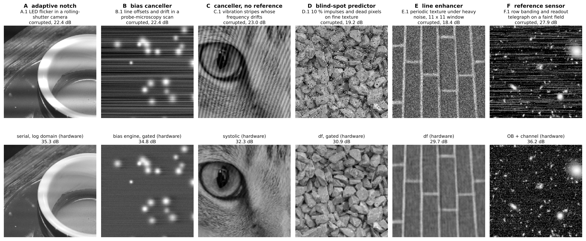</p>
<p align="center"><sub>The first example of every scenario, corrupted (top) and restored by the bit-accurate model of the hardware (bottom); the Verilog and HLS C++ tops produce the same words. Three examples per scenario are in the chapters.</sub></p>

## Contents

| | chapter | what it answers |
|---|---|---|
| 1 | [From the LMS loop to an architecture](docs/01-foundations.md) | the iteration bound; folding; delayed LMS and its exact stability bound; block LMS and its bound; why images need the worst tile and the worst row |
| 2 | [Fixed point](docs/02-fixed-point.md) | Q12 data, Q20 weights, the 48-bit weight accumulator that makes $\mu=2^{-S}$ a bit position and never stalls |
| 3 | [The six engines](docs/03-engines.md) | `lms_serial`, `lms_folded`, `lms_df`, `lms_systolic`, `lms_rowblock`, `lms_da` and the shared error unit, with block diagrams and costs |
| 4 | [Front ends](docs/04-front-ends.md) | the window generator with reflected borders, C's high band and reflected history, plane waves from phase accumulators, optical-black references |
| A–F | [A](docs/scenarios/A.md) · [B](docs/scenarios/B.md) · [C](docs/scenarios/C.md) · [D](docs/scenarios/D.md) · [E](docs/scenarios/E.md) · [F](docs/scenarios/F.md) | each scenario in six sections: the problem, the algorithm with its derivations and an illustrated figure, the RTL architectures, the HLS C++ implementation, three examples run on both, the smoke test |
| 5 | [Verification](docs/05-verification.md) | how the Verilog and the HLS C++ are checked against the models, and what that does and does not cover |
| 6 | [Results](docs/06-results.md) | the eighteen application examples, row-block LMS, design space, synthesis |
| 7 | [Choosing an architecture](docs/07-choosing.md) | a procedure, the scenarios at three video formats, a worked example |
| | [References](docs/references.md) | with DOIs; BibTeX in [`references.bib`](references.bib) |

Every folder has its own guide: [`rtl/`](rtl/README.md) · [`hls/`](hls/README.md) · [`tb/`](tb/README.md) ·
[`sim/`](sim/README.md) · [`smoke/`](smoke/README.md) · [`syn/`](syn/README.md) · [`afarch/`](afarch/README.md) ·
[`experiments/`](experiments/README.md) · [`figures/`](figures/README.md) · [`results/`](results/README.md) ·
[`docs/`](docs/README.md) · [`data/`](data/README.md).

## The six scenarios, from algorithm to hardware

| | scenario | reference | taps | architectures | examples | float → hardware (first example) |
|---|---|---|---|---|---|---|
| [A](docs/scenarios/A.md) | adaptive notch | $\cos,\sin$ from phase accumulators and a ROM | $2K$ | A1 serial, A2 direct-form DLMS, A3 folded, A4 lattice IIR notch | LED flicker · three plane waves · mains hum | 35.38 → 35.33 dB |
| [B](docs/scenarios/B.md) | bias canceller | the constant 1 | none | B1 LMS, B2 sign-error, B3 gated; no multiplier | probe microscopy · CCD readout · scanned page | 34.63 → 34.78 dB |
| [C](docs/scenarios/C.md) | canceller without a reference | the row's delayed high band | 128 | C1 serial, C2 folded, C3/C3′ direct-form/systolic DLMS, C4 row-block, C5 DA | drifting stripes · random phase · two tones | 32.47 → 32.48 dB |
| [D](docs/scenarios/D.md) | self-tuning blind-spot predictor | the $5\times5$ window minus its centre | 24 | D1 serial, D2 folded, D3 direct-form DLMS, D4 systolic DLMS, D5 row-block | impulses on texture · Gaussian noise · salt and pepper | 30.99 → 30.94 dB |
| [E](docs/scenarios/E.md) | adaptive line enhancer | a larger window minus a blind spot | 40 to 120 | E1 to E5, as D | periodic texture · two-tone lattice · correlated noise | 29.79 → 29.75 dB |
| [F](docs/scenarios/F.md) | reference-sensor canceller | optical-black columns, a reference channel | 1 | F1 frozen, F2 online on the OB pixels, F3 dark-frame calibration | faint field · banding · telegraph | 36.28 → 36.24 dB |

(Hardware = the exact-LMS engines, or the bias engine for B; B is measured after aligning the mean offset. All
eighteen examples are tabulated in [6.1](docs/06-results.md#61-application-examples).)

Every scenario chapter explains its algorithm with a derivation and a figure computed on the models:

<table>
<tr>
<td width="50%"><a href="docs/scenarios/A.md#2-the-algorithm">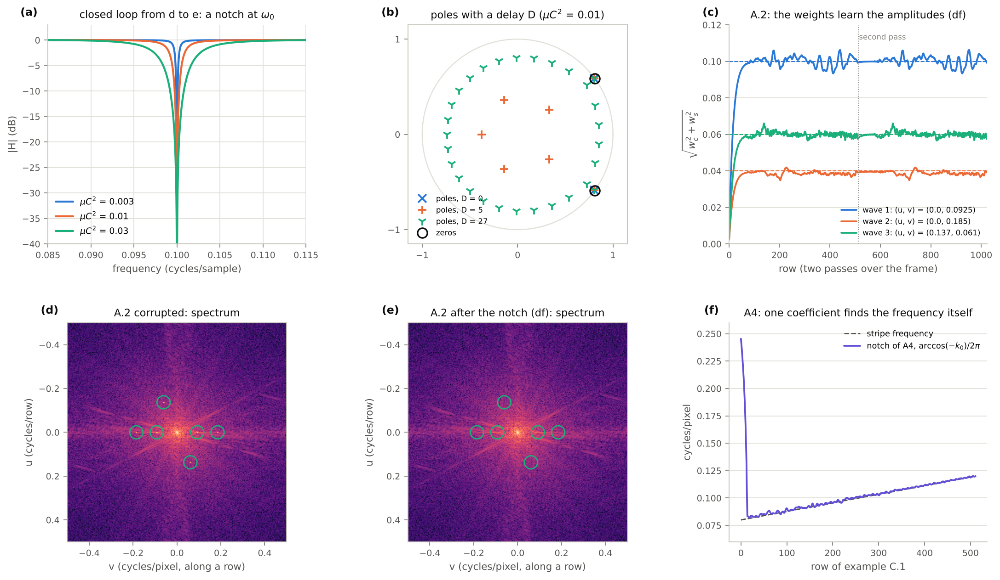</a><br><sub><b>A</b>: the closed loop is a notch at each frequency; an adaptation delay leaves its poles in place; the weights learn the amplitudes; a lattice notch finds an unknown frequency.</sub></td>
<td width="50%"><a href="docs/scenarios/B.md#2-the-algorithm">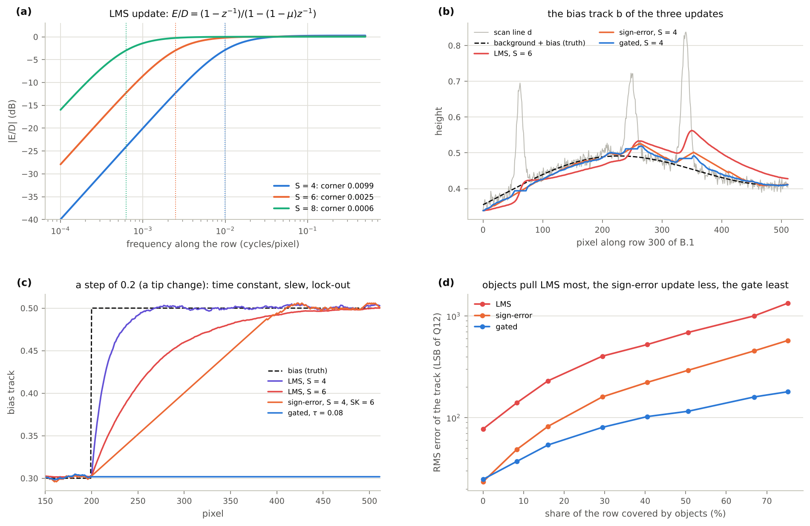</a><br><sub><b>B</b>: LMS on the constant 1 is a first-order high-pass; the sign-error update follows the median at a fixed slew rate; the gate skips objects and locks out on steps.</sub></td>
</tr>
<tr>
<td><a href="docs/scenarios/C.md#2-the-algorithm">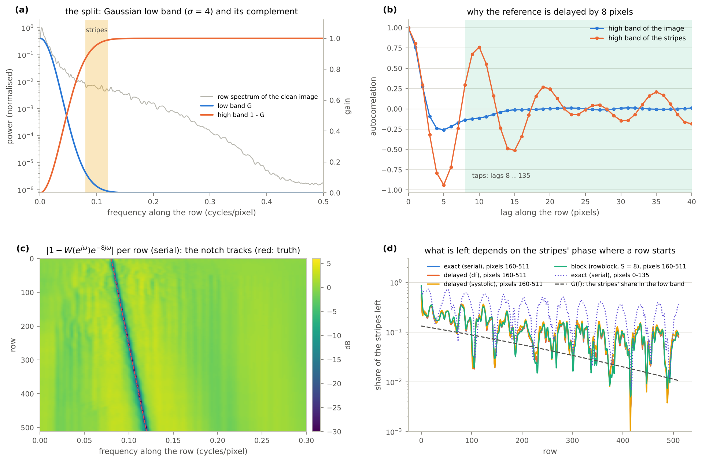</a><br><sub><b>C</b>: the two-band split; why the reference is delayed by 8 pixels; the predictor's notch follows a drifting frequency; what the reflected start of a row leaves.</sub></td>
<td><a href="docs/scenarios/D.md#2-the-algorithm">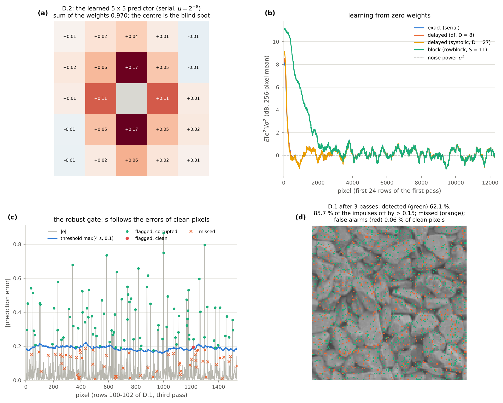</a><br><sub><b>D</b>: the learned blind-spot kernel; learning from zero weights in the three engine classes; the robust gate at work; detections and false alarms.</sub></td>
</tr>
<tr>
<td><a href="docs/scenarios/E.md#2-the-algorithm">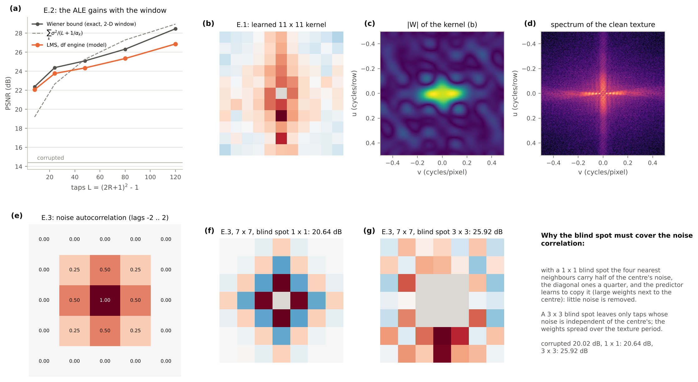</a><br><sub><b>E</b>: the line enhancer against its exact Wiener bound for 8 to 120 taps; a learned kernel and its pass bands; why the blind spot must cover the noise correlation.</sub></td>
<td><a href="docs/scenarios/F.md#2-the-algorithm">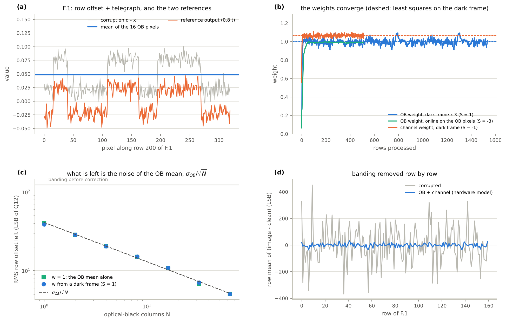</a><br><sub><b>F</b>: the two references; the weights converging on a dark frame and online; the residual banding at $\sigma_{OB}/\sqrt N$; the row offsets before and after.</sub></td>
</tr>
</table>

## One model, two implementations

<p align="center">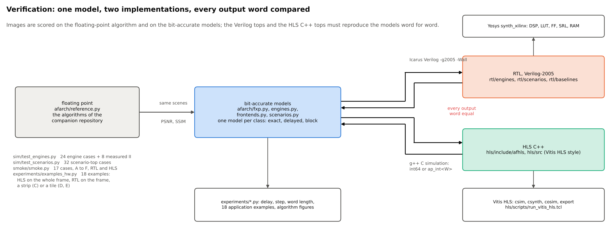</p>

| check | what runs | Verilog (Icarus) | HLS C++ (g++, int64 and `ap_int`) |
|---|---|---|---|
| [`sim/test_engines.py`](sim/README.md) | 24 engine cases on hostile step streams, 8 measured initiation intervals | all equal | |
| [`sim/test_scenarios.py`](sim/README.md) | 32 scenario-top cases on image crops | all equal | |
| [`smoke/smoke.py`](smoke/README.md) | 17 cases, two or three per scenario, A to F | all equal | all equal |
| [`experiments/examples_hw.py`](experiments/README.md) | the 18 application examples, 67 configurations | 33 runs: whole frames (A, B, F), strips (C), tiles (D, E) | 67 runs, whole frames |

The HLS C++ ([`hls/`](hls/README.md)) is written for Vitis HLS: `ap_int<W>` of the RTL's widths, AXI4-Stream
pixels, AXI4-Lite parameters, the three algorithmic classes as templates with their pipelining pragmas. Every
narrowing goes through a saturation or a checked narrowing, so a C simulation with 64-bit integers, one with
`ap_int`, the Verilog and the model all produce the same words. [`hls/scripts/run_vitis_hls.tcl`](hls/scripts/run_vitis_hls.tcl)
runs any smoke case through Vitis HLS (C simulation, synthesis, C/RTL co-simulation, IP export).

<p align="center">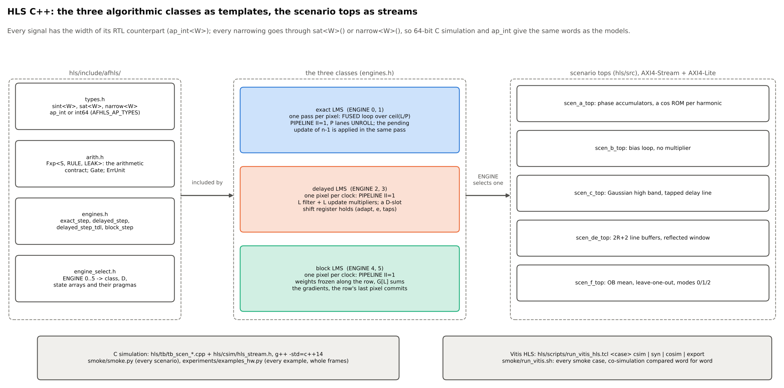</p>

## The argument in nine results

1. **The loop sets the clock.** The LMS recursion closes a loop through two multiplications, an adder tree, the
   error subtraction and the update addition, with one register:
   $T_\infty=2T_\times+(\lceil\log_2L\rceil+2)T_+$. Retiming cannot change it. There are three ways around it:
   **fold** (exact LMS, several cycles per pixel), **delay** (DLMS, one pixel per cycle) and **block** (one update
   per row). The six engines are the practical forms of these three ([1.1](docs/01-foundations.md#11-the-loop)).
2. **Exact LMS cannot reach one pixel per clock.** Folded over $P$ lanes it needs
   $\lceil L/P\rceil+\lceil\log_2P\rceil+5$ cycles, which floors at $\lceil\log_2L\rceil+6$: 11 cycles for 24 taps,
   however many multipliers are spent ([1.2](docs/01-foundations.md#12-folding-exact-lms-at-ii--1),
   [6.3](docs/06-results.md#63-design-space)).
3. **The DLMS bound is exact, and images need its local form.** $0<\mu\lambda<2\sin\frac{\pi}{2(2D+1)}$, derived
   from the roots of $z^{D}(z-1)=-\mu\lambda$. With the eigenvalue of the worst $64\times64$ tile it predicts where
   the fixed-point predictor diverges (between $D=64$ and $D=128$); with the image-wide eigenvalue it would not
   ([1.3](docs/01-foundations.md#13-delaying-the-update-dlms)).
4. **A systolic array is a DLMS with one delay for every tap.** In skewed weights $\hat w_j(m)=w_j(m+j)$ the
   systolic LMS is an ordinary DLMS with $D=L+3$, so its margin shrinks as $1/L$; at the delays the engines
   actually have, DLMS costs at most 0.15 dB.
5. **Block LMS needs $\mu N\lambda_{\max,\text{row}}<2$ with the worst row.** The condition separates divergence from
   convergence exactly in both tested scenes; inside it, the row-block engines match exact LMS to within 0.07 dB
   ([6.2](docs/06-results.md#62-row-block-lms)).
6. **One weight accumulator removes stalling.** Keeping $A=w\cdot2^{V}$ with the step as a bit position keeps
   every update; a 20-bit weight register would lose 0.11 dB on the LED-flicker example ($\mu=2^{-17}$), an 18-bit
   one 0.85 dB. In 17 of the 18 examples fixed point costs at most 0.06 dB where the comparison is like for like;
   in the eighteenth the gate's simplified constants, not the arithmetic, cost 0.6 dB ([2.3](docs/02-fixed-point.md#23-stalling-in-a-weight-register),
   [6.1](docs/06-results.md#61-application-examples)).
7. **Borders cost nothing.** Reading the row buffers at reflected addresses produces the software's reflect-padded
   windows with no padded storage and no multiplexers on the window
   ([4.1](docs/04-front-ends.md#41-borders-without-padding-reflected-addressing)).
8. **A frequency can be one coefficient.** A lattice IIR notch (architecture A4) tracks stripes whose frequency
   drifts from 0.08 to 0.12 cycles/pixel with 5 multipliers: 32.66 dB, against 32.48 dB for the 128-tap canceller
   of C ([A](docs/scenarios/A.md#25-when-the-frequency-is-unknown-the-lattice-notch-a4)).
9. **Verified word for word, twice.** 24 engine cases, 8 measured initiation intervals and 32 scenario-top cases
   pass on the Verilog; 17 smoke cases pass on the Verilog and on the HLS C++ in both number modes; the 18 examples
   run through both. Every multiplier maps onto one DSP48E1 ([5](docs/05-verification.md),
   [6.4](docs/06-results.md#64-synthesis)).

## The loop, and the three ways around it

<p align="center">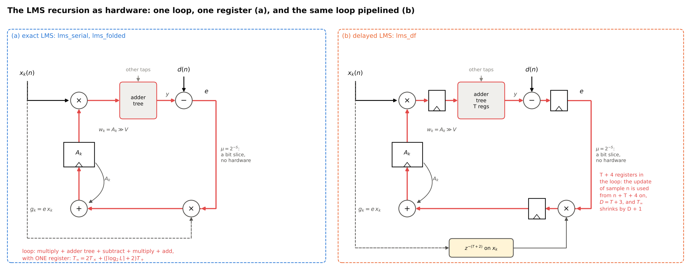</p>

| | engine | class | multipliers | cycles per pixel $II$ | adaptation delay $D$ | at $L=24$ (Yosys, xc7) |
|---|---|---|---|---|---|---|
| fold | [`lms_serial`](docs/03-engines.md#31-lms_serial) | exact LMS | 1 | $2L+3$ | 0 | 1 DSP, 475 LUT |
| fold | [`lms_folded`](docs/03-engines.md#32-lms_folded) | exact LMS | $2P$ | $\lceil L/P\rceil+\lceil\log_2P\rceil+5$ | 0 | $P=6$: 12 DSP, 1295 LUT |
| delay | [`lms_df`](docs/03-engines.md#33-lms_df) | delayed LMS | $2L$ | 1 | $\lceil\log_2L\rceil+3$ | 48 DSP, 1551 LUT |
| delay | [`lms_systolic`](docs/03-engines.md#34-lms_systolic) | delayed LMS | $2L$ | 1 | $L+3$ | 48 DSP, 1077 LUT |
| block | [`lms_rowblock`](docs/03-engines.md#35-lms_rowblock) | block LMS | $2L$ | 1 | one row | 48 DSP, 5032 LUT |
| block | [`lms_da`](docs/03-engines.md#36-lms_da) | block LMS | 0 | $W_D+\lceil\log_2\lceil L/4\rceil\rceil+3$ | one row | 0 DSP, 6985 LUT |

All six share one port list ([`lms_engine.v`](rtl/engines/lms_engine.v), `ENGINE = 0..5`), one arithmetic and one
error unit, so any scenario top runs on any engine. Within a class the engines are bit-identical, because two's
complement addition is associative: the order in which they add the same products cannot change the result. The
HLS C++ has the same three classes ([`engines.h`](hls/include/afhls/engines.h)) under the same `ENGINE` numbers.

<p align="center">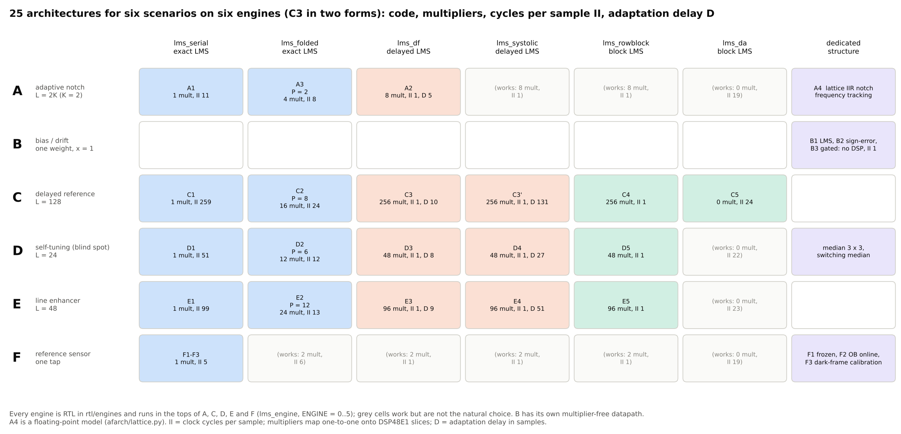</p>

## What the delay and the block cost

<p align="center"></p>

The exact DLMS bound, evaluated with the worst $64\times64$ tile, predicts where the delayed predictor diverges;
the delays of `lms_df` and `lms_systolic` sit well inside it ([1.3](docs/01-foundations.md#images-are-not-stationary)).

<p align="center">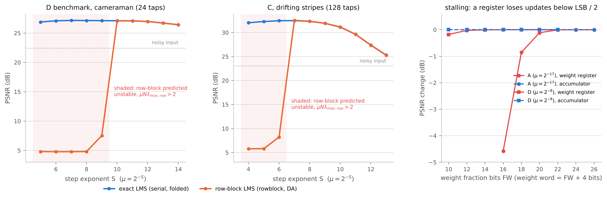</p>

Row-block LMS diverges exactly where $\mu N\lambda_{\max,\text{row}}$ crosses 2 and matches exact LMS inside the
bound; a weight register stalls at small steps, the accumulator does not ([6.2](docs/06-results.md#62-row-block-lms)).

## Which architecture for which rate

<p align="center">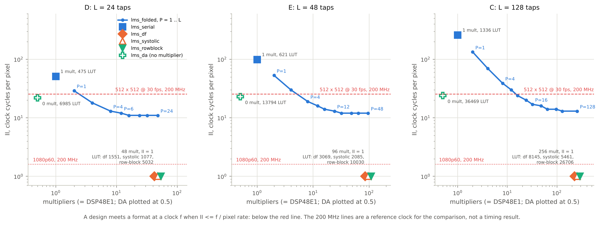</p>

At 512 x 512 and 30 frames/s a 200 MHz reference clock leaves 25 cycles per pixel, and the exact engines suffice
with 1 to 16 multipliers; at 1080p60 it leaves 1.6, and everything that adapts per pixel needs one of the three
one-pixel-per-clock engines. [Chapter 7](docs/07-choosing.md) turns this into a procedure.

## Repository layout

```
afarch/                 Python models of the hardware (the reference both implementations match)
  fxp.py                the arithmetic contract: formats, weight accumulator, rounding, saturation
  engines.py            step-accurate models of exact, delayed and block LMS, and the error unit
  frontends.py          reflected windows, Gaussian high band, tapped delay lines, plane waves, OB means
  scenarios.py          the fixed-point pipelines of A to F, as the tops compute them
  reference.py          floating-point algorithms, PSNR and SSIM
  scenes.py             the corrupted scenes of the examples (fixed seeds)
  lattice.py            architecture A4, the lattice notch (floating point)
  cost.py               time and area formulas, DLMS and block-LMS step bounds
  hdl.py, synth.py      Icarus Verilog and Yosys drivers
  hwrun.py              any scenario input through the Verilog top or the HLS top
rtl/                    Verilog-2005
  common/               lms_arith.vh, lms_err_unit.v, adder_tree.v
  engines/              lms_serial, lms_folded, lms_df, lms_systolic, lms_rowblock, lms_da, lms_engine
  scenarios/            window_gen, scen_a_top ... scen_f_top, cos1024_q12.hex
  baselines/            median3x3_top (median and switching median)
hls/                    HLS C++ for Vitis HLS
  include/afhls/        types.h, arith.h, engines.h, engine_select.h
  src/                  scen_a, scen_b, scen_c, scen_de, scen_f: the tops
  tb/                   C-simulation testbenches
  csim/                 hls_stream.h for g++ C simulation without Vitis
  scripts/              run_vitis_hls.tcl (Vitis HLS flow), gen_tables.py
tb/                     Verilog testbenches
sim/                    test_engines.py, test_scenarios.py: bit-exact regressions of the RTL
smoke/                  smoke.py (every scenario, RTL and HLS), run_vitis.sh
syn/                    synth_engines.py, synth_tops.py (Yosys), vivado_ooc.tcl (Vivado, timing)
experiments/            examples, examples_hw, algorithms, delay_sweep, rowblock_wordlength, design_space, diagrams
docs/                   the chapters
results/                csv and json outputs of every script
figures/                algorithms/, examples/, diagrams/, results/
data/                   test images (CC0 / public domain)
scripts/run_all.sh      regenerates every result and figure
```

## Running it

```bash
pip install -r requirements.txt               # numpy, scipy, scikit-image, matplotlib, pillow
sudo apt-get install iverilog yosys g++       # Icarus Verilog (RTL), Yosys (synthesis), g++ (HLS C simulation)

python smoke/smoke.py                         # the smoke test: every scenario, RTL and HLS, about 2 minutes
python sim/test_engines.py                    # 24 engine cases + 8 initiation intervals, bit-exact
python sim/test_scenarios.py                  # 32 scenario-top cases, bit-exact
python experiments/examples.py                # the 18 application examples (about 15 minutes)
python experiments/examples_hw.py --no-rtl    # the examples through the HLS C++ tops
python experiments/algorithms.py              # the algorithm figures of the six chapters
python syn/synth_engines.py                   # Yosys cell counts of the engines
bash scripts/run_all.sh                       # everything, in order

# with Vitis HLS installed (source its settings64.sh first)
python smoke/smoke.py --only hls --ap-types $XILINX_HLS/include
bash smoke/run_vitis.sh                       # C simulation, synthesis and co-simulation of every smoke case
```

The results in this repository were produced with Python 3.13, NumPy 2.5, SciPy 1.18, Icarus Verilog 12.0,
Yosys 0.71 and g++ 13. [`syn/vivado_ooc.tcl`](syn/vivado_ooc.tcl) runs any module through Vivado out of context
(place, route, timing) and [`hls/scripts/run_vitis_hls.tcl`](hls/scripts/run_vitis_hls.tcl) any smoke case through
Vitis HLS; no Vivado or Vitis result is reported here.

## Citation

GitHub's **Cite this repository** button reads [CITATION.cff](CITATION.cff). In BibTeX:

```bibtex
@software{KhaliliSadaghiani_AdaptiveFilterArchitectures_2026,
  author  = {Khalili Sadaghiani, Abdolvahab},
  title   = {Architectures for Adaptive Filters for Image Denoising},
  year    = {2026},
  url     = {https://github.com/VKHS/Architectures-for-Adaptive-Filters-for-Image-Denoising},
  license = {MIT},
  note    = {ORCID: 0000-0003-4870-2768}
}
```

The algorithms are those of the companion repository:

```bibtex
@software{KhaliliSadaghiani_AdaptiveFilters_2026,
  author  = {Khalili Sadaghiani, Abdolvahab},
  title   = {Adaptive Filters for Image Denoising},
  year    = {2026},
  url     = {https://github.com/VKHS/Adaptive-Filters-for-Image-Denoising},
  license = {MIT},
  note    = {ORCID: 0000-0003-4870-2768}
}
```

## License

The code, RTL, HLS C++, documentation and figures are released under the [MIT License](LICENSE), © 2026
Abdolvahab Khalili Sadaghiani. The test images in `data/` are CC0 or public domain and keep those terms.
