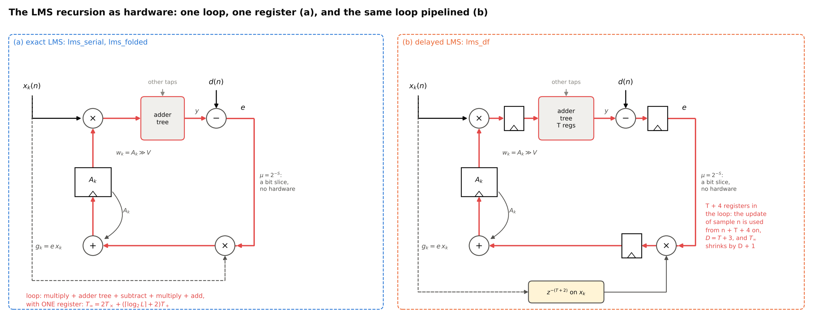
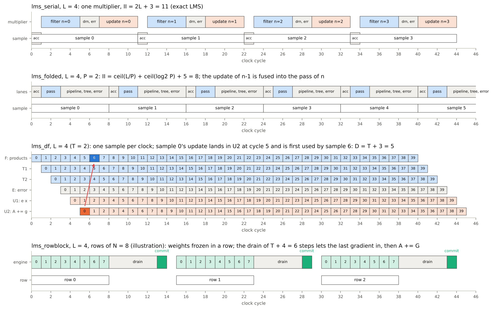
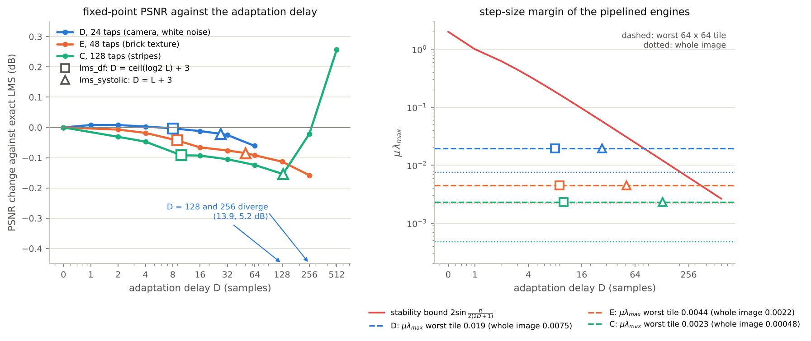

# 1. From the LMS loop to an architecture

[Contents](../README.md#contents) · next: [2. Fixed point](02-fixed-point.md)

Every scenario of this repository is the same adaptive filter, the least-mean-squares (LMS) canceller of
[Widrow et al. (1975)](references.md#widrow1975), wired to a different reference. In hardware the six scenarios
therefore share one question: **how fast can the LMS loop run, and what does it cost to run it faster?** This
chapter answers it from first principles. Everything that follows (engines, front ends, scenario tops) is an
application of the three answers derived here.

## 1.1 The loop

For $L$ taps $\mathbf x(n)$, desired sample $d(n)$ and step $\mu$:

$$
y(n)=\mathbf w^{T}(n)\,\mathbf x(n),\qquad e(n)=d(n)-y(n),\qquad \mathbf w(n+1)=\mathbf w(n)+\mu\,e(n)\,\mathbf x(n).
$$

Panel (a) draws one tap as hardware. A weight leaves its register, multiplies its tap, joins the adder tree,
produces $y$, is subtracted from $d$, becomes the error, multiplies the tap again and returns to the register:
**a loop with one register in it**. Two facts follow.

**The iteration bound.** The computation on the loop is two multiplications, an adder tree over $L$ products,
the error subtraction and the update addition. With multiplier delay $T_\times$ and adder delay $T_+$,

$$
T_\infty \;=\; \frac{2T_\times + \left(\lceil\log_2 L\rceil + 2\right)T_+}{\text{registers in the loop}} \;=\; 2T_\times + \left(\lceil\log_2 L\rceil + 2\right)T_+ .
$$

$T_\infty$ is the *iteration bound* of the data-flow graph ([Parhi 1999](references.md#parhi1999)): no
implementation of this recursion can start a new sample more often than once per $T_\infty$. The step
$\mu=2^{-S}$ costs nothing on the loop; in this repository it is a choice of bits ([chapter 2](02-fixed-point.md)).

**Pipelining cannot help.** Retiming moves registers along edges but keeps the number of registers in every loop
([Leiserson and Saxe 1991](references.md#leiserson1991)). Pipeline registers inserted into the loop change the
algorithm. Feed-forward parts (the products, the tree) can be pipelined at will; the loop cannot.

There are exactly three ways around the bound, and the six engines of this repository are the six practical
implementations of them.

| way around $T_\infty$ | what changes | engines | algorithm (bit-exact class) |
|---|---|---|---|
| **fold**: do the loop's work in several clock cycles per sample | throughput: $II>1$ cycles per sample | `lms_serial`, `lms_folded` | exact LMS |
| **delay** the update by $D$ samples | the algorithm: $\mathbf w(n+1)=\mathbf w(n)+\mu e(n-D)\mathbf x(n-D)$ | `lms_df`, `lms_systolic` | delayed LMS (DLMS) |
| **block** the update: one summed update per image row | the algorithm: weights frozen along a row | `lms_rowblock`, `lms_da` | block LMS |

## 1.2 Folding: exact LMS at II > 1

Folding keeps the algorithm and spends clock cycles. With one multiplier ([`lms_serial`](03-engines.md#31-lms_serial))
the $L$ filter products and the $L$ update products take $2L$ cycles, plus the pipeline latency between the last
product and the error:

$$II_{\text{serial}} = 2L+3 .$$

With $P$ lanes of two multipliers ([`lms_folded`](03-engines.md#32-lms_folded)) each lane updates one weight with
the **previous** sample's error and immediately filters with the updated weight, so one pass of
$M=\lceil L/P\rceil$ cycles does both halves of the loop. The pass, the four-stage lane pipeline, a
$\lceil\log_2 P\rceil$-level adder tree and the error register give

$$II_{\text{folded}} = \lceil L/P\rceil + \lceil\log_2 P\rceil + 5 .$$

Both formulas are measured on the RTL by `sim/test_engines.py`. The second one exposes the limit of folding:
as $P\to L$, $II \to 1 + \lceil\log_2 L\rceil + 5$, the loop latency in clock cycles. For $L=24$ that is 11 cycles:
**exact LMS cannot accept a pixel every clock**, however many multipliers it gets
([design space](06-results.md#63-design-space)).

## 1.3 Delaying the update: DLMS

Panel (b) of the first figure inserts registers into the loop: after the products, after each tree level, after
the error and after the update product. The loop now holds $T+4$ registers ($T=\lceil\log_2 L\rceil$), the
iteration bound drops by the same factor, and one sample enters per clock. The price is that the update of sample
$n$ reaches the filter only at sample $n+T+4$:

$$
\mathbf w(n+1) = \mathbf w(n) + \mu\, e(n-D)\,\mathbf x(n-D),\qquad D = T+3 \;\;(\texttt{lms\_df}),\qquad D = L+3\;\;(\texttt{lms\_systolic}).
$$

**Why the systolic array is a DLMS with one delay for all taps.** In `lms_systolic` the partial sum crosses one
register per tap, so tap $j$ contributes to output $m$ at time $m+j$ with weight $w_j(m+j)$:
$y(m)=\sum_j w_j(m+j)\,x_j(m)$. The error then walks down an error chain, one register per tap, and tap $j$ updates
at time $m+L+3+j$. In the *skewed* weights $\hat w_j(m) = w_j(m+j)$ the skews cancel:

$$
y(m)=\sum_j \hat w_j(m)\,x_j(m),\qquad \hat w_j(m+1)=\hat w_j(m)+\mu\,e(m-D)\,x_j(m-D),\qquad D=L+3 ,
$$

an ordinary DLMS whose delay is the same for every tap. The RTL is checked against exactly this model.

### Stability of DLMS

Under the usual independence assumption ([Haykin 2014](references.md#haykin2014)) the mean weight error $\mathbf v(n)=E[\mathbf w(n)]-\mathbf w_o$ obeys
$\mathbf v(n+1)=\mathbf v(n)-\mu\mathbf R\,\mathbf v(n-D)$. In the eigenbasis of $\mathbf R$ every mode $\lambda$ is
the scalar recursion $u(n+1)=u(n)-\mu\lambda\,u(n-D)$ with characteristic polynomial

$$p(z)=z^{D+1}-z^{D}+\mu\lambda .$$

For small $\mu\lambda$ all roots are inside the unit circle. A root reaches it at $z=e^{j\theta}$ when
$z^{D}(z-1)=-\mu\lambda$. The modulus gives $\mu\lambda=|e^{j\theta}-1|=2\sin(\theta/2)$; the phase, with
$\arg(e^{j\theta}-1)=\pi/2+\theta/2$, gives $D\theta+\pi/2+\theta/2=\pi$, i.e. $\theta=\pi/(2D+1)$. Hence the exact
bound ([Long, Ling and Proakis 1989, 1992](references.md#long1989))

$$
\boxed{\;0<\mu\lambda_{\max}<2\sin\frac{\pi}{2(2D+1)}\;}\qquad\approx\frac{\pi}{2D+1}\ \text{for large } D .
$$

$D=0$ gives the LMS bound $2$, $D=1$ gives $1$, $D=27$ (systolic, 24 taps) gives $0.057$. `afarch.cost.dlms_mu_bound`
implements it, and the bisection in [`experiments/delay_sweep.py`](../experiments/delay_sweep.py) on the roots of
$p(z)$ reproduces it to six digits. Well inside the bound the dominant root is still about $1-\mu\lambda$: the
learning speed is that of LMS, delayed by $D$ samples.

### Images are not stationary

The bound must hold where the local power is largest, not on average. For the D scenario
($\mu=2^{-8}$, 24 taps) the eigenvalue of the whole image gives $\mu\lambda_{\max}=0.0075$, but the worst
$64\times64$ tile gives $0.019$. The bound falls below $0.019$ between $D=64$ ($0.024$) and $D=128$ ($0.012$), and
that is exactly where the fixed-point DLMS diverges:

| scenario | $L$ | $\mu$ | $\mu\lambda_{\max}$, worst tile | `lms_df` $D$ | bound at that $D$ | `lms_systolic` $D$ | bound at that $D$ | PSNR change of `lms_systolic` |
|---|---|---|---|---|---|---|---|---|
| D | 24 | $2^{-8}$ | 0.019 | 8 | 0.185 | 27 | 0.057 | -0.02 dB |
| E | 48 | $2^{-7}$ | 0.0044 | 9 | 0.165 | 51 | 0.031 | -0.09 dB |
| C | 128 | $2^{-7}$ | 0.0023 | 10 | 0.149 | 131 | 0.012 | -0.15 dB |

At the delays the engines actually have, DLMS costs at most 0.15 dB. The margin of the systolic engine shrinks
as $1/L$, which is the real argument for the tree of `lms_df` at large $L$.

## 1.4 Blocking the update: row-block LMS

An image arrives in rows with blanking between them. Freezing the weights along a row and updating them once at its
end, the block LMS of [Clark, Mitra and Parker (1981)](references.md#clark1981) with the row as the block,

$$
\mathbf w(m+1)=\mathbf w(m)+\mu\sum_{n\in\text{row } m} e(n)\,\mathbf x(n),\qquad e(n)=d(n)-\mathbf w^{T}(m)\mathbf x(n),
$$

removes the loop from the row: the filter is a plain FIR, pipelined freely, and the update happens in the
horizontal blanking. In the mean, $\mathbf v(m+1)=(\mathbf I-\mu N\mathbf R_m)\mathbf v(m)$ for a row of $N$ pixels,
so every mode needs $|1-\mu N\lambda|<1$:

$$\boxed{\;\mu N\lambda_{\max,\text{row}}<2\;}$$

$N$ times stricter than LMS. With the worst row's eigenvalue the condition predicts the measured boundaries
exactly: for D, $S=9$ gives $\mu N\lambda=2.87$ (diverges) and $S=10$ gives $1.44$ (converges); for C, $S=6$ gives
$3.02$ (diverges) and $S=7$ gives $1.51$ (converges). Inside the stable range the row-block engines match exact LMS
to within 0.07 dB at the same step ([results](06-results.md#62-row-block-lms)).

## 1.5 Six engines, three numbers

Within one algorithmic class the engines produce **identical bits**. Two's complement addition is associative
and commutative modulo $2^{W}$, so the order in which a serial accumulator, $P$ lanes and an adder tree, a
systolic cascade or a distributed-arithmetic shift-accumulator add the same products cannot change the result.
This is checked, not assumed: every engine runs against the model of its class
([verification](05-verification.md)).

| engine | class | multipliers | $II$ (cycles/sample) | adaptation delay $D$ | latency (cycles) |
|---|---|---|---|---|---|
| `lms_serial` | exact | 1 | $2L+3$ | 0 | $L+3$ |
| `lms_folded` | exact | $2P$ | $\lceil L/P\rceil+\lceil\log_2P\rceil+5$ | 0 | $= II$ |
| `lms_df` | delayed | $2L$ | 1 | $\lceil\log_2L\rceil+3$ | $\lceil\log_2L\rceil+2$ |
| `lms_systolic` | delayed | $2L$ | 1 | $L+3$ | $L+2$ |
| `lms_rowblock` | block | $2L$ | 1 | one row (commit $\lceil\log_2L\rceil+3$ steps after it) | $\lceil\log_2L\rceil+2$ |
| `lms_da` | block | 0 | $W_D+\lceil\log_2\lceil L/4\rceil\rceil+3$ | one row | $= II$ |

[Chapter 3](03-engines.md) builds each of them; [chapter 6](06-results.md) measures what they cost.
