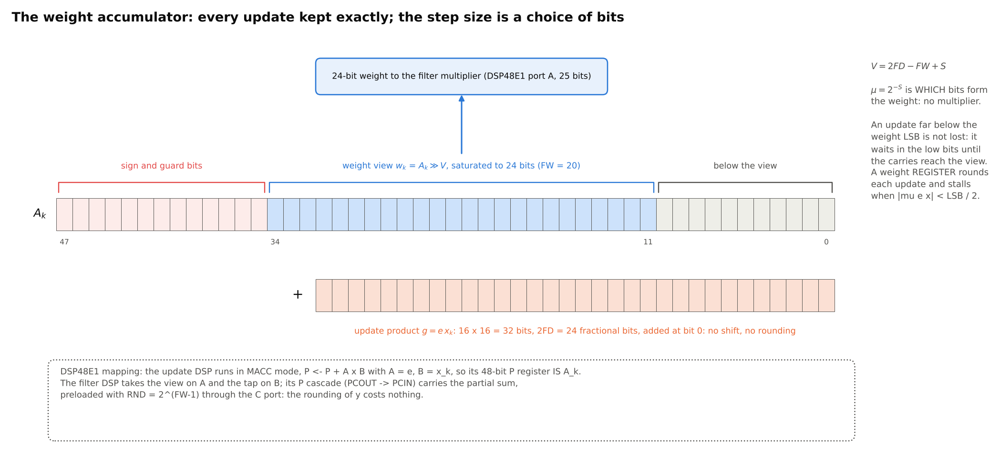

# 2. Fixed point: one arithmetic contract for every engine

[Contents](../README.md#contents) · previous: [1. The loop](01-foundations.md) · next: [3. Engines](03-engines.md)

All engines, front ends and models share the arithmetic of [`rtl/common/lms_arith.vh`](../rtl/common/lms_arith.vh)
and [`afarch/fxp.py`](../afarch/fxp.py). The two files are the contract: the RTL and the Python models compute
the same integers, bit for bit.

## 2.1 Formats

| signal | width | fraction bits | range | why |
|---|---|---|---|---|
| pixel data $x, d, y, e, p$ | $W_D=16$ | $F_D=12$ (Q12) | $[-8, 8)$ | an 8- to 12-bit pixel in $[0,1]$ plus headroom for centring, noise and impulses; fits the 18-bit B port of a DSP48E1 |
| weight view $w$ | $W_W=24$ | $F_W=20$ (Q20) | $[-8, 8)$ | fits the 25-bit A port; resolution $10^{-6}$ |
| accumulators $A$, filter sums | $W_A=48$ | 24 for $A$, 32 for sums | | the 48-bit P register of a DSP48E1 |

The DSP48E1 has a $25\times18$ multiplier and a 48-bit post-adder/accumulator ([AMD UG479](references.md#ug479)), so a
weight-times-pixel product ($24\times16$) and an error-times-pixel product ($16\times16$) each fit one slice.

## 2.2 The weight accumulator

A weight is **stored** as an exact accumulator of update products and **used** through a view:

$$
g_k(n)=e(n)\,x_k(n)\ \ (2F_D=24\ \text{fraction bits}),\qquad A_k \leftarrow A_k+g_k,\qquad w_k=\mathrm{sat}_{W_W}\!\left(A_k \gg V\right),\qquad V=2F_D-F_W+S .
$$

Since $A_k=\sum g_k$ exactly, $w_k=\lfloor 2^{F_W}\,2^{-S}\sum e\,x_k\rfloor$: the Q20 floor of the exact LMS weight
with $\mu=2^{-S}$. Three properties follow, and they decide the architecture of the update path:

1. **The step size is a bit slice.** Changing $\mu$ changes $V$, i.e. which 24 of the 48 bits feed the
   multiplier. No multiplier for $\mu e$, no shifter on the loop.
2. **No update is lost.** An update far below the weight LSB stays in the low bits of $A_k$ until the carries
   reach the view. Nothing stalls (section 2.3).
3. **The update adder is the DSP accumulator.** The update DSP runs in multiply-accumulate mode,
   $P \leftarrow P+A\times B$ with $A=e$, $B=x_k$: its P register *is* $A_k$.

The filter output is rounded once, by preloading the accumulator with half an LSB:

$$y=\mathrm{sat}_{W_D}\!\left(\left(2^{F_W-1}+\textstyle\sum_k w_kx_k\right)\gg F_W\right),\qquad e=\mathrm{sat}_{W_D}(d-y).$$

The preload costs nothing: it is the reset value of the serial accumulator, the C input of the first DSP of a
cascade, or the initial value of lane 0. The view itself uses the floor; its bias of half a Q20 LSB per weight
sits inside the adaptation loop and is compensated by it.

## 2.3 Stalling in a weight register

The classic alternative stores $w_k$ in a register of $F_W$ fraction bits and rounds every update to that LSB.
An update survives only if

$$\left|\mu\,e\,x_k\right| \ \ge\ 2^{-(F_W+1)},$$

so for small steps the adaptation freezes with a residual error, the *digital residual error* of
[Gitlin, Mazo and Taylor (1973)](references.md#gitlin1973) analysed for LMS by
[Caraiscos and Liu (1984)](references.md#caraiscos1984). The A scenario (LED flicker, $\mu=2^{-17}$) is the
extreme case of this repository. Measured on the bit-accurate model
([`experiments/rowblock_wordlength.py`](../experiments/rowblock_wordlength.py)):

| weight fraction bits $F_W$ | 10 | 12 | 16 | 18 | 20 | 22 |
|---|---|---|---|---|---|---|
| A ($\mu=2^{-17}$), weight register with rounded updates | | | -4.58 dB | -0.85 dB | -0.11 dB | -0.003 dB |
| D ($\mu=2^{-8}$), weight register with rounded updates | -0.18 dB | -0.02 dB | 0 | 0 | 0 | 0 |
| A and D, accumulator (this repository) | 0 | 0 | 0 | 0 | 0 | 0 |

(PSNR change against the accumulator; the weight word is $F_W+4$ bits.) A register needs
$F_W\ge22$ for A; the accumulator is exact at any view width, which is why the view can stay at the 24 bits of the
DSP port.

## 2.4 Word growth and guard bits

* **Filter sum.** $|w_kx_k| < 2^{23}\cdot2^{15}=2^{38}$, so $L$ products need $38+\lceil\log_2L\rceil$ bits: 48 bits
  hold $L\le 512$ without overflow, with sign. The models assert it on every sample.
* **Weight accumulator.** $|w|<8$ means $|A|<2^{3+F_W+V}=2^{27+S}$; for $S\le 20$ this fits 48 bits. Saturation
  is applied to the *view*, never to $A$.
* **Row-block gradient.** $|\sum_{\text{row}} g|<N\cdot2^{30}$: 39 bits for $N=512$.
* **Error.** $d-y$ needs 17 bits; it is saturated back to 16, which also bounds the update of an outlier.

## 2.5 Variants of the update

`RULE` selects the update product; all of them keep the accumulator:

| `RULE` | update $g$ | multiplier | used for |
|---|---|---|---|
| 0, LMS | $e\,x$ | yes | everything by default |
| 1, sign-error | $\mathrm{sgn}(e)\,x\cdot2^{F_D}$ | no (add or subtract $x$) | robust to impulses; B's median tracking |
| 2, sign-data | $e\,\mathrm{sgn}(x)\cdot2^{F_D}$ | no | |
| 3, sign-sign | $\mathrm{sgn}(e)\,\mathrm{sgn}(x)\cdot2^{2F_D}$ | no (a counter) | |

`LEAK` > 0 makes it leaky, $A\leftarrow A-(A\gg\texttt{LEAK})+g$ on every applied update: a weight that is not
excited decays instead of drifting, the classic remedy for unbounded weights in fixed point. The gated mode of D
uses the shared error unit ([chapter 3](03-engines.md#37-the-shared-error-unit)).

The step is a power of two. The software of the companion repository normalises the step,
$\mu=\alpha/(L\,\sigma_z^2)$; the hardware rounds $\log_2$ of that to the nearest integer
(`afarch.fxp.step_exponent`), which changes the step by at most $\sqrt2$.

## 2.6 Does fixed point cost anything?

The first application example of every scenario (the examples of the companion repository), run through the
bit-accurate model of its top, against the floating-point algorithm
([`experiments/examples.py`](../experiments/examples.py), [results](06-results.md#61-application-examples)):

| scenario | example | floating point | fixed point, exact LMS |
|---|---|---|---|
| A | A.1 LED flicker, log domain | 35.38 dB | 35.33 dB |
| B | B.1 probe microscopy, gated | 34.63 dB | 34.78 dB |
| C | C.1 drifting stripes | 32.47 dB | 32.48 dB |
| D | D.1 impulses on texture, gated | 30.99 dB | 30.94 dB |
| E | E.1 brick texture, 120 taps | 29.79 dB | 29.75 dB |
| F | F.1 astronomy, both references | 36.28 dB | 36.24 dB |

The differences are within $\pm0.15$ dB, of either sign, and they come mostly from policies, not from word
lengths: the power-of-two step (in F the channel's step becomes 2 instead of 1.48, which alone accounts for
0.03 of the 0.05 dB) and the start of a row in B ($b=d(0)$; the floating-point canceller started the same way
gives 34.77 dB). Narrower data words cost little too: with the accumulator, D gives 27.143 dB with 8 data fraction
bits and 27.145 dB with 12 ([`results/wordlength.csv`](../results/wordlength.csv)). Over all eighteen examples the
differences have the same size and the same causes, with one exception: in
[D.3](scenarios/D.md#d3-salt-and-pepper-impulses) (20 % salt and pepper) the hardware is 0.6 dB below floating
point, and the floating-point algorithm with the hardware's gate constants and power-of-two step comes within
0.04 dB of it: a policy again, not a word length.
