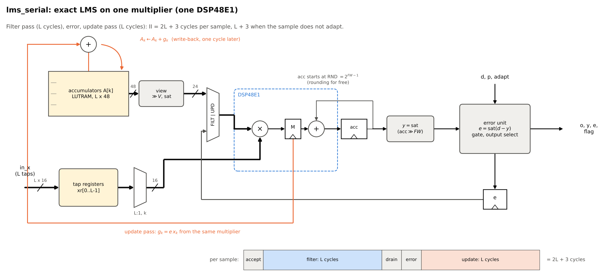
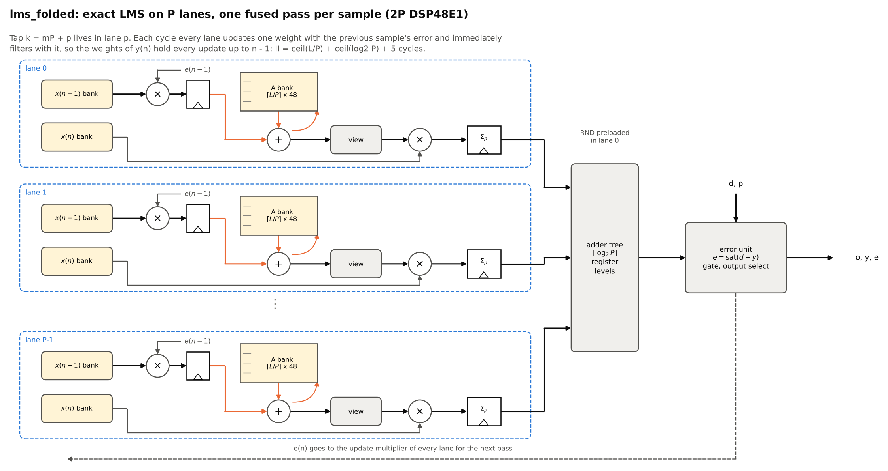
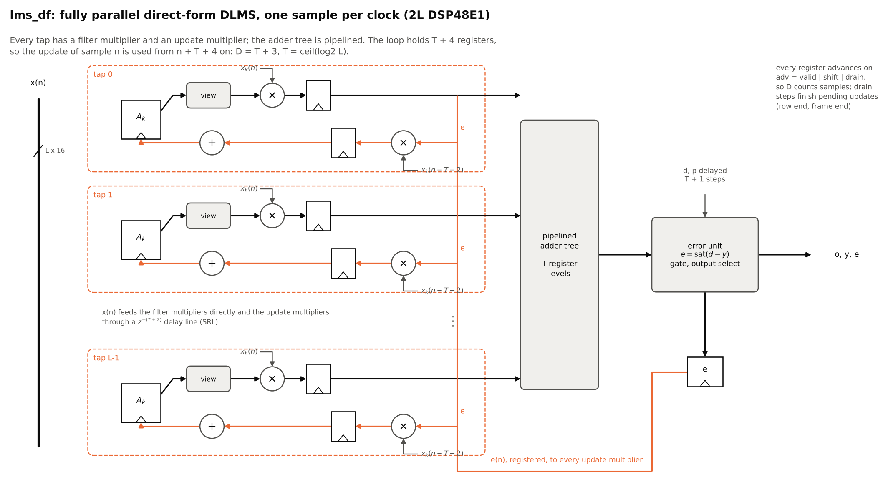
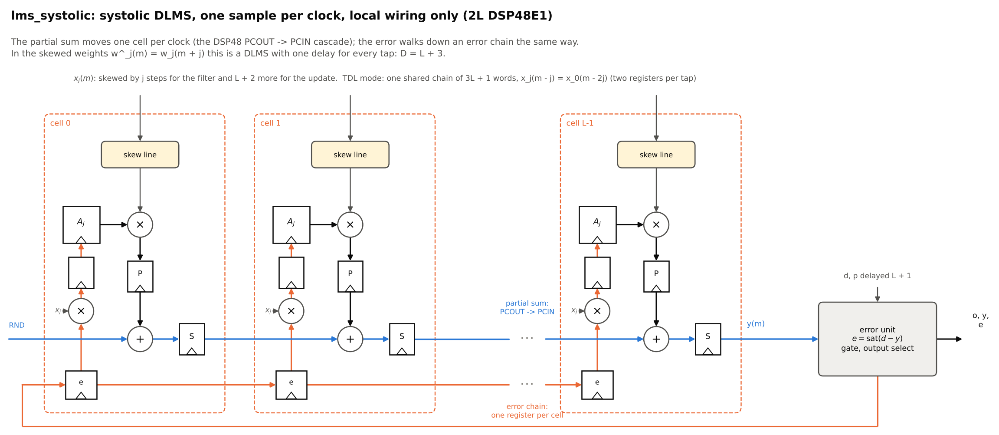
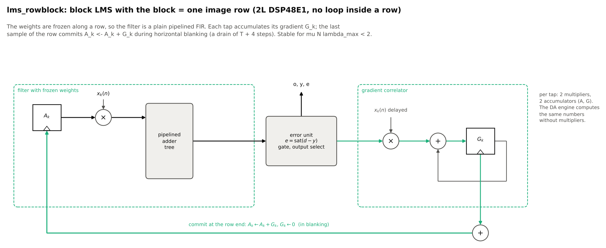
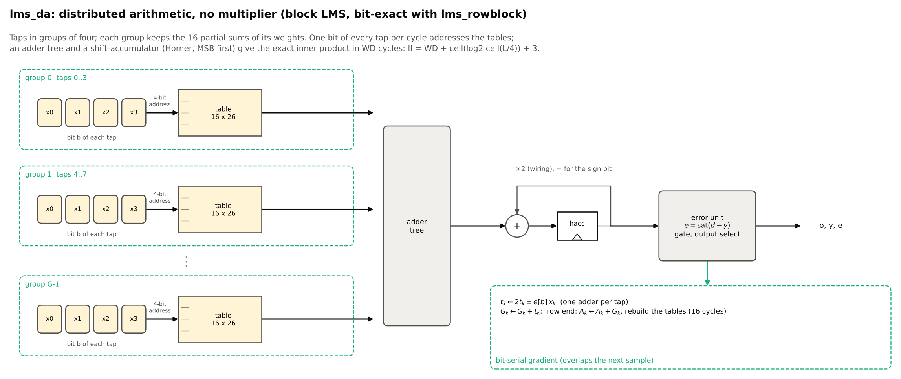

# 3. The six engines

[Contents](../README.md#contents) · previous: [2. Fixed point](02-fixed-point.md) · next: [4. Front ends](04-front-ends.md)

An engine takes a tap vector $\mathbf x(n)$, the desired sample $d(n)$, a pass-through sample $p(n)$ and an
adapt flag, and returns the error-unit output. All six share one port list
([`lms_engine.v`](../rtl/engines/lms_engine.v), parameter `ENGINE` = 0..5), one arithmetic
([chapter 2](02-fixed-point.md)) and one error unit (section 3.7). They differ in time and area.

| | handshake engines: `lms_serial`, `lms_folded`, `lms_da` | pipelined engines: `lms_df`, `lms_systolic`, `lms_rowblock` |
|---|---|---|
| accept | `in_valid` and `in_ready` | every cycle (`in_ready` = 1) |
| state advances | when a sample is processed | on `adv = in_valid \| in_shift \| in_drain` (a clock enable on every register) |
| model ([`afarch/engines.py`](../afarch/engines.py)) | sample by sample, timing-free | step by step: a drain or pre-roll step is an empty step that still moves pending updates |
| tapped delay line | the tap vector comes in | `TDL = 1`: only the newest sample comes in, the line is inside the engine |

Because every register of a pipelined engine advances on `adv`, idle cycles do not exist for the algorithm: the
adaptation delay $D$ counts samples, and a drain burst (horizontal blanking) completes pending updates. The model
replays the same step stream, which is what makes the comparison bit-exact even with random idle cycles.

## 3.1 `lms_serial`

One multiplier is shared by the two halves of the loop. A filter pass reads $A_k$ through the view, multiplies
$x_k$ and accumulates (accumulator preloaded with the rounding constant); after a drain and the error stage an
update pass multiplies $e\,x_k$ with the same multiplier and writes $A_k+g_k$ back one cycle later. The
accumulators live in one memory with a single write port, so they map to distributed RAM (`RAM32M`), and the tap
vector is latched in a register file with an $L{:}1$ read multiplexer.

* $II = 2L+3$ with adaptation, $L+3$ for a sample that does not adapt (gated D skips the update pass).
* Area: 1 DSP48E1, the accumulator memory ($48L$ bits), the tap registers ($16L$ bits) and their multiplexer.
* Use it when the pixel rate is low compared with the clock: A at video rate ($L=4$, 11 cycles), F (one tap,
  5 cycles), or any scenario at a few megapixels per second.

## 3.2 `lms_folded`

Tap $k=mP+p$ belongs to lane $p$, word $m$. In the pass of sample $n$ each lane, per cycle,

| stage | operation |
|---|---|
| S1 | $q \leftarrow g\big(e(n-1), x_k(n-1)\big)$, the update product of the **previous** sample |
| S2 | $A_k \leftarrow A_k + q$ (if $n-1$ adapted); $w \leftarrow \mathrm{view}(A_k)$, read-modify-write of the lane's bank |
| S3 | $r \leftarrow w\,x_k(n)$, the filter product with the freshly updated weight |
| S4 | lane accumulator $\mathrel{+}= r$ |

so the weights of $y(n)$ contain every update up to $n-1$: exact LMS in **one** pass instead of two. The lane
sums meet in a pipelined adder tree; lane 0 starts at the rounding constant. The engine needs the taps of the
previous sample (a second register bank) because the update of $n-1$ happens during the pass of $n$.

* $II=\lceil L/P\rceil+\lceil\log_2P\rceil+5$: $P=1$ gives $L+5$ with two multipliers, against $2L+3$ with one.
* The loop latency stays: $P=L$ still needs $\lceil\log_2L\rceil+6$ cycles. For $L=24$, $P=6$ already gives 12 of
  the 11 that $P=24$ would give.
* Area: $2P$ DSP48E1, $P$ accumulator banks of $\lceil L/P\rceil\times48$ bits (distributed RAM), two tap banks.

## 3.3 `lms_df`

The direct form whose critical path [Meher and Park (2014)](references.md#meher2014) analyse, pipelined at every
level. Every tap has its filter multiplier and its update multiplier; the products enter a pipelined adder tree of
$T=\lceil\log_2L\rceil$ register levels (tap 0 adds the rounding constant, as a DSP's C port would). The error
register broadcasts $e(n)$ to the update multipliers, which take $x_k(n-T-2)$ from a vector delay line (`SRL16E`
shift registers) or, with `TDL = 1`, from further down the engine's own tapped delay line:
$x_k(n-T-2)=x_0(n-k-T-2)$, so one chain of $L+T+1$ words serves both.

* $II=1$, $D=T+3$ (8 for 24 taps, 10 for 128), latency $T+2$.
* Area: $2L$ DSP48E1, a fabric adder tree ($L-1$ adders of 48 bits), the $x$ delay ($16L(T+2)$ bits of SRL, or
  $16(L+T+1)$ in TDL mode).

## 3.4 `lms_systolic`

The systolic DLMS of [Meyer and Agrawal (1993)](references.md#meyer1993) ([Van and Feng 2001](references.md#van2001)
trade part of its delay back for adder-tree levels). The adder tree is replaced by a chain: tap $j$ receives its
input skewed by $j$ steps and adds its product to a partial sum that arrives from tap $j-1$ through one register,
exactly the PCOUT→PCIN cascade of DSP48E1 columns.
No net is longer than one cell, and the post-adders are inside the DSP slices, which is why Yosys maps it with
about 30 % fewer LUTs than `lms_df` (1077 against 1551 at $L=24$). The error walks down an error chain, one
register per tap, and tap $j$ uses $x_j$ delayed by another $L+2$ steps. Section [1.3](01-foundations.md#13-delaying-the-update-dlms)
shows that this is a DLMS with $D=L+3$ for every tap.

* $II=1$, $D=L+3$, latency $L+2$.
* In TDL mode $x_j(m-j)=x_0(m-2j)$: one chain of $3L+1$ words, two registers per tap (the classic systolic FIR).
  With a vector input each tap needs its own line of $L+2+j$ words, $16\cdot(1.5L^2)$ bits in total: affordable for
  $L=24$ (704 SRLs), heavy for $L=48$ (2448), out of the question for $L=128$, where only the TDL form is sensible.
* The price is the delay: the stability margin shrinks as $1/L$ ([1.3](01-foundations.md#stability-of-dlms)).

## 3.5 `lms_rowblock`

The filter is that of `lms_df` with frozen weights. A gradient correlator per tap accumulates
$G_k\mathrel{+}=g(e,x_k)$; the sample flagged `in_last` commits $A_k\leftarrow A_k+G_k$, $G_k\leftarrow0$ when its
gradient arrives, $T+3$ steps later. A drain of $T+4$ steps (horizontal blanking) separates rows so that the next
row sees the new weights; the model's commit delay `Dc` reproduces shorter drains too.

* $II=1$, no feedback inside a row, stable for $\mu N\lambda_{\max,\text{row}}<2$ ([1.4](01-foundations.md#14-blocking-the-update-row-block-lms)).
* Area: $2L$ DSP48E1 and **two** 48-bit accumulators per tap ($A$ and $G$) plus the commit adders: the most LUTs of
  the multiplier-based engines (5032 at $L=24$).
* What it buys: the loop is gone, so the filter can be any FIR structure and the update can be spread over the
  blanking interval.

## 3.6 `lms_da`

Distributed arithmetic ([White 1989](references.md#white1989)) writes each tap in two's complement,
$x_k=-x_k^{(W_D-1)}2^{W_D-1}+\sum_{b<W_D-1}x_k^{(b)}2^b$, so

$$
\sum_k w_kx_k=\sum_b s_b\,2^b\sum_g T_g\!\left[x_{4g+3}^{(b)}x_{4g+2}^{(b)}x_{4g+1}^{(b)}x_{4g}^{(b)}\right],\qquad
T_g[a]=\sum_{i=0}^{3}a_i\,w_{4g+i},\qquad s_{W_D-1}=-1,\ s_b=1 .
$$

Each group of four taps keeps a 16-entry table of the partial sums of its weights; one bit of every tap per cycle
addresses the tables, an adder tree sums the groups, and a shift-accumulator (Horner, MSB first) builds the
exact inner product in $W_D$ cycles. Because the weights change only at the end of a block, the tables are rebuilt
only then (16 cycles), the pairing of DA with block adaptation used by
[Mohanty and Meher (2013)](references.md#mohanty2013). The gradient needs no multiplier either: with `RULE = 0`
$e\,x_k$ is formed over the bits of $e$ (one adder per tap, overlapped with the next sample's filter); with
`RULE = 1` (sign-error) it is $\pm x_k\ll F_D$.

* $II=W_D+\lceil\log_2\lceil L/4\rceil\rceil+3$ (22 for $L=24$, 24 for $L=128$); a row end adds the commit and the
  table rebuild.
* Area: **no DSP**, but LUTs: per tap a 33-bit bit-serial gradient adder, $G$ and $A$, plus the tables; Yosys counts
  6985 LUTs at $L=24$ and 36469 at $L=128$. DA pays off when DSP slices are the scarce resource, not in general.

## 3.7 The shared error unit

[`lms_err_unit.v`](../rtl/common/lms_err_unit.v) closes every engine: $e=\mathrm{sat}(d-y)$ and an output selector,

| `OUT` | output | scenarios |
|---|---|---|
| 0 | $e$ | A, F (canceller output) |
| 1 | $y$ | D, E (prediction is the image) |
| 2 | $\mathrm{sat}(p-y)$ | C (full-band pixel minus the predicted interference) |
| 3 | $\text{flag}\ ?\ y : p$ | gated D (replace only flagged pixels) |

and, for the gated D, a robust gate: a pixel is flagged when $|e|>\max\left((s\gg8)\ll2,\ t_{\min}\right)$, where $s$
is a running scale of the clean errors, $s\leftarrow s+\left((1.5|e|\ll8)-s\right)\gg7$. This is the software's rule
($k=4$, $1.4826\approx1.5$, rate $0.01\approx2^{-7}$, floor $t_{\min}=0.1$) with shifts instead of multipliers. A
flagged pixel neither adapts nor moves $s$.

## 3.8 What they cost

Yosys `synth_xilinx -family xc7` counts at $L=24$ (the D scenario); all configurations are in
[`results/synth_engines.csv`](../results/synth_engines.csv) and [chapter 6](06-results.md#64-synthesis):

| engine | DSP48E1 | LUT | FF | SRL / LUTRAM | $II$ | $D$ |
|---|---|---|---|---|---|---|
| `lms_serial` | 1 | 475 | 585 | 12 LUTRAM | 51 | 0 |
| `lms_folded`, $P=2$ | 4 | 656 | 921 | 12 LUTRAM | 18 | 0 |
| `lms_folded`, $P=6$ | 12 | 1295 | 1254 | 36 LUTRAM | 12 | 0 |
| `lms_df` | 48 | 1551 | 603 | 400 SRL | 1 | 8 |
| `lms_systolic` | 48 | 1077 | 524 | 704 SRL | 1 | 27 |
| `lms_rowblock` | 48 | 5032 | 2915 | 400 SRL | 1 | row |
| `lms_da` | 0 | 6985 | 4353 | 30 LUTRAM | 22 | row |

These are technology-mapped counts from Yosys, not Vivado implementation results; they show the scaling and which
resource each architecture consumes. Clock frequency is not reported: it needs place and route on a chosen part
([`syn/vivado_ooc.tcl`](../syn/vivado_ooc.tcl) runs it with Vivado).
