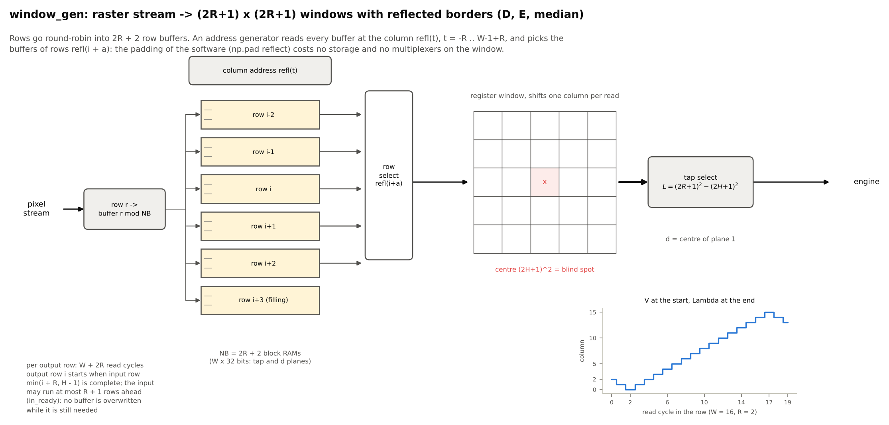

# 4. Front ends: from a raster stream to taps

[Contents](../README.md#contents) · previous: [3. Engines](03-engines.md) · next: [Scenario A](scenarios/A.md)

An engine needs a tap vector per pixel. Where it comes from is what distinguishes the scenarios, and in an FPGA it
is also where the memory goes. All front ends below are RTL in [`rtl/scenarios`](../rtl/scenarios) and are
bit-exact with [`afarch/frontends.py`](../afarch/frontends.py).

| scenario | taps | front end | memory at 512 x 512 (Yosys) |
|---|---|---|---|
| A | $2K$ synthetic $\cos,\sin$ | phase accumulators + cosine ROM | 1 RAMB18 per harmonic ($\cos$ and $\sin$ on its two ports) |
| B | none ($x=1$) | first-pixel load | none |
| C | 128 delayed high-band samples | row buffers, Gaussian high band, V-ordered reads | 2 RAMB18 + distributed RAM |
| D, E | $(2R+1)^2-(2H+1)^2$ window pixels | `window_gen`: $2R+2$ row buffers, reflected addressing | $2R+2$ RAMB18 (6 for D, 8 for E) |
| F | optical-black mean or a reference channel | OB accumulator and register file | registers |

## 4.1 Borders without padding: reflected addressing

Row buffers and a register window are the standard way to stream a neighbourhood ([Bailey
2023](references.md#bailey2023)); what remains is the border. The software pads with `np.pad(..., mode="reflect")`:
$x(-i)=x(i)$ and $x(W-1+i)=x(W-1-i)$. A streaming design can do this without storing a padded image and without
multiplexers on the window, by **reading** the right addresses. Define

$$\mathrm{refl}(t)=\begin{cases}-t & t<0\\ t & 0\le t\le W-1\\ 2(W-1)-t & t>W-1\end{cases}$$

and read column $\mathrm{refl}(t)$ for $t=-R,\dots,W-1+R$. The first $2R+1$ reads fill a window centred on column 0
with exactly the reflected columns, every further read shifts the window by one column, and the last $R$ reads
produce the reflected right border. The read order is a V at the start of the row and a Λ at its end.

[`window_gen.v`](../rtl/scenarios/window_gen.v) applies it in both directions: rows go round-robin into $2R+2$
row buffers, every buffer is read at the same column address, and window row $a$ takes the buffer of image row
$\mathrm{refl}(i+a)$. Its rules:

* **Output row $i$ starts** when input row $\min(i+R,H-1)$ is complete. The last $R$ output rows need no new
  input (their rows below are reflections of rows already stored).
* **The input may run at most $R+1$ rows ahead** (`in_ready`): the buffer of row $r$ is $r \bmod (2R+2)$, and it
  is free once the output has passed row $r-R-2$. One spare buffer is what lets input and output overlap.
* **$W+2R$ read cycles per output row.** With one window per cycle the generator needs $2R$ cycles of horizontal
  blanking per row (4 for D); a slower engine (`lms_serial`, `lms_folded`, `lms_da`) back-pressures it.
* Two planes travel together: the tap source and the desired pixel. They are the same pixel in the first pass;
  the gated D of the software takes the taps of a later pass from the previous pass's output, which a second
  plane allows without changing the window logic.

## 4.2 Scenario C: high band and the reflected history

The two-band canceller needs, per row, the Gaussian high band $h=z-g*z$ ($\sigma=4$, 33 taps) and then, at pixel
$j$, the 128 taps $x_k(j)=h\big(\mathrm{refl}(j-8-k)\big)$: the history of the row before $j$, reflected at the row
start exactly as `np.pad(h, (135, 0), "reflect")` does in the software.
[`scen_c_top.v`](../rtl/scenarios/scen_c_top.v) does it in two phases on a buffered row:

1. **HB phase.** Read the row at $\mathrm{refl}(t)$, $t=-16,\dots,W+15$ (reflected borders, as above) into a
   33-word shift window. The symmetric kernel needs 17 multipliers after 16 pre-adders
   ($g_m(z_{j-m}+z_{j+m})$, the DSP48E1 pre-adder), an adder tree, and the rounding constant. The kernel is
   quantised to Q16 with the centre tap adjusted so that the coefficients sum to exactly $2^{16}$: a constant row
   has an exactly zero high band. $h$ goes to a dual-port buffer.
2. **CANCEL phase.** Steps $t=-(L-1),\dots,W-1$ read $x_0(t)=h(\mathrm{refl}(t-8))$ from one port and $d=h(t)$
   from the other. For $t<0$ the step is a **pre-roll shift**: it enters the tapped delay line but produces no
   output and no update. The reads form the sequence $h(135), h(134), \dots, h(1), h(0), h(1), \dots$, so when pixel
   0 arrives the delay line already holds its reflected history.

The pipelined engines keep the delay line inside (`TDL = 1`); the handshake engines get the 128-tap vector from a
delay line in the top. A row costs $(W+32)$ HB cycles plus $(L-1)+W\cdot II$ CANCEL cycles (plus the drain): about
1200 cycles for $W=512$ with a pipelined engine and about 13 000 with `lms_folded` at $P=8$. A third row buffer would let
the HB phase of the next row overlap the CANCEL phase of the current one.

## 4.3 Scenario A: plane waves without multipliers

Harmonic $k$ at pixel $(i,j)$ has the phase $\theta_k(i,j)=u_k i+v_k j$ cycles. With phase words of 32 bits,
$U_k=\mathrm{round}(u_k2^{32})$ and $V_k=\mathrm{round}(v_k2^{32})$, two accumulators produce it in raster order:

$$\Theta_k(i,0)=\Theta_k(i-1,0)+U_k,\qquad \Theta_k(i,j)=\Theta_k(i,j-1)+V_k\qquad(\bmod 2^{32}).$$

The phase is rounded to $N_A=10$ bits and addresses a 1024-entry cosine ROM in Q12. Every harmonic has its own copy
of the table in one RAMB18: one port reads $\cos\theta$, the other reads $2^{N_A-2}$ entries back for
$\sin\theta=\cos(\theta-\pi/2)$. (A single table shared by all harmonics needs $2K$ read ports; Yosys then builds it
from LUTs, 671 more than the two block RAMs of $K=2$.) Rounding the phase to 10 bits leaves a
reference error about 55 dB below the reference, far under the image noise. The 32-bit accumulators make the
frequency resolution $2^{-32}$ cycles per pixel, so the phase stays coherent over a whole frame. For
multiplicative interference (the LED flicker of the examples) a log ROM before the canceller and an exp ROM after
it turn modulation into addition: two table lookups of 8192 entries each around `scen_a_top`, modelled in
`afarch.scenarios.scenario_a_log` (they are not part of the RTL top).

## 4.4 Scenario F: references that are already there

An image sensor reads optical-black (OB) columns, shielded from light, at the start of each row. They see the
row's offset but not the scene. The OB mean of $N_{OB}=2^m$ columns is an accumulator and a shift. Two subtleties:

* **Calibrate where the scene is absent.** On a scene frame the row means of the image are a huge uncorrelated
  input to the gradient; on a dark frame (or during blanking) the only uncorrelated part is read noise, so the
  weight settles fast and accurately. Mode 1 of [`scen_f_top.v`](../rtl/scenarios/scen_f_top.v) adapts on dark
  frames; mode 0 then applies the frozen weight: one multiplier and one subtractor per pixel.
* **Leave one out when adapting on the OB pixels themselves.** Mode 2 adapts during the OB readout, predicting
  each OB pixel $ob_k=c+n_k$ from the others. If $ob_k$ were inside its own reference
  $x=c+\tfrac{1}{K}\sum_jn_j$, its noise would appear in both $d$ and $x$, adding the same $\sigma^2/K$ to $E[dx]$ and
  $E[x^2]$ and pulling the weight to exactly 1. With $x_k=\tfrac{1}{K-1}\sum_{j\ne k}ob_j$ the common term vanishes
  and the weight converges to $\sigma_c^2/(\sigma_c^2+\sigma^2/(K-1))$, the noise-aware gain. The division by
  $K-1$ is one constant multiply ($\mathrm{round}(2^{12}/15)$ for 16 columns); with 17 OB columns it would be a
  shift.

A tag FIFO marks which engine outputs are scene pixels, so the outputs of the OB updates never leave the top.

## 4.5 Scenario B: nothing to fetch

The bias canceller's reference is the constant 1, so the "filter" is the weight itself and the multiplier
disappears ([scenario B](scenarios/B.md)). The only front-end decision is the start of a row: the hardware loads
$b=d(0)$ at the first pixel (the software uses the median of the first eight pixels, which would need an
eight-pixel delay and a small sorting network).
