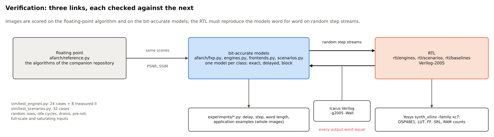

# 5. Verification: bit-exact, not approximately right

[Contents](../README.md#contents) · previous: [Scenario F](scenarios/F.md) · next: [6. Results](06-results.md)

Every number in this repository that describes hardware comes from a model that the RTL reproduces **bit for
bit**. The chain has three links.

<p align="center"></p>

1. **Floating point** ([`afarch/reference.py`](../afarch/reference.py)): the algorithms of the companion
   repository, re-implemented for the scenes of this one. They define what "right" means for an image.
2. **Bit-accurate models** ([`afarch/fxp.py`](../afarch/fxp.py), [`engines.py`](../afarch/engines.py),
   [`frontends.py`](../afarch/frontends.py), [`scenarios.py`](../afarch/scenarios.py)): integer arithmetic with
   the formats, rounding and saturation of [chapter 2](02-fixed-point.md), and one model per algorithmic class
   (exact, delayed, block). The pipelined classes are modelled **step by step**: an idle cycle is not a step, while
   a drain or pre-roll step is an empty step that still moves the pending updates. The models are what the
   experiments run on whole images.
3. **RTL** ([`rtl/`](../rtl)), simulated with Icarus Verilog against the models on the same inputs. The compile
   uses `-g2005 -Wall` (with the timescale and implicit-dimension notes off), and any warning fails the run. Every output word must be equal: `np.array_equal`, no
   tolerance.

## 5.1 Engines

[`sim/test_engines.py`](../sim/test_engines.py) drives [`tb/tb_engine.v`](../tb/tb_engine.v) with a step file in
which every line is a step: valid sample, shift, drain, adapt flag, last-of-row flag, desired, pass-through and
taps. The streams are random and hostile on purpose:

* rows of random length (4 to 30 samples) ending with `last`, followed by drain bursts of random length, often
  shorter than the row-block commit needs (the model's commit delay then decides when the update lands);
* idle cycles inside rows (pipelined engines) and gaps between samples (handshake engines);
* random runs of pre-roll shifts in tapped-delay-line mode;
* full-scale taps (2 % of the samples), saturating desired values (1 %), outliers for the gated error unit (8 %)
  and adaptation switched off on 10 % of the samples.

24 cases cover the six engines with odd tap counts ($L=1$, 3, 5, 7, 13), the four update rules (LMS, sign-error,
sign-data, sign-sign), leakage, all four output modes, the gate, and both tap interfaces. A second run per
handshake engine feeds samples back to back and **measures the initiation interval**: 8 configurations, all equal
to the formulas of [chapter 1](01-foundations.md#15-six-engines-three-numbers) (`serial` $L=8$: 19, $L=24$: 51;
`folded` $L=24$, $P=1,4,6$: 29, 13, 12; $L=48$, $P=12$: 13; `da` $L=24$: 22, $L=128$: 24).

## 5.2 Scenario tops

[`sim/test_scenarios.py`](../sim/test_scenarios.py) runs the complete tops on image crops (a few hundred to a few
thousand pixels, several passes) through dedicated testbenches. 32 cases:

| group | cases | what is exercised |
|---|---|---|
| D, E | 10 | `window_gen` with reflection at all four borders, two planes, blind spots $H=0$ and $H=1$, every engine, the gated predictor over three passes with the tap plane taken from the previous pass |
| C | 6 | the two-phase row schedule, the Gaussian high band, the V-ordered reflected history, pre-roll, every engine |
| A | 6 | phase accumulators across rows and frames, the cosine ROM, every engine |
| B | 3 | the three update modes, row starts |
| F | 5 | OB accumulation, dark-frame calibration then frozen correction, the leave-one-out online mode, the reference channel with $S=-1$, the tag FIFO |
| baselines | 2 | the $3\times3$ median and the switching median |

## 5.3 What the comparison guarantees, and what it does not

**Guaranteed.** For the tested configurations, the RTL computes exactly what the model computes, including
saturation, rounding, row boundaries, drains and idle cycles. Because two's complement addition is associative,
the engines of one class produce identical images ([1.5](01-foundations.md#15-six-engines-three-numbers)); the
experiments therefore report one result per class plus the delay of each engine.

**Not covered by simulation.** Timing closure on a device (the repository reports Yosys cell counts, not clock
frequencies), the behaviour of a real sensor interface, and parameter values far outside the tested ones (the
models assert the word-growth conditions of [2.4](02-fixed-point.md#24-word-growth-and-guard-bits) on every
sample, so an overflow in a whole-image experiment stops it instead of passing silently). The A4 lattice notch
is a floating-point model only.

## 5.4 Running it

```bash
python sim/test_engines.py          # 24 engine cases + 8 initiation intervals, a few seconds
python sim/test_scenarios.py        # 32 scenario cases, about a minute
python sim/test_engines.py df da    # a subset
```

Both scripts need `iverilog` and `vvp` on the path and write `results/rtl_engine_tests.json` and
`results/rtl_scenario_tests.json` when run in full. The same commands run in the continuous integration of the
repository ([`.github/workflows/ci.yml`](../.github/workflows/ci.yml)).
