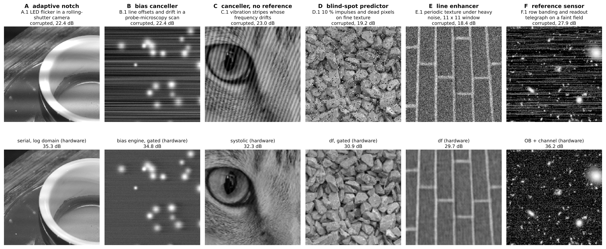
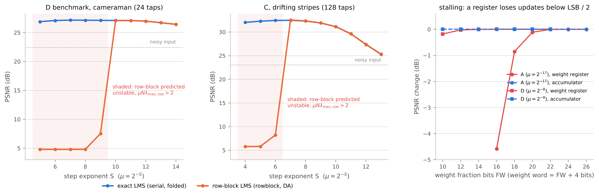
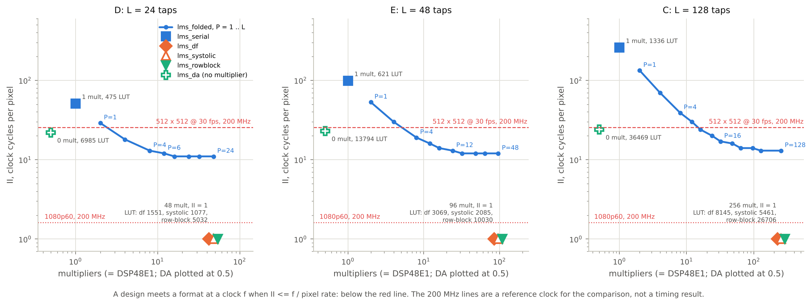

# 6. Results

[Contents](../README.md#contents) · previous: [5. Verification](05-verification.md) · next: [7. Choosing an architecture](07-choosing.md)

Every image result below is computed with the bit-accurate models, which the RTL reproduces word for word
([chapter 5](05-verification.md)); every resource count is a Yosys result. The scripts that produce them are
named in each section, and their outputs are in [`results/`](../results).

## 6.1 Application examples

Eighteen corrupted scenes, three per scenario, each run through the floating-point algorithm and through the
fixed-point pipeline of its scenario top with several engines ([`experiments/examples.py`](../experiments/examples.py),
about 15 minutes; [`results/examples.csv`](../results/examples.csv)). The scenario chapters show every example with
its figure and its full table; every configuration is also reproduced word for word by the HLS C++ top and, for
the configurations marked in the chapters, by the Verilog top ([5.4](05-verification.md#54-the-application-examples-through-both-implementations)).

| | scene and corruption | corrupted | floating point | exact LMS | delayed LMS | block LMS | other |
|---|---|---|---|---|---|---|---|
| [A.1](scenarios/A.md#a1-led-flicker-in-a-rolling-shutter-camera) | LED flicker bands in a rolling-shutter photo, multiplicative | 22.39 | 35.38 | 35.33 | 35.33 ($D=5$), 35.33 ($D=7$) | | 27.60 without the log domain |
| [A.2](scenarios/A.md#a2-three-plane-waves-on-a-photograph) | three plane waves, two vertical and one oblique | 21.44 | 47.26 | 47.25 | 47.25 ($D=6$), 47.24 ($D=9$) | | |
| [A.3](scenarios/A.md#a3-mains-hum-in-a-raster-readout) | mains hum and its third harmonic in a raster readout | 25.36 | 47.55 | 47.55 | 47.53 ($D=5$), 47.52 ($D=7$) | | |
| [B.1](scenarios/B.md#b1-line-offsets-and-drift-in-a-probe-microscopy-scan) | line offsets and drift in a probe-microscopy scan | 22.39 | 34.63 | 34.78 (gated) | | | 33.91 sign-error, 28.52 LMS |
| [B.2](scenarios/B.md#b2-offsets-and-wander-of-a-ccd-readout-faint-field) | offsets and wander of a CCD readout, faint field | 26.81 | 36.65 | 36.65 (gated) | | | 34.84 sign-error, 27.64 LMS |
| [B.3](scenarios/B.md#b3-scan-line-offsets-and-illumination-wander-on-a-page) | scan-line offsets and illumination wander on a page | 22.08 | 37.15 | 37.10 (gated) | | | 32.29 sign-error, 18.75 LMS |
| [C.1](scenarios/C.md#c1-vibration-stripes-whose-frequency-drifts) | vibration stripes with drifting frequency | 23.02 | 32.47 | 32.48 | 32.39 ($D=10$), 32.33 ($D=131$) | 32.35 | 32.66 A4 lattice (float model) |
| [C.2](scenarios/C.md#c2-stripes-with-a-random-phase-on-every-row) | stripes with a random phase on every row | 23.16 | 30.50 | 30.55 | 30.49 ($D=10$), 30.54 ($D=131$) | 30.57 | 28.15 A4 lattice |
| [C.3](scenarios/C.md#c3-two-interference-tones-along-the-rows) | two interference tones along the rows | 25.36 | 31.43 | 31.44 | 31.41 ($D=10$), 31.43 ($D=131$) | 31.45 | 27.00 A4 lattice |
| [D.1](scenarios/D.md#d1-impulses-and-dead-pixels-on-fine-texture) | 10 % impulses and dead pixels on fine texture | 19.23 | 30.99 | 30.94 | 30.91 ($D=8$), 30.87 ($D=27$) | | 27.32 median, 30.07 switching median |
| [D.2](scenarios/D.md#d2-gaussian-noise-on-a-photograph) | Gaussian noise, $\sigma=20/255$ | 22.42 | 27.15 | 27.15 | 27.14 ($D=8$), 27.12 ($D=27$) | 27.08 | 26.95 median |
| [D.3](scenarios/D.md#d3-salt-and-pepper-impulses) | 20 % salt-and-pepper impulses | 12.73 | 33.04 | 32.41 | 32.10 ($D=8$), 32.52 ($D=27$) | | 31.24 median, 31.92 switching median |
| [E.1](scenarios/E.md#e1-periodic-texture-under-heavy-noise-11-x-11-window) | periodic texture under heavy noise, 120 taps | 18.42 | 29.79 | 29.75 | 29.71 ($D=10$), 29.64 ($D=123$) | 29.81 | |
| [E.2](scenarios/E.md#e2-a-two-tone-lattice-in-white-noise-9-x-9-window) | a two-tone lattice in white noise, 80 taps | 14.41 | 25.39 | 25.34 | 25.34 ($D=10$), 25.31 ($D=83$) | 24.85 | |
| [E.3](scenarios/E.md#e3-texture-under-correlated-noise-the-blind-spot-matters) | texture under correlated noise, blind spot $3\times3$ | 20.02 | 26.05 | | 25.92 ($D=9$), 25.83 ($D=43$) | 26.01 | 20.64 with a $1\times1$ blind spot |
| [F.1](scenarios/F.md#f1-row-banding-and-readout-telegraph-on-a-faint-field) | row banding and readout telegraph on a faint field | 27.95 | 36.28 | 36.24 | | | 30.20 OB only, 30.17 OB online |
| [F.2](scenarios/F.md#f2-row-banding-with-optical-black-columns) | row banding with optical-black columns | 30.42 | 39.72 | 39.72 | | | 39.49 OB online |
| [F.3](scenarios/F.md#f3-readout-telegraph-noise-with-a-reference-output) | readout telegraph noise with a reference output | 30.00 | 36.32 | 36.31 | | | |

(PSNR in dB; SSIM ([Wang et al. 2004](references.md#wang2004)) is in the csv. B is measured after aligning the mean
offset. Exact LMS = `lms_serial` and `lms_folded`, which are bit-identical; block LMS = `lms_rowblock` and `lms_da`,
likewise, at the largest power-of-two step with $\mu N\lambda_{\max,\text{row}}\le1$.)

Three observations hold across the eighteen scenes:

* **Fixed point costs at most 0.06 dB** where the comparison is like for like, in 17 of the 18 examples. In D.3
  the hardware is 0.6 dB below the floating-point algorithm; the floating-point algorithm with the hardware's gate
  constants and power-of-two step comes within 0.04 dB of it, so the constants cost the 0.6 dB, not the Q12 data, the
  Q20 weight view or the 48-bit weight accumulator ([chapter 2](02-fixed-point.md)).
* **The delayed engines are within 0.15 dB of exact LMS** in every example but D.3 (from +0.005 dB in A.1 to
  -0.15 dB for the systolic engine in C.1), the loss growing with $D$ while $\mu\lambda_{\max}$ of the worst tile
  stays well inside the DLMS bound ([1.3](01-foundations.md#images-are-not-stationary)). With the gate on dense
  impulses (D.3) they differ by -0.31 and +0.11 dB, because a different decision changes the next pass's taps.
* **The block engines**, at the step their bound allows, end between 0.50 dB below (E.2, where 192-pixel rows give
  them few updates) and 0.06 dB above (E.1) exact LMS at its own step.

The example figures (one per example, in the scenario chapters) show a crop of the corrupted image, the
floating-point result, one hardware result, the difference between the hardware and floating-point outputs, and
the PSNR of every version.

## 6.2 Row-block LMS

[`experiments/rowblock_wordlength.py`](../experiments/rowblock_wordlength.py) sweeps the step of exact and
row-block LMS on the D benchmark (cameraman, Gaussian noise $\sigma=20/255$, 24 taps) and on the C scene (128 taps),
and computes $\mu N\lambda_{\max,\text{row}}$ from the worst row's tap correlation ([`results/rowblock_step.csv`](../results/rowblock_step.csv)):

| | $S$ | $\mu N\lambda_{\max,\text{row}}$ | exact LMS | row-block LMS |
|---|---|---|---|---|
| D | 9 | 2.87 | 27.12 dB | 7.53 dB (diverged) |
| D | 10 | 1.44 | 27.10 dB | 27.08 dB |
| D | 11 | 0.72 | 27.09 dB | 27.08 dB |
| C | 6 | 3.02 | 32.45 dB | 8.23 dB (diverged) |
| C | 7 | 1.51 | 32.48 dB | 32.54 dB |
| C | 8 | 0.75 | 32.33 dB | 32.35 dB |

The bound $\mu N\lambda_{\max,\text{row}}<2$ separates divergence from convergence in both scenes, with the worst
row's eigenvalue and not the image's: for D the image-wide eigenvalue gives $\mu N\lambda=1.91$ at $S=9$, which
would wrongly predict stability. Inside the bound the two classes agree within 0.07 dB. What the block engines
lose is the large steps: D's best exact step ($S=7$, 27.16 dB) is out of their reach. The right panel is
[2.3](02-fixed-point.md#23-stalling-in-a-weight-register): a weight register with rounded updates stalls at small
steps, the accumulator does not.

## 6.3 Design space

[`experiments/design_space.py`](../experiments/design_space.py) places every engine at the tap counts of D, E and
C by multipliers and cycles per pixel ([`results/design_space.csv`](../results/design_space.csv)):

The clock that a format needs is $II\times$ pixel rate:

| | $II$ | 512 x 512 @ 30 fps | 1024 x 1024 @ 30 fps | 1920 x 1080 @ 60 fps |
|---|---|---|---|---|
| any engine with $II=1$ | 1 | 7.9 MHz | 31.5 MHz | 124.4 MHz |
| `lms_folded`, $L=24$, $P=8$ to 24 (the floor of exact LMS) | 11 | 86.5 MHz | 346 MHz | 1369 MHz |
| `lms_folded`, $L=24$, $P=6$ | 12 | 94.4 MHz | 377 MHz | 1493 MHz |
| `lms_folded`, $L=128$, $P=8$ | 24 | 189 MHz | 755 MHz | 2986 MHz |
| `lms_da`, $L=128$ | 24 | 189 MHz | 755 MHz | 2986 MHz |
| `lms_serial`, $L=24$ | 51 | 401 MHz | 1604 MHz | 6345 MHz |

(Pixel rates only; the row overheads of the front ends add a few percent, [4](04-front-ends.md).) Folding flattens at
$II=\lceil\log_2L\rceil+6$ (11, 12 and 13 cycles for 24, 48 and 128 taps): **exact LMS cannot reach one pixel per
clock**. At 300 MHz it stops at 27 Mpixel/s for 24 taps; beyond that only the delayed and block engines remain.
That is the practical content of the iteration bound.

## 6.4 Synthesis

[`syn/synth_engines.py`](../syn/synth_engines.py) and [`syn/synth_tops.py`](../syn/synth_tops.py) run Yosys 0.71
`synth_xilinx -family xc7 -flatten` and count the mapped cells ([`results/synth_engines.csv`](../results/synth_engines.csv),
[`results/synth_tops.csv`](../results/synth_tops.csv)). These are technology-mapped counts before placement, not
Vivado utilisation reports, and they carry no timing; [`syn/vivado_ooc.tcl`](../syn/vivado_ooc.tcl) runs the same
modules through Vivado out of context for those who want both.

**Engines** ($W_D=16$, $W_A=48$; TDL = tapped delay line inside the engine):

| engine | $L$ | DSP48E1 | LUT | FF | SRL | LUTRAM |
|---|---|---|---|---|---|---|
| `lms_serial` | 24 / 48 / 128 | 1 / 1 / 1 | 475 / 621 / 1336 | 585 / 972 / 2256 | 0 | 12 / 48 / 48 |
| `lms_folded` $P=2$, $6$ | 24 | 4, 12 | 656, 1295 | 921, 1254 | 0 | 12, 36 |
| `lms_folded` $P=12$ | 48 | 24 | 2549 | 2454 | 0 | 72 |
| `lms_folded` $P=8$, $32$ | 128 | 16, 64 | 2794, 6731 | 4682, 6406 | 0 | 48, 192 |
| `lms_df` | 24 / 48 | 48 / 96 | 1551 / 3069 | 603 / 1181 | 400 / 784 | 0 |
| `lms_df` TDL | 128 | 256 | 8145 | 5199 | 16 | 0 |
| `lms_systolic` | 24 / 48 | 48 / 96 | 1077 / 2085 | 524 / 1028 | 704 / 2448 | 0 |
| `lms_systolic` TDL | 24 / 128 | 48 / 256 | 1093 / 5461 | 1580 / 8564 | 16 / 64 | 0 |
| `lms_rowblock` | 24 / 48 | 48 / 96 | 5032 / 10 030 | 2915 / 5798 | 400 / 784 | 0 |
| `lms_rowblock` TDL | 128 | 256 | 26 706 | 17 497 | 16 | 0 |
| `lms_da` | 24 / 48 / 128 | 0 | 6985 / 13 794 / 36 469 | 4353 / 8561 / 22 585 | 0 | 30 / 60 / 160 |

**Scenario tops** at $W=512$ (front end, engine and error unit):

| top | engine | DSP48E1 | LUT | FF | SRL | LUTRAM | RAMB18 |
|---|---|---|---|---|---|---|---|
| A, $K=2$ | `lms_serial` | 1 | 567 | 434 | 0 | 12 | 2 |
| A, $K=2$ | `lms_df` | 8 | 405 | 373 | 16 | 0 | 2 |
| B, gated | bias engine | 0 | 146 | 73 | 0 | 0 | 0 |
| C, $L=128$ | `lms_folded` $P=8$ | 32 | 3757 | 8115 | 58 | 144 | 2 |
| C, $L=128$ | `lms_systolic` | 272 | 6646 | 9836 | 186 | 96 | 2 |
| D, $L=24$ | `lms_serial` | 1 | 1158 | 1076 | 16 | 12 | 6 |
| D, $L=24$ | `lms_folded` $P=6$ | 12 | 1920 | 1729 | 16 | 36 | 6 |
| D, $L=24$ | `lms_df` | 48 | 2152 | 1075 | 416 | 0 | 6 |
| D gated, $L=24$ | `lms_df` | 48 | 2243 | 1103 | 416 | 0 | 6 |
| E, $L=48$ | `lms_systolic` | 96 | 2557 | 1847 | 2464 | 0 | 8 |
| F | `lms_serial` | 2 | 341 | 330 | 0 | 4 | 0 |
| baseline | median $3\times3$ | 0 | 864 | 228 | 0 | 0 | 4 |

What the tables show:

* **Multipliers land in DSP48E1 slices one to one**, the 24 x 16 update and filter products included. The Gaussian
  of C adds 16, the leave-one-out constant of F one.
* **The weight memory decides the LUTs of the exact engines.** With a single write port the $L$ accumulators of
  `lms_serial` and the lane banks of `lms_folded` map to distributed RAM (`RAM32M`); `lms_serial` grows from 475 to
  1336 LUTs between 24 and 128 taps.
* **The block engines pay for their second accumulator.** `lms_rowblock` needs 3.2 to 3.3 times the LUTs of
  `lms_df` at every $L$; `lms_da` needs no DSP slice but 6985 to 36 469 LUTs, at $II=22$ to 24.
* **The systolic engine is the leanest pipelined engine in logic** (its adders sit in the DSP cascade), and the
  most expensive in delay lines when its taps arrive as a vector (E).
* **Front ends are cheap.** Row buffers map to one RAMB18 each; the whole D top with `lms_df` is 601 LUTs more than
  the bare engine.
