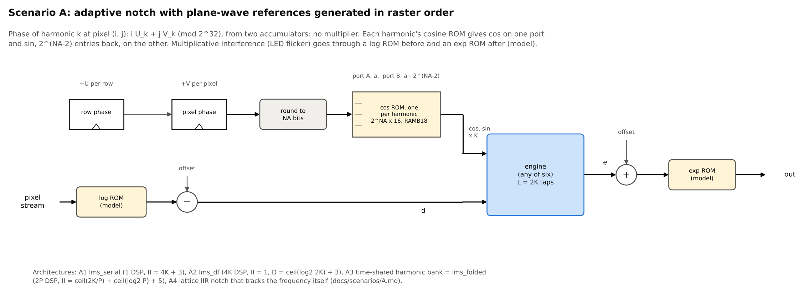
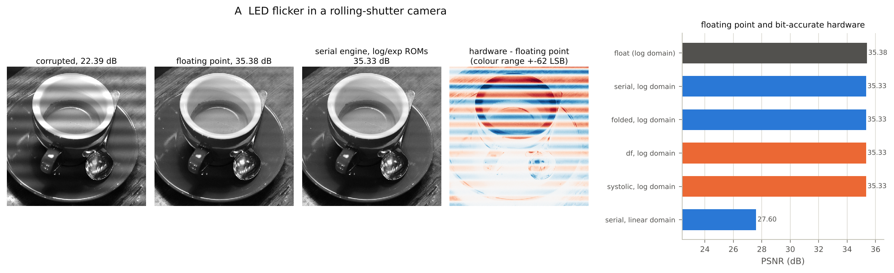

# Scenario A: adaptive notch with synthetic references

[Contents](../../README.md#contents) · [front ends](../04-front-ends.md#43-scenario-a-plane-waves-without-multipliers) · next: [B](B.md)

**The algorithm** ([companion repository, scenario A](https://github.com/VKHS/Adaptive-Filters-for-Image-Denoising/blob/main/docs/A_adaptive_notch.md)).
Interference made of plane waves $\sum_k a_k\cos(2\pi(u_ki+v_kj)+\varphi_k)$ with known frequencies is cancelled by
two weights per frequency on the references $C\cos\theta_k$, $C\sin\theta_k$ ([Widrow et al. 1975](../references.md#widrow1975)).
For one sinusoid, $\theta=\omega_0n$, the closed loop from $d$ to $e$ is the notch
([Glover 1977](../references.md#glover1977))

$$H(z)=\frac{z^2-2z\cos\omega_0+1}{z^2-(2-\mu C^2)\,z\cos\omega_0+1-\mu C^2}:$$

zeros on the unit circle at $e^{\pm j\omega_0}$, poles at radius about $1-\mu C^2/2$, a -3 dB width of about
$\mu C^2$ rad/sample.

## Architectures

| code | engine | multipliers | cycles per pixel | notes |
|---|---|---|---|---|
| **A1** | `lms_serial`, $L=2K$ | 1 | $4K+3$ (11 for two harmonics) | the default: A needs few taps |
| **A2** | `lms_df`, $L=2K$: a parallel pair per harmonic | $4K$ | 1 | $D=\lceil\log_2 2K\rceil+3$ (5 for $K=2$) |
| **A3** | `lms_folded`: a time-shared harmonic bank | $2P$ | $\lceil 2K/P\rceil+\lceil\log_2P\rceil+5$ | many harmonics on few DSPs |
| **A4** | lattice IIR notch (model) | 5 | 1 | finds an unknown, drifting frequency itself |

[`scen_a_top`](../../rtl/scenarios/scen_a_top.v) instantiates any of the six engines; the systolic, row-block and
DA versions are verified as well, but for $L=4$ they offer nothing over A2. The front end (phase accumulators and
the cosine ROM) is in [4.3](../04-front-ends.md#43-scenario-a-plane-waves-without-multipliers).

### The delay of A2 does not move the notch

Write $y(n)=\sum_k w_k(n)x_k(n)$ with the update delayed by $D$ samples. Unrolling the weights,
$y(n)=\mu C^2\sum_{m\le n-D-1}e(m)\cos\big(\omega_0(n-m)\big)$, so $Y=G(z)E$ with

$$G(z)=\mu C^2\,\frac{z\cos\big((D+1)\omega_0\big)-\cos(D\omega_0)}{z^D\,(z^2-2z\cos\omega_0+1)},\qquad
H_D(z)=\frac{1}{1+G(z)}=\frac{z^D(z^2-2z\cos\omega_0+1)}{z^D(z^2-2z\cos\omega_0+1)+\mu C^2\big(z\cos((D+1)\omega_0)-\cos(D\omega_0)\big)} .$$

$D=0$ gives Glover's notch back. The zeros stay at $e^{\pm j\omega_0}$ for every $D$. Substituting
$z=e^{j\omega_0}(1+\delta)$ in the denominator, the leading terms are
$2j\sin\omega_0\,e^{j(D+1)\omega_0}\,\delta$ and $\mu C^2\,j\sin\omega_0\,e^{j(D+1)\omega_0}$, so
$\delta=-\mu C^2/2$: **the notch poles do not depend on $D$ to first order**, and the delay only adds $D$ poles of
radius about $(\mu C^2)^{1/D}$ near the origin. Numerically ($\omega_0=2\pi\cdot0.0185$, $\mu C^2=10^{-3}$) the notch
poles have radius 0.99950 for $D=0$, 5 and 27 alike, and the extra poles reach 0.26 ($D=5$) and 0.82 ($D=27$).
At $\mu C^2=0.1$ the $D=27$ loop is unstable. Scenario A runs at $\mu C^2=2^{-17}$: the four engines give
35.33 dB to within 0.005 dB on the example below.

## A4: an IIR notch that finds the frequency itself

When the frequency is unknown or drifts, A's references cannot be built. The lattice notch of
[Regalia (1991)](../references.md#regalia1991) adapts the frequency as **one coefficient**:

$$H(z)=\tfrac12\big(1+A(z)\big),\qquad A(z)=\frac{k_1+k_0(1+k_1)z^{-1}+z^{-2}}{1+k_0(1+k_1)z^{-1}+k_1z^{-2}},$$

realised as a two-stage lattice, $k_1$ on top and $k_0$ below, with $s$ the state of the lower stage:

$$f_1(n)=x(n)-k_1g_1(n-1),\quad s(n)=f_1(n)-k_0s(n-1),\quad g_1(n)=k_0s(n)+s(n-1),\quad g_2(n)=k_1f_1(n)+g_1(n-1),$$
$$y(n)=\tfrac12\big(x(n)+g_2(n)\big).$$

In the $z$ domain $x=s\,D(z)$ and $g_2=s\,N(z)$ with $D(z)=1+k_0(1+k_1)z^{-1}+k_1z^{-2}$ and $N$ the numerator of
$A$, so $g_2=A(z)x$. The numerator of $1+A(z)$ is $(1+k_1)(1+2k_0z^{-1}+z^{-2})$: the notch sits at
$\omega_0=\arccos(-k_0)$ **for every** $k_1$, and $k_1$ alone sets the bandwidth (poles at radius $\sqrt{k_1}$, a
-3 dB width of $2\arctan\frac{1-k_1}{1+k_1}\approx1-k_1$ rad/sample). The gradient of the output is

$$\frac{\partial y}{\partial k_0}=\frac{1-k_1^2}{2}\,\frac{z^{-1}(1-z^{-2})}{D(z)^2}\,x
=\frac{1-k_1^2}{2}\,\frac{z^{-1}(1-z^{-2})}{D(z)}\,s ,$$

and dropping the remaining $1/D(z)$ gives a regressor that the lattice already holds:

$$k_0\leftarrow k_0-\mu\,y(n)\,\big(s(n-1)-s(n-3)\big).$$

The hardware is four multipliers in the lattice ($k_1g_1$, $k_0s(n-1)$, $k_0s(n)$, $k_1f_1$), one for the update,
and a few registers. Unlike the LMS engines, A4 is an IIR filter: the recursion $s(n-1)\to s(n)$ holds a multiplier
and two adders in one register, which bounds the sample rate at $1/(T_\times+2T_+)$ (well above the pixel rates
of this repository; faster rates would need look-ahead, [Parhi 1999](../references.md#parhi1999)).

**Accuracy against step size.** On a 1-D test (a unit sinusoid at 0.1 cycles/sample in noise of $\sigma=0.3$,
$k_1=0.95$, 40 000 samples), $\mu=10^{-4}$ brings $k_0$ within 0.01 of $-\cos\omega_0$ after about 19 500 samples;
over the last 5000 it averages $-0.8089$ (target $-0.8090$, standard deviation 0.004) and the output power falls
from 0.60 to 0.10 (the noise alone is 0.09). With $\mu=10^{-3}$ it gets there after 2000 samples but settles at
0.114 cycles/sample, outside the notch: the simplified gradient is biased at large steps, so the step must be scaled
to the input power.

**On an image.** The notch runs along the rows of [scenario C](C.md)'s drifting stripes. Each row is buffered (as
in C), $k_0$ adapts along its Gaussian high band (with a 48-sample reflected pre-roll) and the full-band row is then
filtered with that row's final $k_0$; $k_0$ carries over to the next row. From $k_0=0$ (0.25 cycles/pixel) it locks
within 14 rows, then follows the stripe frequency from 0.08 to 0.12 cycles/pixel with a mean error of
0.0007 cycles/pixel (largest 0.0034). The result is **32.66 dB** ($k_1=0.9$, $\mu=0.032$) against 32.48 dB for
C's 128-tap canceller, with 5 multipliers where C's pipelined engines use 256. It is a model
([`afarch/lattice.py`](../../afarch/lattice.py)), not RTL, and it removes one spectral line per section, where C
removes whatever is predictable from the row's history.

## Results

LED flicker in a rolling-shutter camera ([examples](../06-results.md#61-application-examples)): the bands are
multiplicative, so a log ROM before the canceller and an exp ROM after it make them additive. The two ROMs are
table lookups around `scen_a_top` in the model (`scenario_a_log`); the RTL covers the canceller between them.

| | PSNR |
|---|---|
| corrupted | 22.39 dB |
| floating point, log domain | 35.38 dB |
| A1 `lms_serial`, log/exp ROMs ($\mu=2^{-17}$) | 35.33 dB |
| A3 `lms_folded` | 35.33 dB |
| A2 `lms_df` ($D=5$) | 35.33 dB |
| `lms_systolic` ($D=7$) | 35.33 dB |
| A1 without the log domain | 27.60 dB |

$\mu=2^{-17}$ makes A the case for the update accumulator: a 20-bit weight register would lose 0.11 dB and an
18-bit one 0.85 dB to stalling ([2.3](../02-fixed-point.md#23-stalling-in-a-weight-register)).
