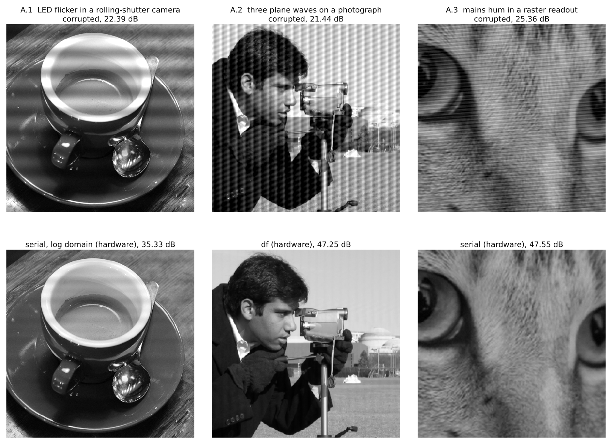
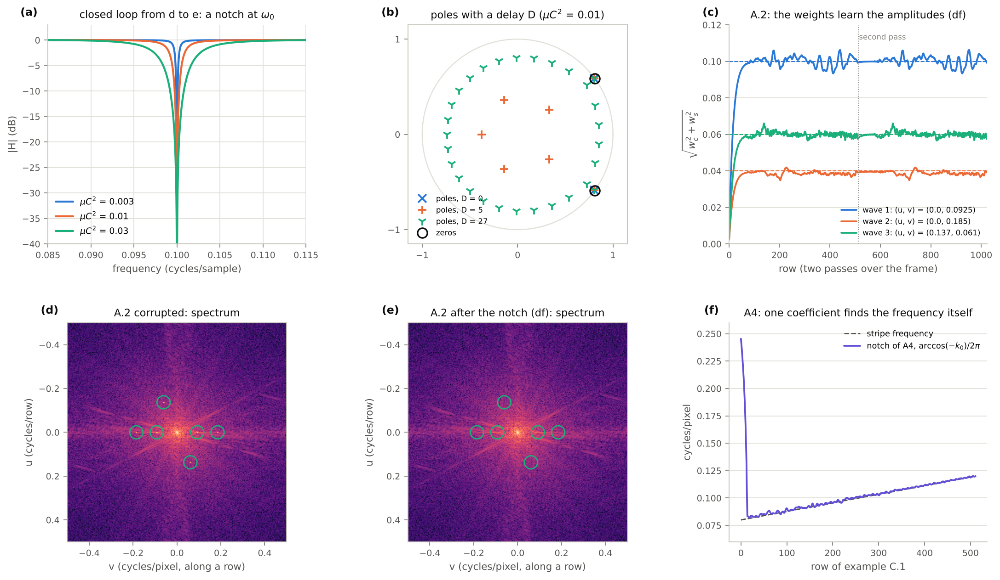
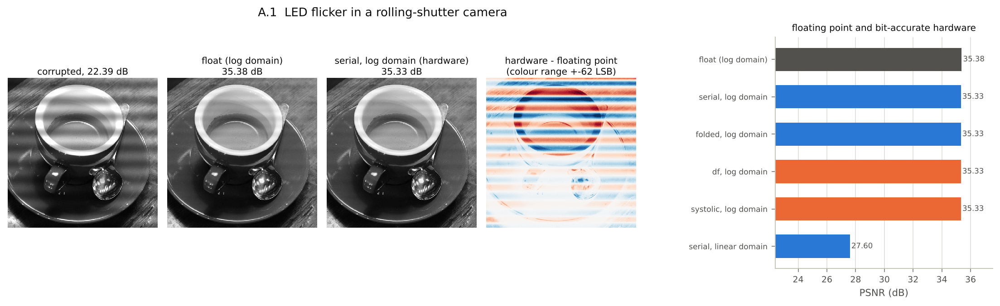
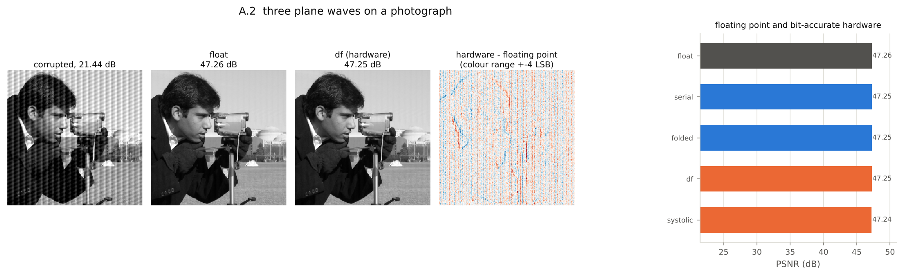
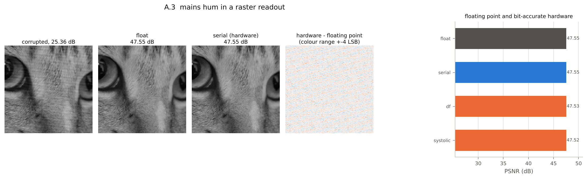

# Scenario A: adaptive notch with synthetic references

[Contents](../../README.md#contents) · [front ends](../04-front-ends.md#43-scenario-a-plane-waves-without-multipliers) · next: [B](B.md)

Periodic interference whose frequencies are known is cancelled by two weights per frequency on a cosine and a
sine reference. The references cost no sensor: a phase accumulator and a cosine table make them in the raster
order of the image. The closed loop is a notch filter at each frequency, as narrow as the step makes it.

<p align="center"></p>

| | |
|---|---|
| interference | $K$ plane waves $\sum_k a_k\cos(2\pi(u_ki+v_kj)+\varphi_k)$ with known $(u_k,v_k)$ |
| reference | $C\cos\theta_k$, $C\sin\theta_k$ from two phase accumulators per harmonic and a cosine ROM: $L=2K$ taps |
| output | the error $e=d-y$ |
| architectures | **A1** `lms_serial`, **A2** `lms_df`, **A3** `lms_folded`, **A4** lattice IIR notch (model) |
| RTL | [`rtl/scenarios/scen_a_top.v`](../../rtl/scenarios/scen_a_top.v), any of the six engines |
| HLS C++ | [`hls/src/scen_a.cpp`](../../hls/src/scen_a.cpp), `scen_a_top` |
| examples | [A.1](#a1-led-flicker-in-a-rolling-shutter-camera) LED flicker · [A.2](#a2-three-plane-waves-on-a-photograph) three plane waves · [A.3](#a3-mains-hum-in-a-raster-readout) mains hum |
| smoke test | `python smoke/smoke.py A`: `A_serial`, `A_df` |
| algorithm | [companion repository, scenario A](https://github.com/VKHS/Adaptive-Filters-for-Image-Denoising/blob/main/docs/A_adaptive_notch.md) |

## 1. The problem

The corrupted image is

$$d(i,j)=x(i,j)+\sum_{k=1}^{K}a_k\cos\big(2\pi(u_ki+v_kj)+\varphi_k\big)+n(i,j),$$

with the frequencies $(u_k,v_k)$ in cycles per row and per pixel known, and the amplitudes $a_k$ and phases
$\varphi_k$ unknown. Read in raster order, pixel $(i,j)$ is sample $n=iW+j$, and the phase
$\theta_k(i,j)=2\pi(u_ki+v_kj)$ advances by $2\pi v_k$ from pixel to pixel and by $2\pi u_k$ from row to row. That
is all the hardware needs to know: **two phase increments per harmonic**.

Interference that is a 1-D signal in time is a plane wave of the image. A hum of $f_h$ in a readout of $P$ pixel
clocks per line (pixels and blanking) has $v=f_h/f_{\text{pix}}$ along a row and $u=\mathrm{frac}(Pv)$ across
rows, because each line starts $P$ clocks after the previous one ([A.3](#a3-mains-hum-in-a-raster-readout)).
Flicker of a light source under a rolling shutter has $v=0$: every row is exposed at its own time
([A.1](#a1-led-flicker-in-a-rolling-shutter-camera)).

## 2. The algorithm

<p align="center"></p>

### 2.1 Two weights per frequency

A sinusoid of unknown amplitude and phase is a linear combination of a cosine and a sine of known phase:

$$a_k\cos(\theta_k+\varphi_k)=\underbrace{\tfrac{a_k\cos\varphi_k}{C}}_{w_{2k}}\,C\cos\theta_k+\underbrace{\big(-\tfrac{a_k\sin\varphi_k}{C}\big)}_{w_{2k+1}}\,C\sin\theta_k .$$

So a linear combiner on the references $x_{2k}=C\cos\theta_k$, $x_{2k+1}=C\sin\theta_k$ can reproduce the
interference exactly, and LMS finds its weights from the corrupted image alone:

$$y(n)=\sum_{l=0}^{2K-1}w_l(n)\,x_l(n),\qquad e(n)=d(n)-y(n),\qquad w_l(n+1)=w_l(n)+\mu\,e(n)\,x_l(n).$$

The scene $x$ and the noise $n$ are uncorrelated with the references (unless the scene itself has energy at
exactly $(u_k,v_k)$), so the minimum of $E[e^2]$ is where $y$ equals the interference and $e$ equals the clean
image plus noise. Panel (c) shows the weights of example A.2 learning the three amplitudes
$C\sqrt{w_{2k}^2+w_{2k+1}^2}$: 0.0994, 0.0391 and 0.0582 at the end of the second pass, against 0.10, 0.04 and
0.06.

### 2.2 The closed loop is a notch

For one harmonic, $\theta(n)=\omega_0n$, unroll the update from zero weights: $w(n)=\mu\sum_{m<n}e(m)\,x(m)$.
Because $\cos a\cos b+\sin a\sin b=\cos(a-b)$,

$$y(n)=w(n)^{\mathsf T}x(n)=\mu C^2\sum_{m<n}e(m)\cos\big(\omega_0(n-m)\big),$$

a convolution of the error with $\mu C^2\cos(\omega_0n)\,u(n-1)$. In the $z$ domain $Y=G(z)E$ with
$G(z)=\mu C^2\frac{z\cos\omega_0-1}{z^2-2z\cos\omega_0+1}$, and with $E=D-Y$
([Glover 1977](../references.md#glover1977)):

$$H(z)=\frac{E(z)}{D(z)}=\frac{1}{1+G(z)}=\frac{z^2-2z\cos\omega_0+1}{z^2-(2-\mu C^2)\,z\cos\omega_0+1-\mu C^2}.$$

* **Zeros on the unit circle** at $e^{\pm j\omega_0}$: the interference frequency is removed completely, whatever
  its amplitude and phase.
* **Poles at radius** $\sqrt{1-\mu C^2}\approx1-\mu C^2/2$, at nearly the same angle: away from $\omega_0$ the poles
  and zeros cancel and $|H|\approx1$.
* **Bandwidth.** The -3 dB width is about $\mu C^2$ rad/sample, $\mu C^2/2\pi$ cycles/sample. Panel (a) measures
  0.00048, 0.00158 and 0.00470 cycles/sample for $\mu C^2=0.003$, $0.01$ and $0.03$; the approximation gives
  0.00048, 0.00159 and 0.00477.
* **Time constant.** The poles at radius $1-\mu C^2/2$ give an envelope $\tau\approx2/(\mu C^2)$ samples. The
  examples use $C=1$ and $\mu=2^{-12}$ (A.2, A.3: $\tau\approx8200$ pixels, 16 rows) or $\mu=2^{-17}$ (A.1: about
  500 rows, hence three passes).

The step is a trade between the notch width (how much of the scene near $(u_k,v_k)$ is removed with the
interference) and the time the weights need to settle. With $K$ well-separated harmonics the loop splits into $K$
such notches.

### 2.3 Multiplicative interference: the log domain

Flicker modulates the exposure: $d=x\,(1+m\cos\theta)$. In the log domain the modulation is additive,

$$\ln d=\ln x+\ln(1+m\cos\theta)=\ln x+m\cos\theta-\tfrac{m^2}{4}(1+\cos2\theta)+\dots,$$

with a second harmonic of relative size $m/4$. Example A.1 ($m=0.25$) therefore cancels $\theta$ and $2\theta$
($K=2$) on $\ln(d+\epsilon)$ and maps the result back with $\exp(\cdot)-\epsilon$. In hardware both maps are ROMs:
13 address bits in, Q12 out, one or two RAMB36 each (`afarch.scenarios.log_luts`). Without them, the same canceller
on the linear image reaches 27.60 dB instead of 35.33 dB.

### 2.4 The adaptation delay does not move the notch

A pipelined engine applies the update of sample $m$ to the filter from sample $m+D+1$. Unrolling as in 2.2,
$y(n)=\mu C^2\sum_{m\le n-D-1}e(m)\cos(\omega_0(n-m))$, so $Y=G_D(z)E$ with

$$G_D(z)=\mu C^2\,\frac{z\cos\big((D+1)\omega_0\big)-\cos(D\omega_0)}{z^D\,(z^2-2z\cos\omega_0+1)},\qquad
H_D(z)=\frac{z^D(z^2-2z\cos\omega_0+1)}{z^D(z^2-2z\cos\omega_0+1)+\mu C^2\big(z\cos((D+1)\omega_0)-\cos(D\omega_0)\big)} .$$

$D=0$ gives Glover's notch back. The zeros stay at $e^{\pm j\omega_0}$ for every $D$. Substituting
$z=e^{j\omega_0}(1+\delta)$ in the denominator, the leading terms are $2j\sin\omega_0\,e^{j(D+1)\omega_0}\,\delta$
and $\mu C^2\,j\sin\omega_0\,e^{j(D+1)\omega_0}$, so $\delta=-\mu C^2/2$: **the notch poles do not depend on $D$
to first order**, and the delay only adds $D$ poles of radius about $(\mu C^2)^{1/D}$ near the origin. Panel (b)
draws them for $\mu C^2=0.01$: the notch poles have radius 0.99499, 0.99486 and 0.99414 for $D=0$, 5 and 27, and
the extra poles reach 0.42 ($D=5$) and 0.89 ($D=27$). At $\mu C^2=10^{-3}$ the notch poles have radius 0.99950 for
all three delays and the extra poles reach 0.26 and 0.82; at $\mu C^2=0.1$ the $D=27$ loop is unstable. The
examples run at $\mu C^2\le2^{-12}$, where the delayed engines are within 0.03 dB of exact LMS.

### 2.5 When the frequency is unknown: the lattice notch (A4)

When the frequency drifts, A's references cannot be built. The lattice notch of
[Regalia (1991)](../references.md#regalia1991) adapts the frequency as **one coefficient**:

$$H(z)=\tfrac12\big(1+A(z)\big),\qquad A(z)=\frac{k_1+k_0(1+k_1)z^{-1}+z^{-2}}{1+k_0(1+k_1)z^{-1}+k_1z^{-2}},$$

realised as a two-stage lattice, $k_1$ on top and $k_0$ below, with $s$ the state of the lower stage:

$$f_1(n)=x(n)-k_1g_1(n-1),\quad s(n)=f_1(n)-k_0s(n-1),\quad g_1(n)=k_0s(n)+s(n-1),\quad g_2(n)=k_1f_1(n)+g_1(n-1),$$
$$y(n)=\tfrac12\big(x(n)+g_2(n)\big).$$

In the $z$ domain $x=s\,D(z)$ and $g_2=s\,N(z)$ with $D(z)=1+k_0(1+k_1)z^{-1}+k_1z^{-2}$ and $N$ the numerator of
$A$, so $g_2=A(z)x$. The numerator of $1+A(z)$ is $(1+k_1)(1+2k_0z^{-1}+z^{-2})$: the notch sits at
$\omega_0=\arccos(-k_0)$ **for every** $k_1$, and $k_1$ alone sets the bandwidth (poles at radius $\sqrt{k_1}$, a
-3 dB width of $2\arctan\frac{1-k_1}{1+k_1}\approx1-k_1$ rad/sample). The gradient of the output is

$$\frac{\partial y}{\partial k_0}=\frac{1-k_1^2}{2}\,\frac{z^{-1}(1-z^{-2})}{D(z)^2}\,x
=\frac{1-k_1^2}{2}\,\frac{z^{-1}(1-z^{-2})}{D(z)}\,s ,$$

and dropping the remaining $1/D(z)$ gives a regressor that the lattice already holds:

$$k_0\leftarrow k_0-\mu\,y(n)\,\big(s(n-1)-s(n-3)\big).$$

Panel (f) runs it along the rows of example C.1, whose stripes drift from 0.08 to 0.12 cycles/pixel. Each row is
buffered, $k_0$ adapts along its Gaussian high band (with a 48-sample reflected pre-roll), the full-band row is
filtered with that row's final $k_0$, and $k_0$ carries over to the next row. From $k_0=0$ (0.25 cycles/pixel) it
locks within 16 rows and then follows the stripes with a mean error of 0.0007 cycles/pixel. The result is
**32.66 dB** ($k_1=0.9$, $\mu=0.032$) against 32.48 dB for C's 128-tap canceller.

**Accuracy against step size.** On a 1-D test (a unit sinusoid at 0.1 cycles/sample in noise of $\sigma=0.3$,
$k_1=0.95$, 40 000 samples), $\mu=10^{-4}$ brings $k_0$ within 0.01 of $-\cos\omega_0$ after about 19 500 samples;
over the last 5000 it averages $-0.8089$ (target $-0.8090$, standard deviation 0.004) and the output power falls
from 0.60 to 0.10 (the noise alone is 0.09). With $\mu=10^{-3}$ it gets there after 2000 samples but settles at
0.114 cycles/sample, outside the notch: the simplified gradient is biased at large steps, so the step must be scaled
to the input power.

## 3. The architecture (RTL)

<p align="center"></p>

[`scen_a_top`](../../rtl/scenarios/scen_a_top.v) generates the references and feeds any of the six engines:

* **Phases without multipliers.** Harmonic $k$ keeps a 32-bit row phase $\Theta^{\text{row}}_k$ and a pixel phase
  $\Theta_k$. At the start of a row $\Theta_k\leftarrow\Theta^{\text{row}}_k$; every pixel adds $V_k=\mathrm{round}(v_k2^{32})$;
  every row end adds $U_k$ to $\Theta^{\text{row}}_k$. Wrapping modulo $2^{32}$ is the phase modulo $2\pi$.
* **One table, two reads.** The phase is rounded to $N_A=10$ bits and addresses a 1024-entry cosine table in Q12;
  $\sin\theta=\cos(\theta-\pi/2)$ is the same table 256 entries back. Each harmonic owns a copy of the table in one
  dual-port RAMB18 (cos on one port, sin on the other), so the $2K$ references come in one cycle. With the phase
  rounded to 10 bits the largest spur of a reference is 60 dB below it (measured at five frequencies from 0.014 to
  0.185 cycles/pixel).
* **Centring.** The pixel enters as $d=\text{pixel}-\text{off}$, the output is $\mathrm{sat}(e+\text{off})$; `off`
  is a port (the frame mean of the previous frame in a video stream).

| code | engine | multipliers | cycles per pixel | notes |
|---|---|---|---|---|
| **A1** | `lms_serial`, $L=2K$ | 1 | $4K+3$ (11 for two harmonics) | the default: A needs few taps |
| **A2** | `lms_df`, $L=2K$: a parallel pair per harmonic | $4K$ | 1 | $D=\lceil\log_2 2K\rceil+3$ (5 for $K=2$) |
| **A3** | `lms_folded`: a time-shared harmonic bank | $2P$ | $\lceil 2K/P\rceil+\lceil\log_2P\rceil+5$ | many harmonics on few DSPs |
| **A4** | lattice IIR notch (model) | 5 | 1 | finds an unknown, drifting frequency itself |

The systolic, row-block and DA versions run in `scen_a_top` as well, but for $L=4$ they offer nothing over A2.
Yosys counts for the complete top at $W=512$, $K=2$ ([6.4](../06-results.md#64-synthesis)):

| top | DSP48E1 | LUT | FF | memory |
|---|---|---|---|---|
| A1, `lms_serial` | 1 | 567 | 434 | 2 RAMB18, 12 LUTRAM |
| A2, `lms_df` | 8 | 405 | 373 | 2 RAMB18, 16 SRL |

**A4 in hardware.** Four multipliers in the lattice ($k_1g_1$, $k_0s(n-1)$, $k_0s(n)$, $k_1f_1$), one for the
update, and a few registers. Unlike the LMS engines, A4 is an IIR filter: the recursion $s(n-1)\to s(n)$ holds a
multiplier and two adders in one register, which bounds the sample rate at $1/(T_\times+2T_+)$ (well above the
pixel rates of this repository; faster rates would need look-ahead, [Parhi 1999](../references.md#parhi1999)).
It is a model ([`afarch/lattice.py`](../../afarch/lattice.py)), not RTL, and it removes one spectral line per
section, where C removes whatever is predictable from the row's history.

**Ports and parameters.** `in_pix`/`in_valid`/`in_ready` and `out_pix`/`out_valid` (a valid/ready stream),
`off`; parameters `W`, `HH`, `K`, `ENGINE`, `P`, `S` ($\mu=2^{-S}$), `UINC` and `VINC` ($K$ packed 32-bit
increments, harmonic 0 in the low bits), `COS_FILE` (the table), `DRAIN_ROW`, `DRAIN_FRAME`. The weights carry
over from frame to frame.

## 4. The HLS C++ implementation

[`hls/src/scen_a.cpp`](../../hls/src/scen_a.cpp) is the same datapath written for Vitis HLS
([`hls/README.md`](../../hls/README.md) explains the shared headers):

```cpp
void scen_a_top(hls::stream<pix_t>& pix_in, hls::stream<pix_t>& pix_out, pix_t off,
                const phase_t uinc[A_K], const phase_t vinc[A_K], bool reset);
//  pix_in, pix_out: AXI4-Stream          off, uinc, vinc, reset: AXI4-Lite registers
```

```cpp
COLS:
    for (int j = 0; j < W; j++) {
        ENGINE_STEP_PIPELINE()                          // PIPELINE II=1 for the delayed and block classes
        for (int k = 0; k < K; k++) {
#pragma HLS UNROLL
            const int a = int(ll(add_wrap<32>(pixph[k], HALF)) >> (32 - NA));     // round the phase
            x[2 * k]     = cos_rom(k, a);                                         // cos
            x[2 * k + 1] = cos_rom(k, (a - (1 << (NA - 2))) & ((1 << NA) - 1));   // sin, 256 entries back
            pixph[k] = add_wrap<32>(pixph[k], vinc[k]);
        }
        const F::data_t d = narrow<16>(sint<17>(pix_in.read()) - off);
        ENGINE_STEP(true, j == W - 1, x, d, d, true, gate_s, o, flag);             // error out
        pix_out.write(sat<16>(sint<17>(o) + off));
    }
```

* **One ROM per harmonic.** `CosRom<k>` is a template, so every harmonic gets its own table (`t[1024]` of
  `short`), read at two addresses per pixel: one dual-port block RAM each, as in the RTL.
* **Phases.** `add_wrap<32>` is the 32-bit wrap-around adder (an `ap_uint<32>` addition under Vitis HLS).
* **The engine** is chosen at compile time by `ENGINE` (0 to 5, the RTL numbering): the exact class pipelines its
  inner pass of $\lceil L/P\rceil$ products, the delayed and block classes pipeline the pixel loop at II = 1.
* **Configuration**: `A_W`, `A_H`, `A_K` (1 to 4), `A_S`, `ENGINE`, `ENG_P`.

The C simulation ([`hls/tb/tb_scen_a.cpp`](../../hls/tb/tb_scen_a.cpp)) streams an image `passes` times and writes
every output word; built with `-DAFHLS_AP_TYPES` it uses `ap_int<W>` of the exact widths, without it 64-bit
integers. Both reproduce the model word for word on every example below. Synthesis targets for the
Vitis HLS flow ([`hls/scripts/run_vitis_hls.tcl`](../../hls/scripts/run_vitis_hls.tcl)), to be replaced by the
measured values:

| `ENGINE` | cycles per pixel | DSP | block RAM |
|---|---|---|---|
| 0, 1 (exact) | $\color{red}{\lceil L/P\rceil+\text{depth}\approx 10}$ | $\color{red}{2P}$ | $\color{red}{K\ \text{RAMB18}}$ |
| 2 (delayed, direct form) | $\color{red}{1}$ | $\color{red}{4K=8}$ | $\color{red}{K\ \text{RAMB18}}$ |

## 5. Examples

Every example is computed on the bit-accurate model, the HLS C++ top (C simulation, the whole frame) and the
Verilog top (Icarus Verilog, the whole frame), which reproduce the model word for word
([`experiments/examples_hw.py`](../../experiments/examples_hw.py), [`results/examples_hw.csv`](../../results/examples_hw.csv)).
PSNR and SSIM are against the clean image ([`results/examples.csv`](../../results/examples.csv)).

### A.1 LED flicker in a rolling-shutter camera

A photograph modulated by 25 % LED flicker at 0.0185 cycles/row, $d=x\,(1+0.25\cos(2\pi\,0.0185\,i+0.4))$, plus
read noise ($\sigma=0.005$). The canceller runs in the log domain (2.3) with $K=2$ harmonics, $(0.0185,0)$ and
$(0.037,0)$, $\mu=2^{-17}$ and three passes.

<p align="center"></p>

| | class | PSNR | SSIM |
|---|---|---|---|
| corrupted | | 22.39 dB | 0.884 |
| floating point, log domain | | 35.38 dB | 0.974 |
| A1 `lms_serial`, log/exp ROMs ($\mu=2^{-17}$) | exact LMS | 35.33 dB | 0.975 |
| A3 `lms_folded` | exact LMS | 35.33 dB | 0.975 |
| A2 `lms_df` ($D=5$) | delayed LMS | 35.33 dB | 0.975 |
| `lms_systolic` ($D=7$) | delayed LMS | 35.33 dB | 0.975 |
| A1 without the log domain | exact LMS | 27.60 dB | 0.888 |

$\mu=2^{-17}$ makes A.1 the case for the weight accumulator: a 20-bit weight register would lose 0.11 dB and an
18-bit one 0.85 dB to stalling ([2.3](../02-fixed-point.md#23-stalling-in-a-weight-register)).

| implementation | configurations | words compared | equal to the model |
|---|---|---|---|
| HLS C++, whole frame | serial, folded, df, systolic (log domain); serial (linear) | 262 144 each | all |
| RTL, whole frame | A1 serial, A2 df (log domain) | 262 144 each | all |

### A.2 Three plane waves on a photograph

Three plane waves of amplitudes 0.10, 0.04 and 0.06 at $(u,v)=(0,0.0925)$, $(0,0.185)$ and $(0.137,0.061)$: two
vertical stripe patterns and an oblique one. $K=3$ ($L=6$), $\mu=2^{-12}$, two passes. Panels (c) to (e) of the
algorithm figure come from this example.

<p align="center"></p>

| | class | PSNR | SSIM |
|---|---|---|---|
| corrupted | | 21.44 dB | 0.381 |
| floating point ($\mu=2^{-12}$) | | 47.26 dB | 0.993 |
| A1 `lms_serial`, A3 `lms_folded` | exact LMS | 47.25 dB | 0.993 |
| A2 `lms_df` ($D=6$) | delayed LMS | 47.25 dB | 0.993 |
| `lms_systolic` ($D=9$) | delayed LMS | 47.24 dB | 0.993 |

| implementation | configurations | words compared | equal to the model |
|---|---|---|---|
| HLS C++, whole frame | serial, folded, df, systolic | 262 144 each | all |
| RTL, whole frame | A1 serial, A2 df | 262 144 each | all |

### A.3 Mains hum in a raster readout

A hum at 0.0137 cycles per pixel clock, with its third harmonic, in a readout of 600 clocks per line (512 pixels
and 88 of blanking): amplitudes 0.07 and 0.03, plus read noise ($\sigma=0.004$). In the image the hum is a pair of
oblique plane waves, $(u,v)=(\mathrm{frac}(600\cdot0.0137),\,0.0137)=(0.22,\,0.0137)$ and $(0.66,\,0.0411)$
(section 1). $K=2$, $\mu=2^{-12}$, two passes.

<p align="center"></p>

| | class | PSNR | SSIM |
|---|---|---|---|
| corrupted | | 25.36 dB | 0.472 |
| floating point ($\mu=2^{-12}$) | | 47.55 dB | 0.992 |
| A1 `lms_serial` | exact LMS | 47.55 dB | 0.992 |
| A2 `lms_df` ($D=5$) | delayed LMS | 47.53 dB | 0.992 |
| `lms_systolic` ($D=7$) | delayed LMS | 47.52 dB | 0.992 |

| implementation | configurations | words compared | equal to the model |
|---|---|---|---|
| HLS C++, whole frame | serial, df, systolic | 262 144 each | all |
| RTL, whole frame | A1 serial, A2 df | 262 144 each | all |

## 6. Smoke test

[`smoke/smoke.py`](../../smoke/smoke.py) streams a 32 x 24 crop with two plane waves, $(0.031,0)$ and
$(0.012,0.137)$, through the RTL top and the HLS top, two passes, $\mu=2^{-10}$, and compares every output word
with the model:

| case | engine | RTL (Icarus, 10 % idle cycles) | HLS C++ (int64 and ap_int) |
|---|---|---|---|
| `A_serial` | `lms_serial` (exact) | PASS | PASS |
| `A_df` | `lms_df` (delayed, $D=5$) | PASS | PASS |

```bash
python smoke/smoke.py A                                   # RTL and HLS C simulation
python smoke/smoke.py A --only hls --ap-types <dir>       # HLS with the ap_int headers in <dir>
bash smoke/run_vitis.sh A                                 # Vitis HLS: csim, csynth, cosim, comparison
```
