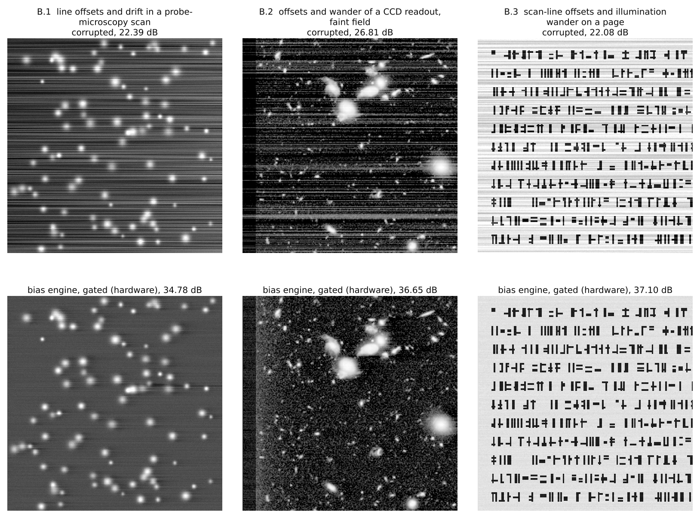
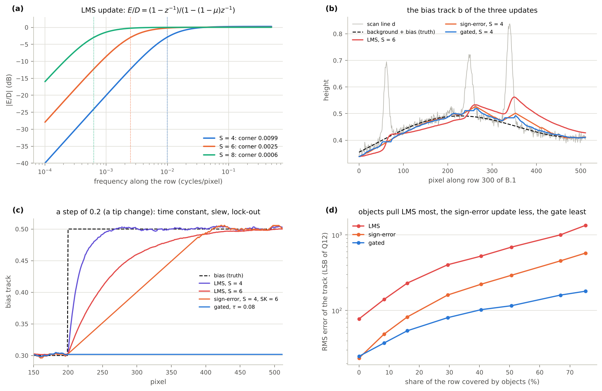
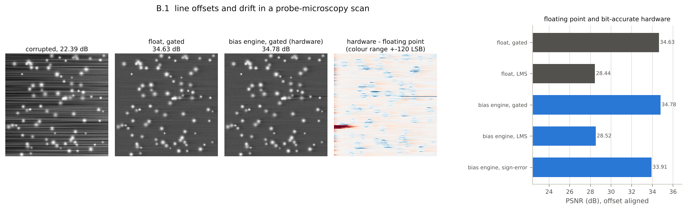
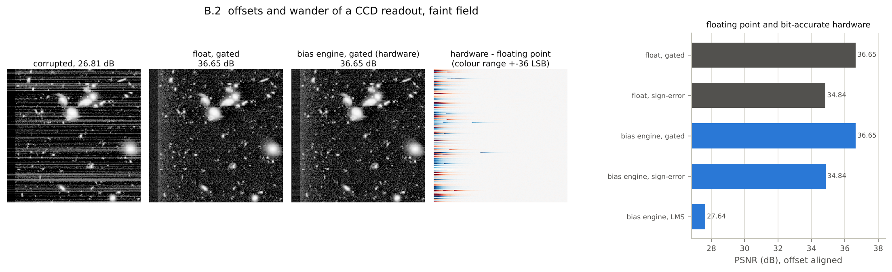
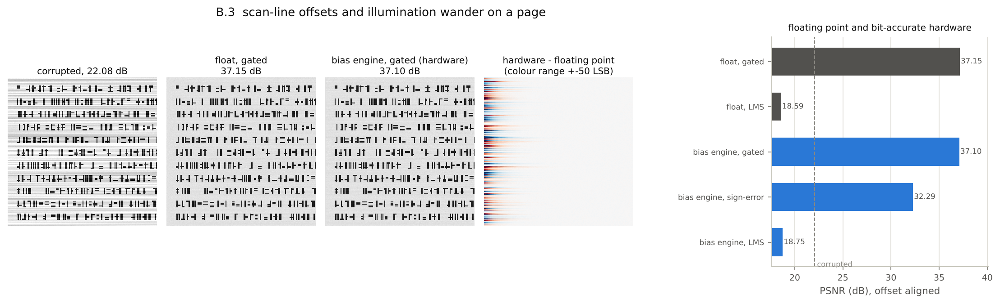

# Scenario B: bias (drift) canceller

[Contents](../../README.md#contents) · previous: [A](A.md) · next: [C](C.md)

A slowly varying offset along every scan line is interference whose reference is the constant 1. One weight, the
bias $b$, follows it; the output is $d-b$. With $x=1$ the multipliers of LMS disappear, and the whole canceller is
an adder loop that runs at one pixel per clock. What remains to design is the update: plain LMS lets every object
pull the bias, a sign-error update follows the median, a gated update skips the objects.

<p align="center"></p>

| | |
|---|---|
| interference | an offset and a drift along each scan line, $b(i,j)$ |
| reference | the constant 1 (no tap, no multiplier) |
| output | $e=d-b$ |
| architectures | **B1** LMS, **B2** sign-error, **B3** gated: one datapath, `MODE` 0, 1, 2 |
| RTL | [`rtl/scenarios/scen_b_top.v`](../../rtl/scenarios/scen_b_top.v) |
| HLS C++ | [`hls/src/scen_b.cpp`](../../hls/src/scen_b.cpp), `scen_b_top` |
| examples | [B.1](#b1-line-offsets-and-drift-in-a-probe-microscopy-scan) probe microscopy · [B.2](#b2-offsets-and-wander-of-a-ccd-readout-faint-field) CCD readout · [B.3](#b3-scan-line-offsets-and-illumination-wander-on-a-page) scanned page |
| smoke test | `python smoke/smoke.py B`: `B_lms`, `B_sign`, `B_gated` |
| algorithm | [companion repository, scenario B](https://github.com/VKHS/Adaptive-Filters-for-Image-Denoising/blob/main/docs/B_bias_drift.md) |

## 1. The problem

Along scan line $i$,

$$d(j)=x(j)+b(j)+n(j),$$

where $b$ is an offset that changes from line to line plus a drift that changes slowly along the line (thermal
drift of a probe microscope, the readout electronics of a CCD, the illumination of a scanner), $x$ is the scene and
$n$ read noise. The scenes where a 1-D canceller is the right tool have a **flat background with objects on it**:
probe-microscopy scans, faint astronomical fields, printed pages, fluorescence images. There $b$ is the level of
the background, and the objects are what must not move it.

## 2. The algorithm

<p align="center"></p>

### 2.1 LMS on the constant reference

With $x=1$ the filter output is the weight itself, $y=b$, the error is $e=d-b$, and LMS gives

$$b(n+1)=b(n)+\mu\,e(n)=(1-\mu)\,b(n)+\mu\,d(n):$$

an exponential running mean of $d$. From $E=D-B$ and $zB=B+\mu E$,

$$H(z)=\frac{E(z)}{D(z)}=\frac{z-1}{z-(1-\mu)},$$

a first-order high-pass with its zero at DC and its pole at $1-\mu$: the corner is near $\mu$ rad/sample,
$\mu/2\pi$ cycles/pixel, and $b$ follows the drift with a time constant of $1/\mu$ pixels (panel (a): corners of
0.0099, 0.0025 and 0.0006 cycles/pixel for $S=4$, 6 and 8, $\mu=2^{-S}$). Everything below the corner is removed:
the offset, the drift, **and the low frequencies of the scene**. On a flat background that is what is wanted; on a
natural image it is not (see [2.5](#25-beyond-the-scan-line)).

An object of height $h$ and width $w$ adds about $\mu hw$ to $b$ while the canceller passes it, which leaves a
dark shadow behind every object that relaxes with the time constant $1/\mu$ (panel (b), red).

### 2.2 Sign-error: the running median

$$b(n+1)=b(n)+\mu_s\,\mathrm{sgn}\big(e(n)\big).$$

The stationary point of $E[\mathrm{sgn}(d-b)]=0$ is the **median** of $d$, which an object covering less than half
of the recent pixels cannot move by more than the step times its width. The step is fixed, $\mu_s$ per pixel
whatever the error: the update follows a drift whose slope is below $\mu_s$ and no faster (panel (c): a step of 0.2
takes $0.2/\mu_s\approx200$ pixels at $\mu_s=4/4096$). It has no time constant, a **slew rate**.

### 2.3 Gated: the mean of the background

$$b(n+1)=\begin{cases}b(n)+\mu\,e(n) & |e(n)|<\tau\\ b(n) & \text{otherwise.}\end{cases}$$

Pixels farther than $\tau$ from the current bias are not used: $b$ is the running mean of the pixels within $\tau$
of it, which on a flat background are the background pixels. $\tau$ must pass the background's error (read noise
and tracking error) and stop the objects. Two consequences, both visible in panel (c):

* a jump of the bias larger than $\tau$ (a tip change, a new frame region) is never followed: **lock-out**;
* the start matters: if $b$ starts on an object, the background is farther than $\tau$ and is never used. The
  hardware starts every row at $b=d(0)$, so the first pixel of a row must be background (example B.2 has prescan
  pixels for that).

### 2.4 Objects against the three updates

Panel (d) sweeps the share of a 512-pixel row covered by objects (Gaussian bumps of height 0.25 to 0.5 on a
background of 0.3 with a sinusoidal drift, 60 rows per point, the first 32 pixels of each row left out). The RMS
error of the track:

| coverage | 0 % | 8 % | 16 % | 29 % | 41 % | 51 % | 67 % | 75 % |
|---|---|---|---|---|---|---|---|---|
| LMS, $S=6$ | 78 | 140 | 231 | 404 | 526 | 691 | 1004 | 1341 |
| sign-error, $S=4$, $S_K=6$ | 24 | 49 | 82 | 160 | 223 | 293 | 455 | 576 |
| gated, $S=4$, $\tau=0.08$ | 25 | 37 | 54 | 81 | 103 | 116 | 160 | 180 |

(LSB of Q12; 4096 = 1.0.) Without objects the LMS track errs by 78 LSB because its time constant at $S=6$
(64 pixels) lags the drift; the gate costs nothing there. With objects, the LMS error grows with their mean, the
sign-error one with the shift of the median, and the gated one only through the object edges, where the error is
still below $\tau$.

### 2.5 Beyond the scan line

On natural images with row banding the companion repository runs the bias weight **line to line**: the primary is
row $i$, the reference the previous corrected row, and the sequence of row offsets $b_i$ is high-passed across rows
(a Gaussian of 16 rows) so that slow scene shading survives. In hardware this is the same one-weight datapath on
the difference of two rows (one row buffer) and a small filter over the scalars $b_i$. Because that filter is
two-sided, the correction of row $i$ needs offsets of later rows: either a frame of latency or the previous frame's
offsets. It is not implemented here; when optical-black columns exist, [scenario F](F.md) measures the offsets
instead of inferring them and is the better design.

## 3. The architecture (RTL)

<p align="center"></p>

With $x=1$ the filter product $w\,x$ is $w$ itself and the update product $e\,x$ is $e$: **the multipliers
disappear**. [`scen_b_top`](../../rtl/scenarios/scen_b_top.v) keeps $b$ in an accumulator $B$ with $F_D+S$
fractional bits, so that $\mu=2^{-S}$ is a bit position and every update is exact (no stalling):

$$b=\mathrm{sat}\big(B\gg S\big),\qquad e=\mathrm{sat}(d-b),\qquad B\leftarrow B+\Delta,$$

| code | `MODE` | $\Delta$ | what $b$ converges to |
|---|---|---|---|
| **B1** | 0, LMS | $e$ | the running mean of $d$ ($\mu=2^{-S}$) |
| **B2** | 1, sign-error | $\mathrm{sgn}(e)\,2^{S_K}$ | the running median: $b$ moves by exactly $2^{S_K-S}$ codes per pixel |
| **B3** | 2, gated | $e$ if $\lvert e\rvert<\tau$, else 0 | the mean of the background: object pixels are skipped |

The first pixel of a row loads $b=d(0)$ (the software starts at the median of the first eight pixels, which would
need an eight-pixel delay and a sorting network). The loop $B\to b\to e\to\Delta\to B$ holds one register, two
saturations, the subtractor, the mode logic and the adder: carry chains of $W_D+S+2$ bits and multiplexers, no
multiplier. It runs at **one pixel per clock without pipelining**, and Yosys counts 146 LUTs, 73 flip-flops and no
DSP slice for the gated version at $W=512$.

The LMS mode is linear, so its loop could be pipelined by look-ahead: $b(n+M)=(1-\mu)^Mb(n)+\mu\sum_{i<M}(1-\mu)^id(n+M-1-i)$
needs only constant coefficients ([Parhi 1999](../references.md#parhi1999)). The sign and gated modes are
nonlinear and cannot be unrolled this way; at one pixel per clock they do not need to be.

**Ports and parameters.** `in_pix`/`in_valid`/`in_ready`, `out_pix` (the output $e$) and `out_bias` (the track
$b$) with `out_valid`; parameters `W`, `S`, `MODE`, `SK`, `TAU` (in codes: 328 = 0.08).

## 4. The HLS C++ implementation

```cpp
void scen_b_top(hls::stream<pix_t>& pix_in, hls::stream<pix_t>& pix_out, hls::stream<pix_t>& bias_out);

    const int WB = 16 + B_S + 2;                    // the accumulator B: F_D + S fraction bits
    sint<WB> bacc = 0;
ROWS:
    for (int i = 0; i < B_H; i++) {
    COLS:
        for (int j = 0; j < B_W; j++) {
#pragma HLS PIPELINE II=1
            const pix_t d = pix_in.read();
            const sint<WB> be = (j == 0) ? sint<WB>(sint<WB>(d) << B_S) : bacc;   // row start: b = d
            const pix_t b = sat<16>(be >> B_S);
            const pix_t e = sat<16>(sint<17>(d) - sint<17>(b));
            sint<WB> step;
            if (B_MODE == 0) step = e;                                               // LMS
            else if (B_MODE == 1) step = sint<WB>(sgn(e)) * sint<WB>(1 << B_SK);     // sign-error
            else {                                                                   // gated
                const sint<17> ae = (e < 0) ? sint<17>(-sint<17>(e)) : sint<17>(e);
                step = (ae < B_TAU) ? sint<WB>(e) : sint<WB>(0);
            }
            bacc = narrow<WB>(be + step);
            pix_out.write(e);
            bias_out.write(b);
        }
    }
```

[`hls/src/scen_b.cpp`](../../hls/src/scen_b.cpp) is the loop above: one `ap_int<W_D+S+2>` register carried from
pixel to pixel, so the dependence distance of the loop is one and II = 1 needs the loop body (two saturations, a
subtraction, the mode multiplexer, an addition) within one clock, exactly as in the RTL. `sgn(e)` times a power
of two is a sign-extended shift, not a multiplier. Configuration: `B_W`, `B_H`, `B_S`, `B_MODE`, `B_SK`, `B_TAU`.
The three streams are AXI4-Stream ports. Targets for Vitis HLS ([`hls/README.md`](../../hls/README.md)), to be
replaced by the measured values: II $\color{red}{1}$, $\color{red}{0}$ DSP, $\color{red}{\text{about 150}}$ LUT.

## 5. Examples

Each example is computed on the bit-accurate model and reproduced word for word (output and bias track) by the
HLS C++ top and the Verilog top over the whole frame ([`results/examples_hw.csv`](../../results/examples_hw.csv)).
The canceller removes the mean level of every line along with its offset, so PSNR is measured after aligning the
mean offset of the whole image.

### B.1 Line offsets and drift in a probe-microscopy scan

A synthetic probe-microscopy scan of 90 objects (Gaussian bumps of height 0.25 to 0.5) on a background of 0.3,
with a line offset ($\sigma=0.05$), a sinusoidal wander along each line (amplitude 0.05 to 0.08, 0.8 cycles per
line), a ramp of 0.1 across the line and read noise ($\sigma=0.01$).

<p align="center"></p>

| | floating point | `scen_b_top` | SSIM (hardware) |
|---|---|---|---|
| corrupted | 22.39 dB | | 0.281 |
| B1, LMS | 28.44 dB ($\mu=0.02$) | 28.52 dB ($S=6$) | 0.671 |
| B2, sign-error | | 33.91 dB ($S=4$, $S_K=6$) | 0.830 |
| B3, gated, $\tau=0.08$ | 34.63 dB ($\mu=0.05$) | **34.78 dB** ($S=4$) | 0.858 |

The gated engine scores 0.15 dB above the floating-point run because it starts each row at $b=d(0)$ instead of the
median of eight pixels: the floating-point canceller with the same start and $\mu=2^{-4}$ gives 34.77 dB.

**Tuning B2: match the slew rate to the drift.** The steepest drift in this scene is the wander,
$0.08\cdot2\pi\cdot0.8/512=7.9\cdot10^{-4}$ per pixel, plus the ramp, $0.1/512=2.0\cdot10^{-4}$:
$9.8\cdot10^{-4}$ per pixel, or 4.0 codes. With $S=4$:

| $S_K$ | step (codes per pixel) | PSNR (offset aligned) |
|---|---|---|
| 5 | 2 | 29.69 dB |
| **6** | **4** | **33.91 dB** |
| 7 | 8 | 32.84 dB |
| 8 | 16 | 29.89 dB |

The best step equals the steepest drift: a smaller one cannot follow it, a larger one adds jitter and lets $b$
climb over objects by up to (object width) $\times\,2^{S_K-S}$ codes.

**Tuning B3: $\tau$ between the noise and the objects.** $\tau=0.08$ (328 codes) passes the background error and
stops the objects. With $S=4$ the gated engine gives 34.78 dB; $S=3$ (32.07 dB) tracks too nervously, $S=5$
(33.48 dB) too slowly.

| implementation | configurations | words compared | equal to the model |
|---|---|---|---|
| HLS C++, whole frame | gated, LMS, sign-error | 262 144 (output and track) each | all |
| RTL, whole frame | gated, LMS, sign-error | 262 144 (output and track) each | all |

### B.2 Offsets and wander of a CCD readout, faint field

A faint astronomical field read out by a CCD whose rows start with 16 **prescan** pixels (no light, only the
offset): a row offset ($\sigma=0.04$), a sinusoidal wander (0.03, 0.5 to 1.5 cycles per row) and read noise
($\sigma=0.008$). The sky is flat and dark, the galaxies are bright and cover large parts of some rows. The prescan
gives the gated update the start on background that it needs (2.3); PSNR is measured on the 496 scene columns.

<p align="center"></p>

| | floating point | `scen_b_top` | SSIM (hardware) |
|---|---|---|---|
| corrupted | 26.81 dB | | 0.617 |
| B1, LMS ($S=6$) | | 27.64 dB | 0.793 |
| B2, sign-error ($S=4$, $S_K=6$) | 34.84 dB ($\mu_s=2^{-10}$) | 34.84 dB | 0.919 |
| B3, gated, $\tau=0.08$ ($S=4$) | 36.65 dB ($\mu=2^{-4}$) | **36.65 dB** | 0.942 |

Without the prescan, the rows that begin on a galaxy would start the gated update on the galaxy, the lock-out of
panel (c). The prescan, which a CCD has anyway, makes the first pixel of every row dark.

| implementation | configurations | words compared | equal to the model |
|---|---|---|---|
| HLS C++, whole frame | gated, sign-error, LMS | 262 144 (output and track) each | all |
| RTL, whole frame | gated, sign-error, LMS | 262 144 (output and track) each | all |

### B.3 Scan-line offsets and illumination wander on a page

A synthetic printed page (lines of glyph-like strokes, ink 0.12 on paper 0.88) scanned line by line, each line
with its own offset ($\sigma=0.05$) and an illumination wander of up to $\pm0.12$ along it, plus noise
($\sigma=0.01$). Here the objects are **darker** than the background: ink covers 29 % of a scan line through
text on average and up to 43 %.

<p align="center"></p>

| | floating point | `scen_b_top` | SSIM (hardware) |
|---|---|---|---|
| corrupted | 22.08 dB | | 0.679 |
| B1, LMS | 18.59 dB ($\mu=0.02$) | 18.75 dB ($S=6$) | 0.779 |
| B2, sign-error ($S=4$, $S_K=6$) | | 32.29 dB | 0.937 |
| B3, gated, $\tau=0.08$ ($S=4$) | 37.15 dB ($\mu=2^{-4}$) | **37.10 dB** | 0.955 |

Plain LMS makes the page **worse** than the corrupted scan: the mean of a text line is pulled down by the ink, so
every line of text gets a bright band around it. The gate removes the problem; the median update, pulled by the
ink where it covers much of the line, stays 4.8 dB behind.

| implementation | configurations | words compared | equal to the model |
|---|---|---|---|
| HLS C++, whole frame | gated, sign-error, LMS | 262 144 (output and track) each | all |
| RTL, whole frame | gated, sign-error, LMS | 262 144 (output and track) each | all |

## 6. Smoke test

A 48 x 16 crop of a synthetic scan with a line offset and a ramp, through the RTL top (with 10 % random idle cycles)
and the HLS top; every output word and every word of the bias track must equal the model's:

| case | update | RTL | HLS C++ (int64 and ap_int) |
|---|---|---|---|
| `B_lms` | LMS, $S=6$ | PASS | PASS |
| `B_sign` | sign-error, $S=6$, $S_K=2$ | PASS | PASS |
| `B_gated` | gated, $S=4$, $\tau=0.08$ | PASS | PASS |

```bash
python smoke/smoke.py B
bash smoke/run_vitis.sh B          # with Vitis HLS installed: csim, csynth, cosim, comparison
```
