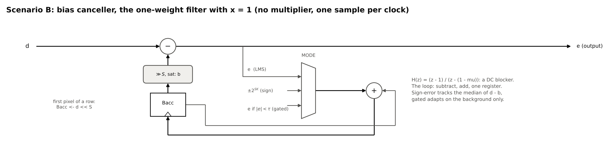
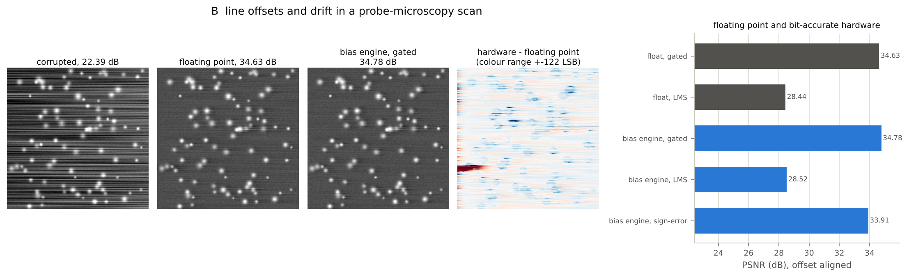

# Scenario B: bias (drift) canceller

[Contents](../../README.md#contents) · previous: [A](A.md) · next: [C](C.md)

**The algorithm** ([companion repository, scenario B](https://github.com/VKHS/Adaptive-Filters-for-Image-Denoising/blob/main/docs/B_bias_drift.md)).
A slowly varying offset along a scan line is interference whose reference is the constant 1. One weight $b$
multiplies it, the output is $e=d-b$, and LMS gives

$$b(n+1)=b(n)+\mu\,e(n),\qquad H(z)=\frac{E(z)}{D(z)}=\frac{z-1}{z-(1-\mu)},$$

a first-order high-pass with its zero at DC and its corner near $\mu$ rad/sample: $b$ follows the drift with a time
constant of about $1/\mu$ pixels. On scenes with a flat background (probe microscopy, documents, astronomy,
fluorescence) the objects must not pull $b$, which gives two robust variants of the update.

## One datapath, three updates

With $x=1$ the filter product $w\,x$ is $w$ itself and the update product $e\,x$ is $e$: **the multipliers
disappear**. [`scen_b_top`](../../rtl/scenarios/scen_b_top.v) keeps $b$ in an accumulator $B$ with $F_D+S$
fractional bits, so that $\mu=2^{-S}$ is a bit position and every update is exact (no stalling):

$$b=\mathrm{sat}\big(B\gg S\big),\qquad e=\mathrm{sat}(d-b),\qquad B\leftarrow B+\Delta,$$

| code | `MODE` | $\Delta$ | what $b$ converges to |
|---|---|---|---|
| **B1** | 0, LMS | $e$ | the running mean of $d$ ($\mu=2^{-S}$) |
| **B2** | 1, sign-error | $\mathrm{sgn}(e)\,2^{S_K}$ | the running median: $b$ moves by exactly $2^{S_K-S}$ codes per pixel |
| **B3** | 2, gated | $e$ if $\lvert e\rvert<\tau$, else 0 | the mean of the background: object pixels are skipped |

The first pixel of a row loads $b=d(0)$ (the software starts at the median of the first eight pixels, which would
need an eight-pixel delay and a sorting network). The loop $B\to b\to e\to\Delta\to B$ holds one register, two
saturations, the subtractor, the mode logic and the adder: carry chains of $W_D+S+2$ bits and multiplexers, no
multiplier. It runs at **one pixel per clock without pipelining**, and Yosys counts 146 LUTs, 73 flip-flops and no
DSP slice for the gated version at $W=512$.

The LMS mode is linear, so its loop could be pipelined by look-ahead: $b(n+M)=(1-\mu)^Mb(n)+\mu\sum_{i<M}(1-\mu)^id(n+M-1-i)$
needs only constant coefficients ([Parhi 1999](../references.md#parhi1999)). The sign and gated modes are
nonlinear and cannot be unrolled this way; at one pixel per clock they do not need to be.

## Design rules

**B2: match the slew rate to the drift.** The sign-error update moves $b$ by a fixed $2^{S_K-S}$ codes per pixel
whatever the error is, so it can follow a drift whose slope is below that step and no faster; a larger step adds
jitter and lets $b$ climb over objects by up to (object width) $\times\,2^{S_K-S}$ codes. In the example the steepest
drift is the wander, $0.08\cdot2\pi\cdot0.8/512=7.9\cdot10^{-4}$ per pixel, plus the ramp, $0.1/512=2.0\cdot10^{-4}$:
$9.8\cdot10^{-4}$ per pixel, or 4.0 codes. With $S=4$:

| $S_K$ | step (codes per pixel) | PSNR (offset aligned) |
|---|---|---|
| 5 | 2 | 29.69 dB |
| **6** | **4** | **33.91 dB** |
| 7 | 8 | 32.84 dB |
| 8 | 16 | 29.89 dB |

The best step is the one that equals the steepest drift.

**B3: $\tau$ between the noise and the objects.** The gate must pass the background error (read noise of
$\sigma=0.01$ plus the tracking error) and stop the objects (heights 0.25 to 0.5): $\tau=0.08$ (328 codes) does
both. With $S=4$ the gated engine gives 34.78 dB; $S=3$ (32.07 dB) tracks too nervously, $S=5$ (33.48 dB) too
slowly.

**B1** is the textbook canceller: on this scene every object leaves a shadow, because the mean follows the
objects.

## Results

Probe-microscopy scan with line offsets, a drift along every line and 90 objects
([examples](../06-results.md#61-application-examples)). The canceller removes the DC of every line, so PSNR is
measured after aligning the mean offset.

| | floating point | `scen_b_top` |
|---|---|---|
| corrupted | 22.39 dB | |
| B1, LMS | 28.44 dB ($\mu=0.02$) | 28.52 dB ($S=6$) |
| B2, sign-error | | 33.91 dB ($S=4$, $S_K=6$) |
| B3, gated, $\tau=0.08$ | 34.63 dB ($\mu=0.05$) | **34.78 dB** ($S=4$) |

The gated engine scores 0.15 dB above the floating-point run because it starts each row at $b=d(0)$ instead of the
median of eight pixels: the floating-point canceller with the same start and $\mu=2^{-4}$ gives 34.77 dB. The
arithmetic costs nothing measurable.

## Beyond the scan line

On natural images with row banding the companion repository runs the bias weight **line to line**: the primary is
row $i$, the reference the previous corrected row, and the sequence of row offsets $b_i$ is high-passed across rows
(a Gaussian of 16 rows) so that slow scene shading survives. In hardware this is the same one-weight datapath on
the difference of two rows (one row buffer) and a small filter over the scalars $b_i$. Because that filter is
two-sided, the correction of row $i$ needs offsets of later rows: either a frame of latency or the previous
frame's offsets. It is not implemented here; when optical-black columns exist, [scenario F](F.md) measures the
offsets instead of inferring them and is the better design.
