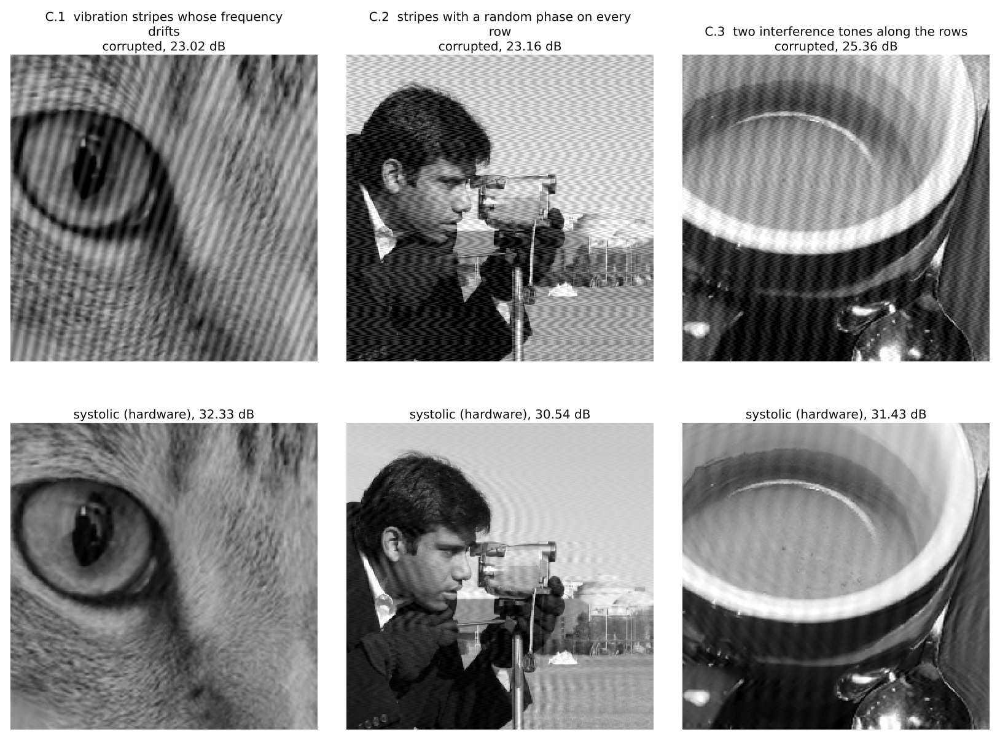
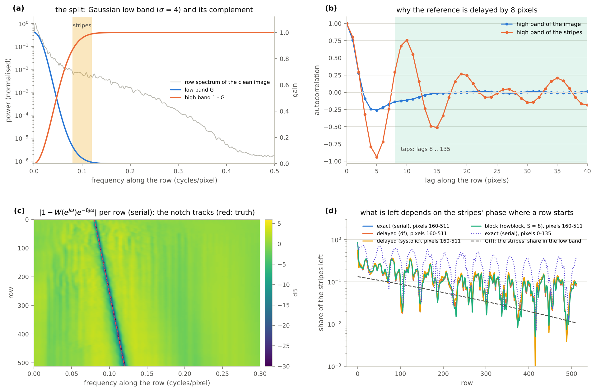
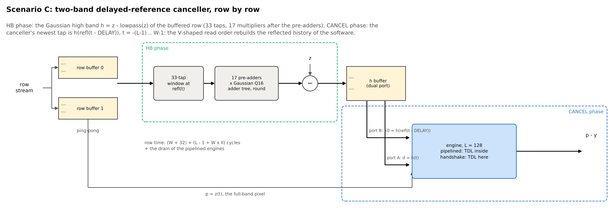
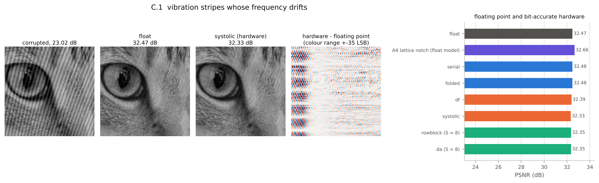
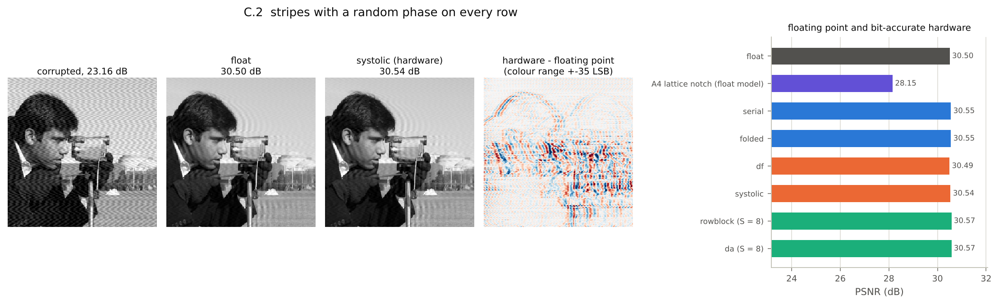
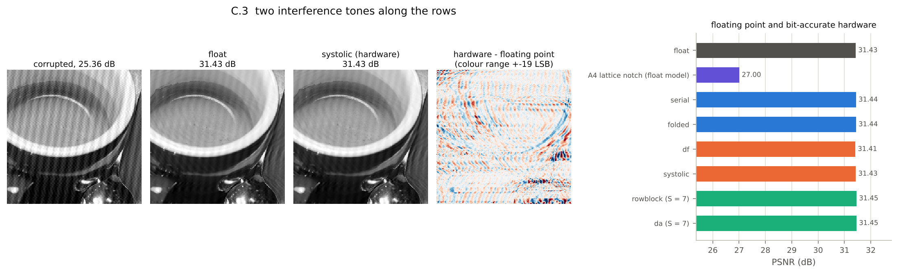

# Scenario C: periodic interference without a reference

[Contents](../../README.md#contents) · previous: [B](B.md) · next: [D](D.md)

When the frequency of the interference is unknown, drifts, or has a different phase on every row, and no sensor
sees it, the image is its own reference: a periodic component stays correlated across any delay, image detail does
not. A 128-tap predictor fed with the row's own high band, delayed by 8 pixels, predicts the interference and
nothing else, and the prediction is subtracted from the pixel. C is the hardware stress test of the repository:
128 taps, and a tap vector that must come from the row's own history.

<p align="center"></p>

| | |
|---|---|
| interference | periodic along the rows, frequency unknown or drifting, any phase per row |
| reference | the row's own Gaussian high band, delayed by $\Delta=8$: $L=128$ taps from a tapped delay line |
| output | the pixel minus the prediction, $z-y$ (`OUT = 2`) |
| architectures | **C1** `lms_serial`, **C2** `lms_folded`, **C3**/**C3′** `lms_df`/`lms_systolic`, **C4** `lms_rowblock`, **C5** `lms_da` |
| RTL | [`rtl/scenarios/scen_c_top.v`](../../rtl/scenarios/scen_c_top.v) |
| HLS C++ | [`hls/src/scen_c.cpp`](../../hls/src/scen_c.cpp), `scen_c_top` |
| examples | [C.1](#c1-vibration-stripes-whose-frequency-drifts) drifting stripes · [C.2](#c2-stripes-with-a-random-phase-on-every-row) random phase per row · [C.3](#c3-two-interference-tones-along-the-rows) two tones |
| smoke test | `python smoke/smoke.py C`: `C_folded`, `C_df`, `C_rowblock` |
| algorithm | [companion repository, scenario C](https://github.com/VKHS/Adaptive-Filters-for-Image-Denoising/blob/main/docs/C_periodic_noref.md) |

## 1. The problem

Along row $i$,

$$d(j)=x(j)+p(j)+n(j),\qquad p(j)=\sum_m a_m\cos\big(2\pi f_m(i)\,j+\varphi_m(i)\big),$$

stripes from vibration, a scanning mechanism or electrical pickup, whose frequencies $f_m$ may drift from row to
row and whose phases $\varphi_m$ may be anything. Nothing about $p$ is known except that it is periodic within a
row. Scenario A would need $(u,v)$ for every component; C needs nothing.

## 2. The algorithm

<p align="center"></p>

### 2.1 Prediction across a delay

A periodic $p$ is predictable from its own past at any distance: $p(j)$ is a linear combination of $p(j-\Delta-k)$,
$k=0..L-1$, for any $\Delta$ once $L$ covers a period. Detail and noise are not predictable beyond their correlation
length. So the linear predictor

$$y(j)=\sum_{k=0}^{L-1}w_k\,h(j-\Delta-k),\qquad e(j)=h(j)-y(j),\qquad w\leftarrow w+\mu\,e\,\mathbf h_{j-\Delta},$$

converges to the Wiener predictor of the part of $h$ that is correlated across the delay, the interference, and the
output $\text{out}(j)=z(j)-y(j)$ is the pixel without it. The weights are carried from row to row, so a stationary
or slowly drifting interference is learned once and tracked.

### 2.2 The two-band split

Natural images are not white: their low frequencies are predictable too, and a predictor on the full band would
remove scene content. The predictor therefore runs on the **Gaussian high band** of each row,

$$h=z-g_\sigma*z,\qquad \sigma=4,$$

where edges and texture are close to white and the stripes pass almost unchanged (panel (a)): the low band
$G(f)$ keeps 13 % of the amplitude at 0.08 cycles/pixel, 4 % at 0.10, 1 % at 0.12 and nothing at 0.16. The low
band never meets the canceller, which also means that **the share $G(f)$ of the stripes that lies in the low band
is never removed**: 21 % at 0.07 cycles/pixel, the lower tone of example C.3.

### 2.3 Why the delay is 8 pixels

Panel (b) is the autocorrelation along the rows of the two components of example C.1. The high band of the image
falls to $-0.25$ at lag 5 and stays within $\pm0.14$ from lag 8 on. The stripes' autocorrelation oscillates with
their period (0.76 at lag 10, $-0.51$ at lag 15) and decays only because the period changes from row to row. With
the taps at lags 8 to 135, the predictor sees the stripes' history and little of the image's.

### 2.4 Tracking a drifting frequency

The canceller's response at the stripe frequency is $|1-W(e^{j\omega})e^{-j8\omega}|$, with $W$ the transfer of the
128 weights. Panel (c) draws it for every row of C.1, from the weights at the end of the row: a notch that moves
with the stripes from 0.08 to 0.12 cycles/pixel (red: the true frequency), 25.5 dB deep at the true frequency in the
median row (20 to 34 dB in 80 % of the rows).

### 2.5 The start of a row

The row has no past, so the tapped delay line starts with the reflected history: at pixel $j$ it holds
$x_k(j)=h(\mathrm{refl}(j-8-k))$, the software's `np.pad(…, mode="reflect")`. The mirrored stripes agree with the
real ones only when their phase at the row start is $0$ or $\pi$. In C.1 that phase advances by 0.0131 cycles per
row, so the agreement returns every $0.5/0.0131\approx38$ rows. Panel (d) shows the consequence: the share of the
stripes left in the output (the projection of $\text{out}-x$ on $p$) is largest in the first 136 pixels of a row and
oscillates with a period of 38 rows; where the reflection agrees, it falls to the floor set by the low band, $G(f)$.
The median share left is 0.28 in the first 136 pixels of a row and 0.10 after them, the same for the four engine
classes.

## 3. The architecture (RTL)

<p align="center"></p>

[`scen_c_top`](../../rtl/scenarios/scen_c_top.v) processes a frame row by row
([4.2](../04-front-ends.md#42-scenario-c-high-band-and-the-reflected-history)):

1. **Row buffers.** A row enters one of two row buffers (ping-pong), so the next row can arrive while one is
   processed.
2. **HB phase.** $h(j)=z(j)-\mathrm{lowpass}(z)(j)$ with a 33-tap symmetric Gaussian (Q16 coefficients that sum to
   exactly $2^{16}$, so a constant row has an exactly zero high band) and reflected borders: the buffer is read at
   $\mathrm{refl}(t)$, $t=-16..W+15$. 17 multipliers after the pre-adders (the smallest coefficient, 2, is a
   shift), an adder tree, rounding. $h$ goes to a third buffer.
3. **CANCEL phase.** Steps $t=-(L-1)..W-1$ feed the newest tap $x_0(t)=h(\mathrm{refl}(t-\Delta))$, a V-shaped read
   order at the start of the row; $t<0$ are pre-roll shifts, $t\ge0$ are samples with $d=h(t)$ and $p=z(t)$. The
   engine's output is $p-y$.

Pipelined engines keep the tapped delay line inside (`TDL = 1`) and get `DRAIN_ROW` drain steps after each row;
handshake engines get the tap vector from a delay line kept in the top.

| code | engine | multipliers (engine) | $II$ | $D$ | cycles per 512-pixel row |
|---|---|---|---|---|---|
| **C1** | `lms_serial` | 1 | 259 | 0 | about 133 300 |
| **C2** | `lms_folded`, $P=8$ | 16 | 24 | 0 | about 13 000 |
| **C3** | `lms_df` (TDL) | 256 | 1 | 10 | about 1 200 |
| **C3′** | `lms_systolic` (TDL), the systolic form of C3 | 256 | 1 | 131 | about 1 200 |
| **C4** | `lms_rowblock` (TDL) | 256 | 1 | one row | about 1 200 |
| **C5** | `lms_da` | 0 | 24 | one row | about 13 000 |

A row costs $W+32$ cycles of high band, $L-1$ pre-roll shifts and $W\cdot II$ cycles of cancelling (plus the
drain of the pipelined engines). At a 200 MHz reference clock (a reference for comparison, not a timing result) a
512 x 512 frame takes 0.34 s with C1, 33 ms with C2 and C5, and 3 ms with C3 and C4: **C2 is the smallest exact
design that just meets 512 x 512 at 30 frames/s** (33.2 ms per frame), and the pipelined engines are needed
beyond that.

Yosys counts for the complete top at $W=512$ ([6.4](../06-results.md#64-synthesis)):

| top | DSP48E1 | LUT | FF | memory |
|---|---|---|---|---|
| C2, `lms_folded` $P=8$ | 32 (16 + 16 high band) | 3757 | 8115 | 2 RAMB18, 144 LUTRAM |
| C3′, `lms_systolic` | 272 (256 + 16) | 6646 | 9836 | 2 RAMB18, 96 LUTRAM |

The engine alone: `lms_df` takes 8145 LUTs at $L=128$, `lms_systolic` 5461 (its adders sit in the DSP cascade),
`lms_rowblock` 26 706 (a second 48-bit accumulator per tap), `lms_da` 36 469 and no DSP slice.

**Ports and parameters.** A valid/ready pixel stream in and out; parameters `W`, `HH`, `L`, `DELAY`, `ENGINE`,
`P`, `S`, `DRAIN_ROW`, `DRAIN_FRAME`.

### The price of each way around the loop

**Delay.** The worst $64\times64$ tile has $\mu\lambda_{\max}=0.0023$ at $\mu=2^{-7}$
([1.3](../01-foundations.md#images-are-not-stationary)). `lms_df` ($D=10$, bound 0.149) is 65 times inside the
bound and loses 0.09 dB; `lms_systolic` ($D=131$, bound 0.012) is 5 times inside and loses 0.15 dB. The sweep over
$D$ on example C.1:

| $D$ | 0 | 2 | 4 | 10 | 16 | 32 | 64 | 131 | 256 | 512 |
|---|---|---|---|---|---|---|---|---|---|---|
| PSNR (dB) | 32.48 | 32.45 | 32.43 | 32.39 | 32.39 | 32.38 | 32.36 | 32.33 | 32.46 | 32.74 |

The loss grows slowly up to $D\approx L$. Beyond, the PSNR rises again: at $D=512$ the update computed at a pixel
is applied at the same column of the next row, a schedule close to the row-block update, which suits these
stripes. The bound still holds there ($0.0031$ against $0.0023$); at $D=1024$ it would not.

**Block.** For C.1 the worst row has $512\,\lambda_{\max,\text{row}}=193$, so the row-block engines need $S\ge7$
($\mu N\lambda=1.51$); $S=6$ ($3.02$) diverges, exactly as predicted
([1.4](../01-foundations.md#14-blocking-the-update-row-block-lms)). At $S=7$ the row-block engine gives 32.54 dB,
0.06 dB above exact LMS at the same step (32.48 dB). The examples keep a factor of two from the bound,
$\mu N\lambda_{\max,\text{row}}\le1$, which is $S=8$ in C.1 and C.2 and $S=7$ in C.3.

**Fold.** C2 keeps exact LMS and C5 the block update at $II=24$; they pay in time instead. With the high-band
phase of every row included, 512 x 512 at 30 frames/s needs a clock of about 200 MHz for either.

## 4. The HLS C++ implementation

[`hls/src/scen_c.cpp`](../../hls/src/scen_c.cpp) has the three phases of the RTL as three loops per row:

```cpp
void scen_c_top(hls::stream<pix_t>& pix_in, hls::stream<pix_t>& pix_out, bool reset);

ROWS:
    for (int r = 0; r < H; r++) {
    READ:
        for (int c = 0; c < W; c++) {
#pragma HLS PIPELINE II=1
            z[c] = pix_in.read();                              // the row (a block RAM)
        }
    HB:
        for (int t = -GH; t < W + GH; t++) {
#pragma HLS PIPELINE II=1
            /* shift the 33-sample window: zw[2GH] = z[refl(t, W)] */
            if (t >= GH) {
                sint<48> lp = sint<48>(1LL << (GF - 1)) + sint<48>(GCOEF[0]) * zw[GH];
                for (int m = 1; m <= GH; m++) {                // UNROLL: 16 pre-adders, 16 products
#pragma HLS UNROLL
                    lp += sint<48>(GCOEF[m]) * sint<18>(sint<17>(zw[GH - m]) + zw[GH + m]);
                }
                h[t - GH] = sat<16>(sint<17>(z[t - GH]) - sint<17>(lp >> GF));
            }
        }
    CANCEL:
        for (int t = -(L - 1); t < W; t++) {
            ENGINE_STEP_PIPELINE()                             // PIPELINE II=1 for the delayed and block classes
            /* shift the tapped delay line: tdl[0] = h[refl(t - C_DELAY, W)] */
            const bool valid = t >= 0;
            const int j = valid ? t : 0;
            if (valid || ENGINE_WANTS_EMPTY_STEPS) {           // pre-roll: empty steps for the delayed class
                ENGINE_STEP(valid, valid && j == W - 1, tdl, h[j], z[j], true, gate_s, o, flag);
                if (valid) pix_out.write(o);                   // o = sat(z - y)
            }
        }
    }
```

* **The tapped delay line** `tdl` is `ENG_TDL_LEN` registers (`ARRAY_PARTITION complete`): $L$ for the exact and
  block classes, $L+D$ for the delayed class, whose updates need the taps of step $s-D$ (`delayed_step_tdl`): the
  same chain of $L+D$ words as `lms_df` and `lms_systolic` with `TDL = 1`.
* **Empty steps.** The delayed class must see the pre-roll steps as empty steps, which advance its queue of pending
  updates exactly as the RTL's pre-roll does; the other classes only shift.
* **Pre-adders.** Each sum of two mirrored samples is formed in 18 bits, `sint<18>(sint<17>(a) + b)`, signed:
  the high band of a row with negative codes comes out right. The RTL needs the same care: in Verilog a
  concatenation makes a whole conditional expression unsigned, and the pre-adder of `scen_c_top` zero-extended its
  sum until the example runs with negative codes showed it. It sign-extends now, and the smoke and regression cases
  of C use signed codes.
* **Configuration**: `C_W`, `C_H`, `C_L`, `C_DELAY`, `C_S`, `ENGINE`, `ENG_P`.

Targets for Vitis HLS, to be replaced by the measured values ([`hls/README.md`](../../hls/README.md)):

| `ENGINE` | cycles per row ($W=512$) | DSP |
|---|---|---|
| 1, $P=8$ (exact) | $\color{red}{\approx W\,(16+\text{depth})+2W+32}$ | $\color{red}{16+\le17}$ |
| 2 (delayed, direct form) | $\color{red}{\approx 3W+L+32}$ | $\color{red}{256+\le17}$ |

The three loops of a row run one after the other (read, high band, cancel); the RTL overlaps the read of the next
row with the processing of the current one, which a `DATAFLOW` region over a row FIFO would do in HLS.

## 5. Examples

Every configuration of every example is reproduced word for word by the HLS C++ top over the whole frame. Icarus
Verilog simulates the 128-tap engines slowly (a few pixels per second for the 256-multiplier direct form), so the
Verilog top runs `lms_folded` on a strip of 16 rows of each example, from zero weights, against the model run on the
same strip; the pipelined Verilog engines are checked by the smoke test and the regression at $L=16$
([`sim/test_scenarios.py`](../../sim/test_scenarios.py)).

### C.1 Vibration stripes whose frequency drifts

Stripes of amplitude 0.10 whose frequency drifts from 0.08 to 0.12 cycles/pixel down the image, with a phase that
advances 0.013 cycles per row: $\mu=2^{-7}$ for the per-pixel engines, $2^{-8}$ for the block engines.

<p align="center"></p>

| | class | PSNR | SSIM |
|---|---|---|---|
| corrupted | | 23.02 dB | 0.437 |
| floating point | | 32.47 dB | 0.919 |
| C1 `lms_serial`, C2 `lms_folded` ($S=7$) | exact LMS | 32.48 dB | 0.919 |
| C3 `lms_df` ($D=10$) | delayed LMS | 32.39 dB | 0.918 |
| C3′ `lms_systolic` ($D=131$) | delayed LMS | 32.33 dB | 0.917 |
| C4 `lms_rowblock`, C5 `lms_da` ($S=8$) | block LMS | 32.35 dB | 0.917 |
| [A4](A.md#25-when-the-frequency-is-unknown-the-lattice-notch-a4) lattice notch, floating-point model | IIR | 32.66 dB | 0.922 |

C1 and C2 are bit-identical, and so are C4 and C5. What the systolic engine leaves beyond the floating-point
result (difference panel) is stripe residue, within 35 LSB (0.009) on 99.5 % of the pixels.

| implementation | configurations | words compared | equal to the model |
|---|---|---|---|
| HLS C++, whole frame | serial, folded, df, systolic, rowblock, da | 262 144 each | all |
| RTL, rows 100 to 115 | C2 `lms_folded` | 8192 | all |

### C.2 Stripes with a random phase on every row

Stripes at a fixed 0.1 cycles/pixel and amplitude 0.10 on the cameraman, with an independent random phase on every
row: no plane wave, so scenario A cannot model them, and the weights must not depend on the phase (they do not:
a predictor is phase-invariant). $\mu=2^{-8}$ for all engines.

<p align="center"></p>

| | class | PSNR | SSIM |
|---|---|---|---|
| corrupted | | 23.16 dB | 0.385 |
| floating point | | 30.50 dB | 0.845 |
| C1 `lms_serial`, C2 `lms_folded` ($S=8$) | exact LMS | 30.55 dB | 0.846 |
| C3 `lms_df` ($D=10$) | delayed LMS | 30.49 dB | 0.844 |
| C3′ `lms_systolic` ($D=131$) | delayed LMS | 30.54 dB | 0.846 |
| C4 `lms_rowblock`, C5 `lms_da` ($S=8$) | block LMS | 30.57 dB | 0.846 |
| A4 lattice notch, floating-point model | IIR | 28.15 dB | 0.790 |

| implementation | configurations | words compared | equal to the model |
|---|---|---|---|
| HLS C++, whole frame | serial, folded, df, systolic, rowblock, da | 262 144 each | all |
| RTL, rows 40 to 55 | C2 `lms_folded` | 8192 | all |

### C.3 Two interference tones along the rows

Two tones on a photograph: 0.06 at 0.07 cycles/pixel with a phase that advances 0.011 cycles per row, and 0.05 at
0.16 cycles/pixel with a random phase per row. $\mu=2^{-7}$ for all engines.

<p align="center"></p>

| | class | PSNR | SSIM |
|---|---|---|---|
| corrupted | | 25.36 dB | 0.513 |
| floating point | | 31.43 dB | 0.852 |
| C1 `lms_serial`, C2 `lms_folded` ($S=7$) | exact LMS | 31.44 dB | 0.853 |
| C3 `lms_df` ($D=10$) | delayed LMS | 31.41 dB | 0.852 |
| C3′ `lms_systolic` ($D=131$) | delayed LMS | 31.43 dB | 0.853 |
| C4 `lms_rowblock`, C5 `lms_da` ($S=7$) | block LMS | 31.45 dB | 0.853 |
| A4 lattice notch, floating-point model | IIR | 27.00 dB | 0.678 |

One set of 128 weights cancels both tones; one lattice section removes one line, so A4 would need a second section
here. The 0.07-cycle tone keeps 21 % of its amplitude in the low band (2.2), which no setting of the canceller
removes: the price of the split, paid here because the lower tone sits close to it.

| implementation | configurations | words compared | equal to the model |
|---|---|---|---|
| HLS C++, whole frame | serial, folded, df, systolic, rowblock, da | 262 144 each | all |
| RTL, rows 100 to 115 | C2 `lms_folded` | 8192 | all |

## 6. Smoke test

Six rows of 64 pixels with an oblique stripe pattern, centred so that about half of the codes are negative,
$L=16$, $\Delta=6$, $\mu=2^{-6}$; every output word must equal the model's:

| case | engine | RTL (Icarus, 10 % idle cycles) | HLS C++ (int64 and ap_int) |
|---|---|---|---|
| `C_folded` | `lms_folded`, $P=2$ (exact) | PASS | PASS |
| `C_df` | `lms_df` (delayed, $D=7$, TDL) | PASS | PASS |
| `C_rowblock` | `lms_rowblock` (block, TDL) | PASS | PASS |

```bash
python smoke/smoke.py C
bash smoke/run_vitis.sh C          # with Vitis HLS installed
```
