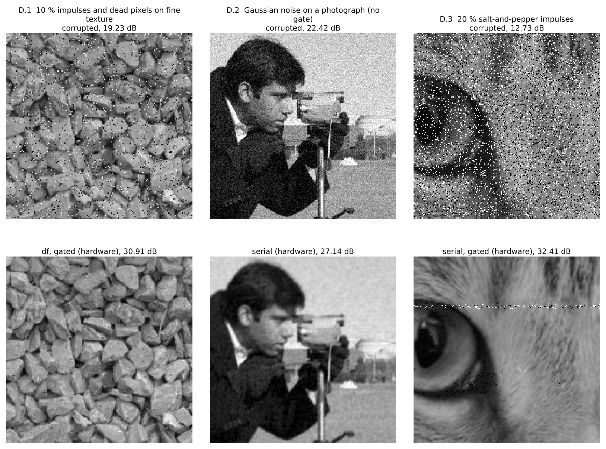
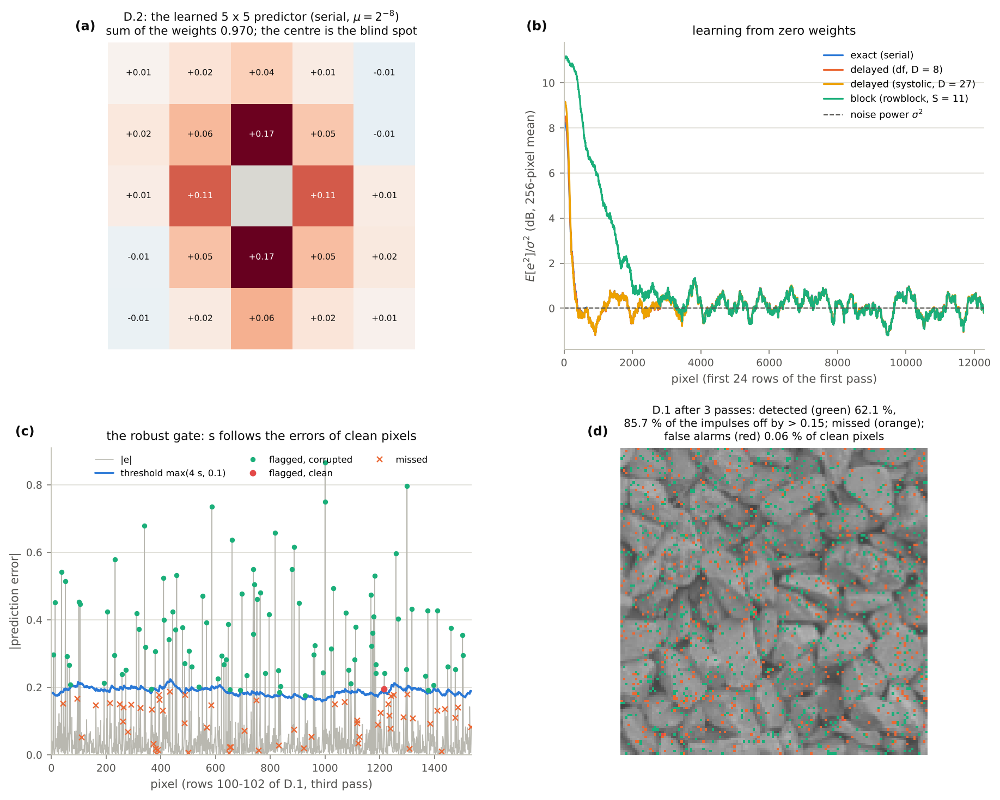
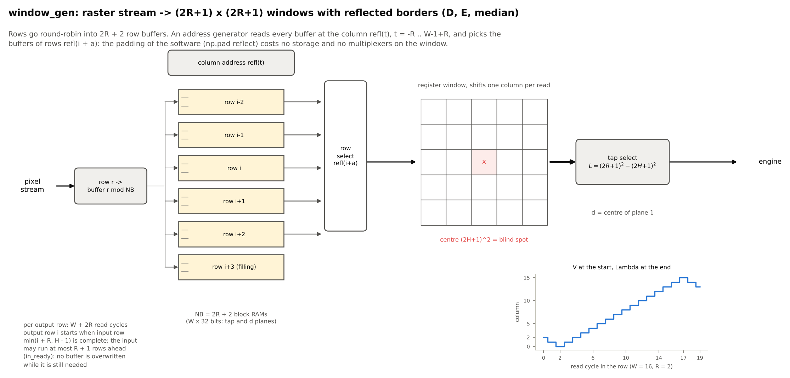
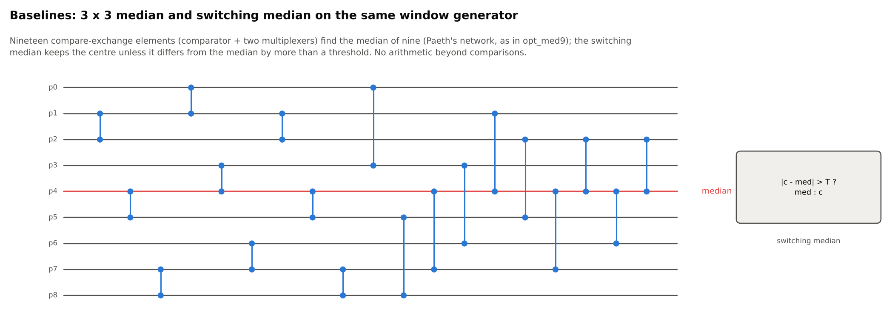
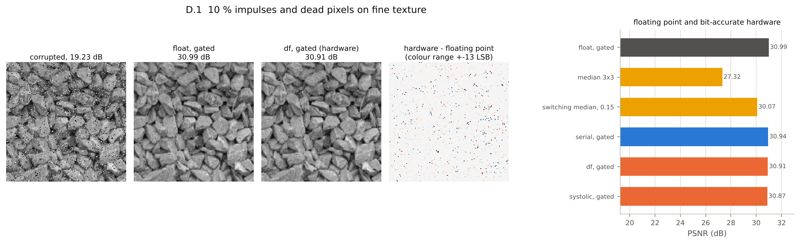
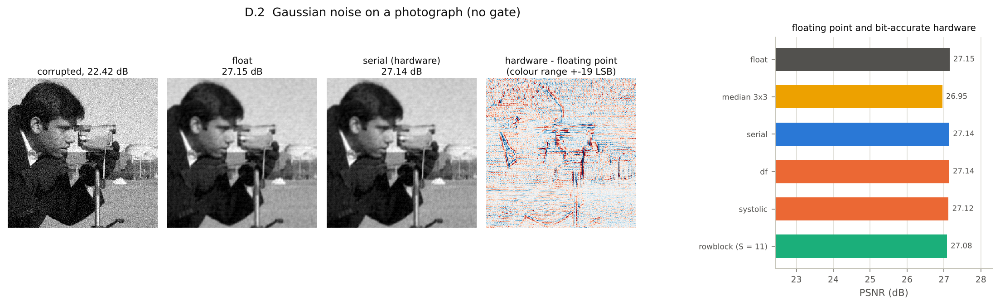
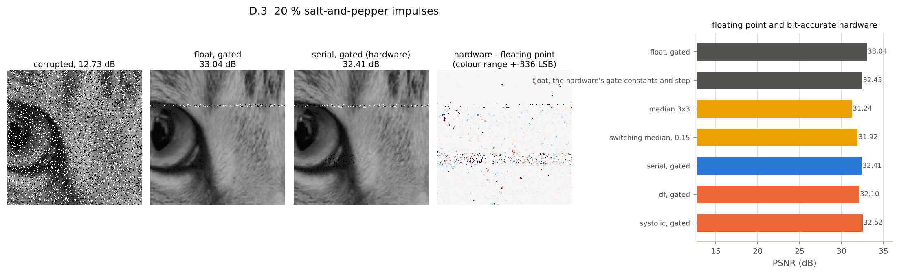

# Scenario D: self-tuning blind-spot predictor

[Contents](../../README.md#contents) · previous: [C](C.md) · next: [E](E.md)

Without any reference, a pixel is predicted from its $5\times5$ neighbourhood with the centre left out. Because the
centre's noise is invisible to the taps, minimising the prediction error tunes the filter towards the clean image,
which is never seen: the filter tunes itself on the noisy image alone. For sparse noise the prediction error is
also a detector, and the gated variant replaces only the pixels it flags.

<p align="center"></p>

| | |
|---|---|
| noise | white (Gaussian) or sparse (impulses, salt and pepper, dead pixels) |
| reference | the $5\times5$ window without its centre: $L=24$ taps from a window generator with reflected borders |
| output | the prediction $y$, or (gated) $y$ where the gate flags the pixel and $d$ elsewhere |
| architectures | **D1** `lms_serial`, **D2** `lms_folded`, **D3** `lms_df`, **D4** `lms_systolic`, **D5** `lms_rowblock`; median baseline |
| RTL | [`rtl/scenarios/scen_de_top.v`](../../rtl/scenarios/scen_de_top.v) (`R = 2`, `HOLE = 0`) |
| HLS C++ | [`hls/src/scen_de.cpp`](../../hls/src/scen_de.cpp), `scen_de_top` |
| examples | [D.1](#d1-impulses-and-dead-pixels-on-fine-texture) impulses on texture · [D.2](#d2-gaussian-noise-on-a-photograph) Gaussian noise · [D.3](#d3-salt-and-pepper-impulses) salt and pepper |
| smoke test | `python smoke/smoke.py D`: `D_gated_serial`, `D_gated_df`, `D_systolic` |
| algorithm | [companion repository, scenario D](https://github.com/VKHS/Adaptive-Filters-for-Image-Denoising/blob/main/docs/D_self_tuning.md) |

## 1. The problem

$$d(i,j)=x(i,j)+n(i,j),$$

with $n$ independent from pixel to pixel: white Gaussian noise of variance $\sigma^2$ (D.2), or sparse impulses
that replace a fraction of the pixels by random values (D.1) or by 0 and 1 (D.3). There is no second sensor and no
clean image to train on.

## 2. The algorithm

<p align="center"></p>

### 2.1 Why the blind spot makes self-tuning work

Predict the pixel from its neighbours, the centre excluded:

$$y(i,j)=\sum_{(a,b)\ne(0,0)}w_{ab}\,d(i+a,j+b),\qquad e(i,j)=d(i,j)-y(i,j),\qquad w\leftarrow w+\mu\,e\,\mathbf d_{\text{taps}} .$$

With $e=(x-y)+n$ at the centre,

$$E[e^2]=E[(x-y)^2]+2E[n\,(x-y)]+\sigma^2=E[(x-y)^2]+\sigma^2,$$

because $y$ is made of other pixels, whose noise is independent of the centre's, and $x$ is independent of $n$.
**The prediction error and the error against the clean image differ by a constant**, so LMS on the first minimises
the second. The Wiener solution is $w=R^{-1}p$ with $R$ the correlation of the taps (noise included on its
diagonal) and $p$ the correlation of the taps with the centre, which contains the signal only. Panel (b) shows the
consequence: $E[e^2]$ never falls below $\sigma^2$, and what it shows above $\sigma^2$ is the error of the image
estimate.

### 2.2 What the filter learns

Panel (a) is the kernel learned on D.2 (the cameraman with $\sigma=20/255$) after two passes: a smoothing kernel
shaped by the image, with 0.17 on the vertical neighbours and 0.11 on the horizontal ones, and a sum of 0.970.
The sum below one is the Wiener shrinkage: on centred pixels ($d$ minus the image mean) the estimate is pulled
towards the mean where the neighbourhood is noisy.

### 2.3 Learning

Panel (b) starts from zero weights. The exact engine and the two delayed engines reach the noise floor within
about 500 pixels, the delays of 8 and 27 samples change nothing visible. The block engine adapts once per row and,
at the step its bound allows ($\mu=2^{-11}$, against $2^{-8}$), needs about 3000 pixels.

### 2.4 The gate: the prediction error as a detector

For sparse noise most pixels are clean, and a corrupted pixel shows up as a large $|e|$. The gated variant
([`lms_err_unit`](../03-engines.md#37-the-shared-error-unit), `GATED = 1`):

* keeps a running scale $s\leftarrow s+2^{-7}(1.5\,|e|-s)$ of the errors of **clean** pixels (1.5 stands for the
  1.4826 of the software, the factor that turns a median absolute deviation into a standard deviation; a running
  mean of $|e|$ takes the median's place);
* flags a pixel when $|e|>\max(4s,\,t_{\min})$, $t_{\min}=0.1$;
* outputs $y$ for a flagged pixel and $d$ for a clean one, and adapts only on clean pixels;
* starts from the mean filter ($w=1/L$), so that it detects from the first pixel, and runs three passes, each
  taking its taps from the previous pass's output.

Panel (c) follows the gate through three rows of D.1 in the third pass: the threshold settles near 0.19, the large
errors are flagged, and what is missed are impulses whose prediction error stays below the threshold, mostly those
whose random value landed near the true one (the largest deviation among them in these rows is 0.27). Over the frame
(panel (d)) the gate detects 62.1 % of the impulses, **85.7 % of those that move a pixel by more than 0.15**, and
flags 0.06 % of the clean pixels.

## 3. The architecture (RTL)

[`scen_de_top`](../../rtl/scenarios/scen_de_top.v) chains the window generator, any of the six engines and the
shared error unit:

```
pixel ─▶ − off ─▶ window_gen (2R+1)², reflected borders ─▶ taps without the (2H+1)² centre ─▶ engine ─▶ y or (flag ? y : d) ─▶ + off
```

<p align="center"></p>

* **Window.** [`window_gen`](../04-front-ends.md#41-borders-without-padding-reflected-addressing) with $R=2$: six
  row buffers (six RAMB18 at $W=512$, two 16-bit planes each) and a $5\times5$ register window. The tap
  selection is wiring: a constant function `tap_index` maps window positions to taps and drops the blind spot.
* **Centring.** The pixels are centred on an offset (the image median for the gated filter, the mean otherwise),
  which is an input of the top; in a video stream it is the previous frame's value.
* **Gate.** The error unit with `OUT = 3` and `GATED = 1`
  ([3.7](../03-engines.md#37-the-shared-error-unit)): a running scale $s$ with 8 fraction bits, rate $2^{-7}$,
  threshold $\max((s\gg8)\ll2,\ 410)$, i.e. $k=4$ and $t_{\min}=0.1$, and no multiplier. It costs 91 LUTs and 28
  flip-flops over the plain predictor (Yosys, `lms_df` top). The weights start at $1/L$ (`A0`), a mean filter,
  so the gate works from the first pixel.
* **Passes.** The window generator carries two planes, the tap source and the desired pixel. The second and third
  passes stream the frame again with the previous output as tap source, so the gated filter at three passes
  needs a frame buffer and three times the pixel rate. A cascade of three tops would need only row buffers, but
  each pass would then start from its own weights; the model and the results below carry one set of weights
  through the passes.

| code | engine | multipliers | $II$ | $D$ | top at $W=512$ (Yosys) |
|---|---|---|---|---|---|
| **D1** | `lms_serial` | 1 | 51 | 0 | 1 DSP, 1158 LUT, 6 RAMB18 |
| **D2** | `lms_folded`, $P=6$ | 12 | 12 | 0 | 12 DSP, 1920 LUT, 6 RAMB18 |
| **D3** | `lms_df` | 48 | 1 | 8 | 48 DSP, 2152 LUT, 6 RAMB18 (gated: 2243 LUT) |
| **D4** | `lms_systolic` | 48 | 1 | 27 | (engine: 48 DSP, 1077 LUT, 704 SRL) |
| **D5** | `lms_rowblock` | 48 | 1 | one row | (engine: 48 DSP, 5032 LUT) |
| baseline | median $3\times3$ / switching median | 0 | 1 | | 0 DSP, 864 LUT, 4 RAMB18 |

The window generator needs $W+2R$ read cycles per row, so the pipelined engines see 4 blanking cycles per row at
$R=2$. At the 200 MHz reference clock, D1 handles about 3.9 Mpixel/s, a 512 x 512 frame in 67 ms; D2 handles
16.7 Mpixel/s, enough for 512 x 512 at 30 frames/s with two passes; the pipelined engines handle the full clock
rate.

The [median baseline](../../rtl/baselines/median3x3_top.v) uses the same window generator with $R=1$ and the
19 compare-exchange network of [Paeth and Devillard](../references.md#devillard1998) for the median of nine; its
switching form replaces only the pixels farther than a threshold from the median.

<p align="center"></p>

**Ports and parameters.** Two input planes `in_tap` and `in_d` with `in_valid`/`in_ready`, `off`, and `out_pix`,
`out_flag`, `out_valid`; parameters `W`, `HH`, `R`, `HOLE`, `ENGINE`, `P`, `S`, `GATED`, `A0`, the gate's `GKS`,
`GRATE`, `GFRAC`, `TMIN`, `S0`, and `DRAIN_ROW`, `DRAIN_FRAME`.

### Delay, block and word length

These sweeps use example D.2 and the plain (non-gated) predictor at $\mu=2^{-8}$
([1.3](../01-foundations.md#images-are-not-stationary)):

* **Delay.** The worst $64\times64$ tile has $\mu\lambda_{\max}=0.019$. D3 ($D=8$, bound 0.185) costs 0.003 dB and
  D4 ($D=27$, bound 0.057) 0.02 dB. The bound reaches $0.019$ between $D=64$ and $D=128$, where the predictor
  diverges.
* **Block.** The worst row has $512\,\lambda_{\max,\text{row}}=1472$, so D5 needs $S\ge10$ ($\mu N\lambda=1.44$);
  $S=9$ ($2.87$) diverges. At $S=10$ D5 gives 27.08 dB, against 27.16 dB for exact LMS at its best step $S=7$:
  the block engine pays for the smaller step it is forced to take.
* **Word length.** With the weight accumulator, 10 fraction bits in the weight view and 8 in the data lose nothing
  measurable (27.145 and 27.143 dB against 27.145 dB). A weight register with rounded updates loses 0.18 dB at
  $F_W=10$ ([2.3](../02-fixed-point.md#23-stalling-in-a-weight-register)).

## 4. The HLS C++ implementation

[`hls/src/scen_de.cpp`](../../hls/src/scen_de.cpp) serves D and E (`DE_R`, `DE_HOLE`):

```cpp
void scen_de_top(hls::stream<pix_t>& tap_in, hls::stream<pix_t>& d_in, hls::stream<pix_t>& pix_out,
                 hls::stream<bool>& flag_out, pix_t off, long long a0_wq, bool reset);

    static pix_t lbt[NB][W], lbd[NB][W];                // 2R+2 row buffers per plane (block RAMs)
ROWS:
    for (int i = 0; i < H; i++) {
        for (int a = 0; a < K; a++) wrow[a] = refl(i + a - R, H) % NB;    // reflected rows
    COLS:
        for (int t = 0; t < W + 2 * R; t++) {
            ENGINE_STEP_PIPELINE()                      // II = 1 for the delayed and block classes
            if (rd && t < W) { /* the next row streams into the spare buffers */ }
            const int c = refl(t - R, W);               // reflected column: V and Lambda read patterns
            /* shift the (2R+1) x (2R+1) register window, read column c of every window row */
            if (t >= 2 * R) {
                /* x[] = the window without the (2 HOLE + 1)^2 centre, row-major: unrolled at compile time */
                ENGINE_STEP(true, j == W - 1, x, d, d, true, gate_s, o, flag);
                pix_out.write(sat<16>(sint<17>(o) + off));
                flag_out.write(flag);
            }
        }
    }
    ENGINE_FINISH(x);                                   // the frame drain
```

* **Line buffers.** `lbt` (tap plane) and `lbd` (desired plane) are $2R+2$ rows each, partitioned by row
  (`ARRAY_PARTITION dim=1`): $2R+1$ rows are read for the window while the spare one is written. The reflected
  addressing `refl()` gives the software's reflect-padded windows without any padded storage.
* **Taps.** The loops that build `x[]` run over constants ($R$, `DE_HOLE`), so the tap selection is wiring, as
  in the RTL.
* **Gate.** `ErrUnit<F, OUT_GATED, 1>` and `Gate<>` in [`arith.h`](../../hls/include/afhls/arith.h): the same
  scale, threshold and floor as the RTL, with the scale as a `static` register.
* **Passes.** One call is one pass; the weights and the gate's scale are `static` and carry over, `reset`
  restarts them with the weights at `a0_wq` ($2^{20}/L$ for the gated filter). The testbench feeds the previous
  pass's output as the tap plane.
* **Configuration**: `DE_W`, `DE_H`, `DE_R`, `DE_HOLE`, `DE_S`, `DE_GATED`, `DE_RULE`, `DE_LEAK`, `ENGINE`, `ENG_P`.

Targets for Vitis HLS, to be replaced by the measured values ([`hls/README.md`](../../hls/README.md)):

| `ENGINE` | cycles per row ($W=512$, $R=2$) | DSP | block RAM |
|---|---|---|---|
| 0 (exact, $P=1$) | $\color{red}{\approx(W+4)(24+\text{depth})}$ | $\color{red}{2}$ | $\color{red}{12\ \text{RAMB18}}$ |
| 2 (delayed, direct form) | $\color{red}{W+4}$ | $\color{red}{48}$ | $\color{red}{12\ \text{RAMB18}}$ |

## 5. Examples

Every configuration of every example is reproduced word for word (pixel and gate flag) by the HLS C++ top over
the whole frame (the words of the last pass, which carry every earlier one). The Verilog top runs a $128\times128$ tile of each example (Icarus Verilog
simulates the 48-multiplier engine at about 400 pixels per second), from the initial weights, against the model
run on the same tile.

### D.1 Impulses and dead pixels on fine texture

Gravel texture with 10 % random-valued impulses and 0.5 % dead and hot pixels; gated predictor, three passes,
$\mu=2^{-6}$.

<p align="center"></p>

| | PSNR | SSIM |
|---|---|---|
| corrupted | 19.23 dB | 0.593 |
| floating point, gated | 30.99 dB | 0.944 |
| D1 `lms_serial`, gated (exact LMS) | 30.94 dB | 0.943 |
| D3 `lms_df`, gated ($D=8$) | 30.91 dB | 0.943 |
| D4 `lms_systolic`, gated ($D=27$) | 30.87 dB | 0.943 |
| median $3\times3$ | 27.32 dB | 0.881 |
| switching median, threshold 0.15 (best PSNR of 0.05 to 0.2) | 30.07 dB | 0.947 |

The gated predictor beats the median by 3.6 dB and the best switching median by 0.9 dB in PSNR; in SSIM the
switching median is slightly ahead (0.947 against 0.943). It is the cheap alternative (no multiplier, 864 LUTs)
and shares the idea of replacing only outliers. Its detector even finds more of the impulses (84 % of those that
deviate by more than 0.1, against 76 % in the predictor's last pass), but it also flags 1.0 % of the clean
pixels, against 0.06 %: on fine texture a clean pixel is often far from the median of its neighbours, and every
false alarm replaces it by that median. Which measure matters, squared error or local structure, decides whether
the multipliers are worth it.

| implementation | configurations | words compared | equal to the model |
|---|---|---|---|
| HLS C++, whole frame, 3 passes | serial, df, systolic (gated) | 262 144 (pixel and flag) each | all |
| RTL, tile at row 150, column 180 | D1 serial, D3 df (gated) | 16 384 each | all |

### D.2 Gaussian noise on a photograph

The benchmark of the companion repository: the cameraman with Gaussian noise of $\sigma=20/255$; plain predictor
(no gate), two passes, $\mu=2^{-8}$.

<p align="center"></p>

| | class | PSNR | SSIM |
|---|---|---|---|
| corrupted | | 22.42 dB | 0.358 |
| floating point | | 27.15 dB | 0.644 |
| D1 `lms_serial` | exact LMS | 27.15 dB | 0.644 |
| D3 `lms_df` ($D=8$) | delayed LMS | 27.14 dB | 0.644 |
| D4 `lms_systolic` ($D=27$) | delayed LMS | 27.12 dB | 0.641 |
| D5 `lms_rowblock` ($S=11$) | block LMS | 27.08 dB | 0.654 |
| median $3\times3$ | baseline | 26.95 dB | 0.581 |

A linear predictor on 24 neighbours gains 4.7 dB on white noise, 0.2 dB more than the median of nine, with a
clearly higher SSIM (0.644 against 0.581).

| implementation | configurations | words compared | equal to the model |
|---|---|---|---|
| HLS C++, whole frame, 2 passes | serial, df, systolic, rowblock | 262 144 each | all |
| RTL, tile at row 60, column 140 | D1 serial, D3 df | 16 384 each | all |

### D.3 Salt-and-pepper impulses

20 % of the pixels of a photograph set to 0 or 1; gated predictor, three passes, $\mu=2^{-7}$.

<p align="center"></p>

| | class | PSNR | SSIM |
|---|---|---|---|
| corrupted | | 12.73 dB | 0.065 |
| floating point, gated | | 33.04 dB | 0.956 |
| floating point, the hardware's gate constants and step | | 32.45 dB | 0.948 |
| D1 `lms_serial`, gated | exact LMS | 32.41 dB | 0.948 |
| D3 `lms_df`, gated ($D=8$) | delayed LMS | 32.10 dB | 0.946 |
| D4 `lms_systolic`, gated ($D=27$) | delayed LMS | 32.52 dB | 0.953 |
| median $3\times3$ | baseline | 31.24 dB | 0.910 |
| switching median, threshold 0.15 | baseline | 31.92 dB | 0.938 |

Impulses at 0 and 1 are far from almost every true value, so the gate finds 98.2 % of them and flags 0.10 % of the
clean pixels (serial engine). With a fifth of the pixels corrupted, a fifth of every window is corrupted too in
the first pass; the later passes take their taps from the corrected image, which is why the gate runs three
passes. The hardware is 0.6 dB below the floating-point algorithm here, more than in D.1, and the second
floating-point row says why: with the gate constants of the hardware (a rate of $2^{-7}$ and a factor of 1.5
instead of 0.01 and 1.4826) and its power-of-two step, the floating-point algorithm gives 32.45 dB. The constants
cost 0.6 dB on this scene, the arithmetic 0.04 dB. The three engines differ by up to 0.4 dB, also more than in D.1
and D.2: the gate's decisions depend on the weights, and every flag that changes also changes the taps of the next
pass.

| implementation | configurations | words compared | equal to the model |
|---|---|---|---|
| HLS C++, whole frame, 3 passes | serial, df, systolic (gated) | 262 144 (pixel and flag) each | all |
| RTL, tile at row 100, column 150 | D1 serial (gated) | 16 384 each | all |

## 6. Smoke test

A 32 x 24 crop, through the RTL top (with 10 % random idle cycles) and the HLS top; every output pixel and every
gate flag must equal the model's:

| case | configuration | RTL | HLS C++ (int64 and ap_int) |
|---|---|---|---|
| `D_gated_serial` | gravel with 12 % impulses, gated, `lms_serial`, 3 passes | PASS | PASS |
| `D_gated_df` | the same with `lms_df` ($D=8$) | PASS | PASS |
| `D_systolic` | cameraman with Gaussian noise, plain, `lms_systolic` ($D=27$), 2 passes | PASS | PASS |

```bash
python smoke/smoke.py D
bash smoke/run_vitis.sh D          # with Vitis HLS installed
```
