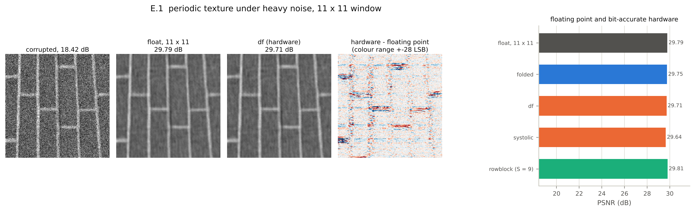
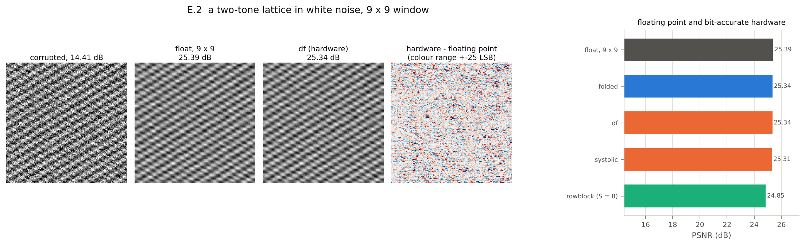
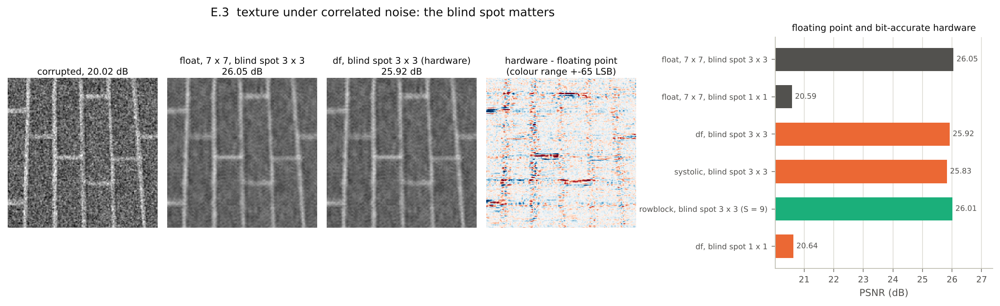

# Scenario E: two-dimensional adaptive line enhancer

[Contents](../../README.md#contents) · previous: [D](D.md) · next: [F](F.md)

The adaptive line enhancer predicts a signal from its own surroundings across a gap that outlasts the noise
correlation. What is periodic survives the prediction, what is broadband does not, so the prediction is the
periodic part with the noise suppressed. In an image the gap is a blind spot inside a large window: E is the
predictor of [D](D.md) with more taps and, where the noise is correlated, a larger blind spot.

<p align="center"></p>

| | |
|---|---|
| signal | periodic or quasi-periodic texture: lines in the 2-D spectrum |
| noise | broadband, white or correlated over a few pixels |
| reference | a $(2R+1)^2$ window without its $(2H+1)^2$ centre: $L=(2R+1)^2-(2H+1)^2$ taps (48 to 120 here) |
| output | the prediction $y$ |
| architectures | **E1** `lms_serial`, **E2** `lms_folded`, **E3** `lms_df`, **E4** `lms_systolic`, **E5** `lms_rowblock` |
| RTL | [`rtl/scenarios/scen_de_top.v`](../../rtl/scenarios/scen_de_top.v) (`R`, `HOLE`) |
| HLS C++ | [`hls/src/scen_de.cpp`](../../hls/src/scen_de.cpp), `scen_de_top` (`DE_R`, `DE_HOLE`) |
| examples | [E.1](#e1-periodic-texture-under-heavy-noise-11-x-11-window) brick, 120 taps · [E.2](#e2-a-two-tone-lattice-in-white-noise-9-x-9-window) lattice, 80 taps · [E.3](#e3-texture-under-correlated-noise-the-blind-spot-matters) correlated noise |
| smoke test | `python smoke/smoke.py E`: `E_systolic`, `E_rowblock`, `E_da` |
| algorithm | [companion repository, scenario E](https://github.com/VKHS/Adaptive-Filters-for-Image-Denoising/blob/main/docs/E_line_enhancer.md) |

## 1. The problem

$$d(i,j)=x(i,j)+n(i,j),\qquad x=\sum_k a_k\cos\big(2\pi(u_ki+v_kj)+\varphi_k\big)+\text{(slowly varying part)},$$

texture made of a few spectral lines (bricks, fabric, a crystal lattice, a halftone screen) under noise that is
broadband in the spectrum. The noise may be correlated over a few pixels (interpolated, demosaicked or compressed
images): its autocorrelation $r_n(a,b)$ is then nonzero for small $\max(|a|,|b|)$.

## 2. The algorithm

<p align="center"></p>

### 2.1 The predictor and its blind spot

$$y(i,j)=\sum_{\max(|a|,|b|)>H}w_{ab}\,d(i+a,j+b),\qquad e=d-y,\qquad w\leftarrow w+\mu\,e\,\mathbf d_{\text{taps}} .$$

As in D, $E[e^2]=E[(x-y)^2]+\sigma^2-2E[n(i,j)\,y(i,j)]$. The last term vanishes only when no tap carries noise
correlated with the centre's, i.e. when the blind spot covers the noise correlation:
$r_n(a,b)=0$ for $\max(|a|,|b|)>H$. Then minimising the prediction error minimises the error against the clean
texture.

### 2.2 The gain of the line enhancer

Take one complex exponential of power $P$ in white noise of power $\sigma^2$, $\alpha=P/\sigma^2$, and $L$ taps at
distinct offsets. The tap correlation is $R=P\,\mathbf a\mathbf a^{\mathsf H}+\sigma^2I$ with $|a_l|=1$, the
cross-correlation with the centre $p=P\,\mathbf a$, and the Wiener weights are

$$w=R^{-1}p=\frac{P}{\sigma^2+LP}\,\mathbf a .$$

The prediction passes the exponential with gain $g=\frac{L\alpha}{1+L\alpha}$ and the noise with power
$\sigma^2L\big(\frac{\alpha}{1+L\alpha}\big)^2=g^2\sigma^2/L$, so its error against the clean exponential is

$$\mathrm{MSE}=(1-g)^2P+g^2\frac{\sigma^2}{L}=\frac{\sigma^2}{L+1/\alpha} .$$

For $L\alpha\gg1$ the noise is divided by $L$: **every tap adds signal coherently and noise incoherently**. A real
cosine is two exponentials of half its power, and for well-separated lines the terms add,
$\mathrm{MSE}\approx\sum_k\sigma^2/(L+1/\alpha_k)$ ([Widrow et al. 1975](../references.md#widrow1975);
[Zeidler 1990](../references.md#zeidler1990)).

Panel (a) checks this on the lattice of example E.2 (two cosines of amplitude 0.22 and 0.14, $\sigma=0.2$), for
windows from $3\times3$ to $11\times11$:

| taps $L$ | 8 | 24 | 48 | 80 | 120 |
|---|---|---|---|---|---|
| Wiener bound, exact (2-D tap geometry) | 22.38 dB | 24.39 dB | 25.09 dB | 26.32 dB | 28.46 dB |
| approximation $\sum_k\sigma^2/(L+1/\alpha_k)$ | 19.20 dB | 22.66 dB | 25.25 dB | 27.29 dB | 28.95 dB |
| LMS, `lms_df` (model), 2 passes | 22.07 dB | 23.77 dB | 24.35 dB | 25.34 dB | 26.87 dB |

(The exact bound is $P_x-p^{\mathsf T}R^{-1}p$ with $R$ and $p$ from the lattice's autocorrelation; the corrupted
image is at 14.41 dB.) The approximation assumes the lines' steering vectors orthogonal, which small windows do not
resolve; from 48 taps on it is within 1 dB of the exact bound. LMS stays 0.3 to 1.6 dB below the bound: the cost of
learning the weights on 74 000 noisy pixels with a fixed step.

### 2.3 What the weights become

Panel (b) is the $11\times11$ kernel learned on E.1 (brick); panel (c) its frequency response
$|W(e^{j\omega_u},e^{j\omega_v})|$ and panel (d) the spectrum of the clean texture: the filter passes the part of
the plane where the texture has its energy, around the origin and along the axes, and attenuates the rest, where
there is only noise.

### 2.4 Correlated noise and the blind spot

Example E.3 adds noise filtered by a $2\times2$ box, so that the centre's noise has correlation 0.5 with its four
nearest neighbours and 0.25 with the diagonal ones, and none beyond (panel (e)). With a $1\times1$ blind spot
($H=0$, 48 taps) the predictor learns to copy the neighbours' noise, large weights next to the centre (panel (f)),
and gains 0.6 dB. With a $3\times3$ blind spot ($H=1$, 40 taps) no tap carries noise correlated with the centre,
the weights spread over the texture (panel (g)), and the gain is 5.9 dB: **the blind spot must be at least as wide
as the noise correlation**.

## 3. The architecture (RTL)

E is [`scen_de_top`](../../rtl/scenarios/scen_de_top.v) with a larger window: parameters `R` and `HOLE`. What
changes with $R$ is the size of everything:

| | $R=3$, $H=0$ (companion default) | $R=4$, $H=0$ (E.2) | $R=5$, $H=0$ (E.1) |
|---|---|---|---|
| taps $L$ | 48 | 80 | 120 |
| row buffers (RAMB18 at $W=512$) | 8 | 10 | 12 |
| window registers | $7\times7$ of 16 bits | $9\times9$ of 16 bits | $11\times11$ of 16 bits |
| blanking cycles per row (window generator) | 6 | 8 | 10 |

| code | engine | multipliers | $II$ at $L=48$ / $L=120$ | $D$ at $L=48$ / $L=120$ |
|---|---|---|---|---|
| **E1** | `lms_serial` | 1 | 99 / 243 | 0 |
| **E2** | `lms_folded`, $P=12$ | 24 | 13 / 19 | 0 |
| **E3** | `lms_df` | $2L$ | 1 | 9 / 10 |
| **E4** | `lms_systolic` | $2L$ | 1 | 51 / 123 |
| **E5** | `lms_rowblock` | $2L$ | 1 | one row |

**The systolic engine does not suit a window.** Its skewed taps need, for a vector input, a delay line of
$L+2+j$ words for tap $j$: $1.5L^2$ words in total. Yosys maps them to 2448 SRL cells at $L=48$ (704 at $L=24$),
and the E top with `lms_systolic` at $R=3$ takes 96 DSP slices, 2557 LUTs and 2464 SRL cells. The direct form
needs $(\lceil\log_2L\rceil+2)L$ words (784 SRL cells at $L=48$) and has the shorter delay. In C the taps come
from one delay line, which the systolic engine shares ($3L+1$ words), and there it needs fewer LUTs than the direct
form ([C](C.md#3-the-architecture-rtl)).

**Delay.** At $L=48$ and $\mu=2^{-7}$ on the brick scene of E.1, the worst $64\times64$ tile has
$\mu\lambda_{\max}=0.0044$ ([1.3](../01-foundations.md#images-are-not-stationary)):

| $D$ | 0 | 2 | 4 | 9 (`lms_df`) | 16 | 32 | 51 (`lms_systolic`) | 64 | 128 | 256 |
|---|---|---|---|---|---|---|---|---|---|---|
| PSNR (dB) | 29.09 | 29.08 | 29.07 | 29.05 | 29.02 | 29.01 | 29.00 | 29.00 | 28.98 | 28.93 |

The loss is gradual and stays under 0.16 dB up to $D=256$ (bound 0.0061, still above 0.0044).

## 4. The HLS C++ implementation

E uses the HLS top of D, [`hls/src/scen_de.cpp`](../../hls/src/scen_de.cpp) ([D, section 4](D.md#4-the-hls-c-implementation)),
with `DE_R` and `DE_HOLE` set: the line buffers become $2R+2$ rows, the register window $(2R+1)^2$, and the tap
list, built by loops over compile-time constants, drops the $(2H+1)^2$ centre. Nothing else changes; the number of
taps `ENG_L` is computed from the two radii in [`scen_de.h`](../../hls/src/scen_de.h). Targets for Vitis HLS at
$L=120$, to be replaced by the measured values:

| `ENGINE` | cycles per row ($W=512$, $R=5$) | DSP | block RAM |
|---|---|---|---|
| 1, $P=12$ (exact) | $\color{red}{\approx(W+10)(10+\text{depth})}$ | $\color{red}{24}$ | $\color{red}{24\ \text{RAMB18}}$ |
| 2 (delayed, direct form) | $\color{red}{W+10}$ | $\color{red}{240}$ | $\color{red}{24\ \text{RAMB18}}$ |

## 5. Examples

Every configuration of every example is reproduced word for word by the HLS C++ top over the whole frame (the words
of the second pass, which carry the first). The Verilog top runs a $96\times96$ tile of each example, from zero weights, against the model run on the
same tile: with `lms_folded` in E.1 and E.2, whose direct forms (160 and 240 multipliers) Icarus Verilog simulates at
a few pixels per second, and with `lms_df` in E.3 (80 and 96 multipliers).

### E.1 Periodic texture under heavy noise, 11 x 11 window

Brick texture under white noise of $\sigma=0.12$, $11\times11$ window ($L=120$), two passes, $\mu=2^{-8}$
(block engine: $2^{-9}$, $\mu N\lambda_{\max,\text{row}}=1.0$).

<p align="center"></p>

| | class | PSNR | SSIM |
|---|---|---|---|
| corrupted | | 18.42 dB | 0.256 |
| floating point, $11\times11$ | | 29.79 dB | 0.791 |
| E2 `lms_folded` ($S=8$) | exact LMS | 29.75 dB | 0.789 |
| E3 `lms_df` ($D=10$) | delayed LMS | 29.71 dB | 0.787 |
| E4 `lms_systolic` ($D=123$) | delayed LMS | 29.64 dB | 0.785 |
| E5 `lms_rowblock` ($S=9$) | block LMS | 29.81 dB | 0.795 |

With 120 taps the line enhancer adds 11.3 dB on this periodic texture (exact LMS).

**What the taps buy.** The window size sets the multiplier count of every pipelined engine ($2L$) and the
length of the serial and folded passes. On the same scene (exact LMS, two passes, step from the same
normalised $\alpha=0.01$):

| window | $5\times5$ | $7\times7$ | $9\times9$ | $11\times11$ |
|---|---|---|---|---|
| taps $L$ | 24 | 48 | 80 | 120 |
| PSNR | 28.51 dB | 29.09 dB | 29.53 dB | 29.75 dB |

Five times the multipliers of the $5\times5$ window buy 1.25 dB; each doubling of $L$ is worth about half a
decibel on this scene, less than the $10\log_{10}2=3$ dB of 2.2, because brick is not a set of pure lines and LMS
pays for every extra weight it has to learn.

| implementation | configurations | words compared | equal to the model |
|---|---|---|---|
| HLS C++, whole frame, 2 passes | folded, df, systolic, rowblock | 262 144 each | all |
| RTL, tile at row 160, column 160 | E2 `lms_folded` ($L=120$, $P=2$) | 9216 | all |

### E.2 A two-tone lattice in white noise, 9 x 9 window

The synthetic lattice of panel (a), two cosines of amplitude 0.22 and 0.14 at $(0.071,0.043)$ and
$(0.118,-0.067)$ cycles per row and pixel, under white noise of $\sigma=0.2$ (an SNR of $-0.7$ dB per pixel);
$192\times192$ pixels, $9\times9$ window ($L=80$), two passes, $\mu=2^{-9}$.

<p align="center"></p>

| | class | PSNR | SSIM |
|---|---|---|---|
| corrupted | | 14.41 dB | 0.501 |
| floating point, $9\times9$ | | 25.39 dB | 0.942 |
| E2 `lms_folded` ($S=9$) | exact LMS | 25.34 dB | 0.942 |
| E3 `lms_df` ($D=10$) | delayed LMS | 25.34 dB | 0.942 |
| E4 `lms_systolic` ($D=83$) | delayed LMS | 25.31 dB | 0.941 |
| E5 `lms_rowblock` ($S=8$) | block LMS | 24.85 dB | 0.933 |

The Wiener bound for this window is 26.32 dB (2.2): exact LMS gets within 1 dB of it after two passes over 37 000
pixels. The rows are only 192 pixels long here: the row-block engine makes 384 updates in the two passes and ends
0.5 dB behind.

| implementation | configurations | words compared | equal to the model |
|---|---|---|---|
| HLS C++, whole frame, 2 passes | folded, df, systolic, rowblock | 36 864 each | all |
| RTL, tile at row 48, column 48 | E2 `lms_folded` ($L=80$, $P=2$) | 9216 | all |

### E.3 Texture under correlated noise: the blind spot matters

Brick under noise filtered by a $2\times2$ box (standard deviation 0.10, correlation 0.5 at lag 1), $7\times7$
window, two passes, with the two blind spots of 2.4.

<p align="center"></p>

| | class | PSNR | SSIM |
|---|---|---|---|
| corrupted | | 20.02 dB | 0.322 |
| floating point, blind spot $3\times3$ ($L=40$) | | 26.05 dB | 0.630 |
| floating point, blind spot $1\times1$ ($L=48$) | | 20.59 dB | 0.342 |
| E3 `lms_df`, blind spot $3\times3$ ($S=6$) | delayed LMS | 25.92 dB | 0.622 |
| E4 `lms_systolic`, blind spot $3\times3$ | delayed LMS | 25.83 dB | 0.618 |
| E5 `lms_rowblock`, blind spot $3\times3$ ($S=9$) | block LMS | 26.01 dB | 0.632 |
| E3 `lms_df`, blind spot $1\times1$ ($S=7$) | delayed LMS | 20.64 dB | 0.343 |

The same hardware with `HOLE = 1` instead of `HOLE = 0` turns 0.6 dB into 5.9 dB, at 8 fewer taps.

| implementation | configurations | words compared | equal to the model |
|---|---|---|---|
| HLS C++, whole frame, 2 passes | df, systolic, rowblock ($3\times3$); df ($1\times1$) | 262 144 each | all |
| RTL, tile at row 160, column 160 | E3 df, blind spot $3\times3$ and $1\times1$ | 9216 each | all |

## 6. Smoke test

A 32 x 24 crop of the cameraman with Gaussian noise, $7\times7$ windows, two passes, through the RTL top (with 10 %
random idle cycles) and the HLS top:

| case | configuration | RTL | HLS C++ (int64 and ap_int) |
|---|---|---|---|
| `E_systolic` | blind spot $3\times3$, $L=40$, `lms_systolic` ($D=43$) | PASS | PASS |
| `E_rowblock` | blind spot $3\times3$, $L=40$, `lms_rowblock` | PASS | PASS |
| `E_da` | blind spot $1\times1$, $L=48$, `lms_da` (multiplier-free block LMS) | PASS | PASS |

```bash
python smoke/smoke.py E
bash smoke/run_vitis.sh E          # with Vitis HLS installed
```
