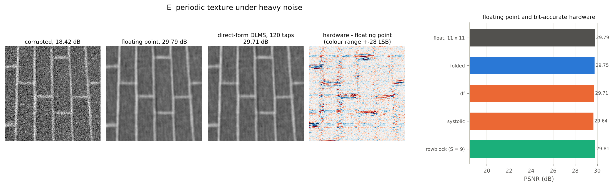

# Scenario E: two-dimensional adaptive line enhancer

[Contents](../../README.md#contents) · previous: [D](D.md) · next: [F](F.md)

**The algorithm** ([companion repository, scenario E](https://github.com/VKHS/Adaptive-Filters-for-Image-Denoising/blob/main/docs/E_line_enhancer.md)).
The adaptive line enhancer predicts a signal from its own past across a delay that outlasts the noise
correlation; for a spectral line of power $P$ in white noise of power $\sigma^2$ the converged filter is a band-pass
with gain $G=\frac{(L/2)\,\mathrm{SNR}}{(L/2)\,\mathrm{SNR}+1}$ at the line, $\mathrm{SNR}=P/\sigma^2$
([Widrow et al. 1975](../references.md#widrow1975); [Zeidler 1990](../references.md#zeidler1990)). In an image the
delay becomes a blind spot of $(2H+1)^2$ pixels inside a $(2R+1)^2$ window:

$$L=(2R+1)^2-(2H+1)^2,\qquad y(i,j)=\sum_{\max(|a|,|b|)>H}w_{ab}\,d(i+a,j+b).$$

More taps mean more gain on periodic texture (the gain formula), and the blind spot must be wider than the noise
correlation. D is the special case $R=2$, $H=0$.

## Architecture

E is [`scen_de_top`](../../rtl/scenarios/scen_de_top.v) with a larger window: parameters `R` and `HOLE`. What
changes with $R$ is the size of everything:

| | $R=3$, $H=0$ (companion default) | $R=5$, $H=0$ (example below) |
|---|---|---|
| taps $L$ | 48 | 120 |
| row buffers (RAMB18 at $W=512$) | 8 | 12 |
| window registers | $7\times7$ of 16 bits | $11\times11$ of 16 bits |
| blanking cycles per row (window generator) | 6 | 10 |

| code | engine | multipliers | $II$ at $L=48$ / $L=120$ | $D$ at $L=48$ / $L=120$ |
|---|---|---|---|---|
| **E1** | `lms_serial` | 1 | 99 / 243 | 0 |
| **E2** | `lms_folded`, $P=12$ | 24 | 13 / 19 | 0 |
| **E3** | `lms_df` | $2L$ | 1 | 9 / 10 |
| **E4** | `lms_systolic` | $2L$ | 1 | 51 / 123 |
| **E5** | `lms_rowblock` | $2L$ | 1 | one row |

**The systolic engine does not suit a window.** Its skewed taps need, for a vector input, a delay line of
$L+2+j$ words for tap $j$: $1.5L^2$ words in total. Yosys maps them to 2448 SRL cells at $L=48$ (704 at $L=24$),
and the E top with `lms_systolic` at $R=3$ takes 96 DSP slices, 2557 LUTs and 2464 SRL cells. The direct form
needs $(\lceil\log_2L\rceil+2)L$ words (784 SRL cells at $L=48$) and has the shorter delay. In C the taps come
from one delay line, which the systolic engine shares ($3L+1$ words), and there it needs fewer LUTs than the direct
form ([C](C.md#architectures)).

## Delay

At $L=48$ and $\mu=2^{-7}$ on the example scene, the worst $64\times64$ tile has $\mu\lambda_{\max}=0.0044$
([1.3](../01-foundations.md#images-are-not-stationary)):

| $D$ | 0 | 2 | 4 | 9 (`lms_df`) | 16 | 32 | 51 (`lms_systolic`) | 64 | 128 | 256 |
|---|---|---|---|---|---|---|---|---|---|---|
| PSNR (dB) | 29.09 | 29.08 | 29.07 | 29.05 | 29.02 | 29.01 | 29.00 | 29.00 | 28.98 | 28.93 |

The loss is gradual and stays under 0.16 dB up to $D=256$ (bound 0.0061, still above 0.0044).

## Results

Brick texture under heavy white noise ($\sigma=0.12$), $11\times11$ window ($L=120$), two passes
([examples](../06-results.md#61-application-examples)):

| | class | PSNR |
|---|---|---|
| corrupted | | 18.42 dB |
| floating point, $11\times11$ | | 29.79 dB |
| E2 `lms_folded` ($S=8$) | exact LMS | 29.75 dB |
| E3 `lms_df` ($D=10$) | delayed LMS | 29.71 dB |
| E4 `lms_systolic` ($D=123$) | delayed LMS | 29.64 dB |
| E5 `lms_rowblock` ($S=9$, $\mu N\lambda_{\max,\text{row}}=1.0$) | block LMS | 29.81 dB |

With 120 taps the line enhancer adds 11.3 dB on this periodic texture (exact LMS).

**What the taps buy.** The window size sets the multiplier count of every pipelined engine ($2L$) and the
length of the serial and folded passes. On the same scene (exact LMS, two passes, step from the same
normalised $\alpha=0.01$):

| window | $5\times5$ | $7\times7$ | $9\times9$ | $11\times11$ |
|---|---|---|---|---|
| taps $L$ | 24 | 48 | 80 | 120 |
| PSNR | 28.51 dB | 29.09 dB | 29.53 dB | 29.75 dB |

Five times the multipliers of the $5\times5$ window buy 1.25 dB; each doubling of $L$ is worth about half a
decibel on this scene.
