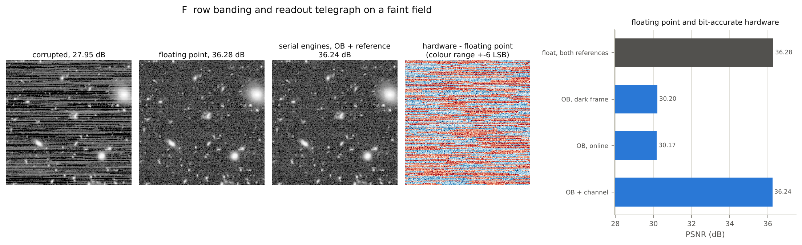

# Scenario F: reference-sensor canceller

[Contents](../../README.md#contents) · previous: [E](E.md) · next: [5. Verification](../05-verification.md)

**The algorithm** ([companion repository, scenario F](https://github.com/VKHS/Adaptive-Filters-for-Image-Denoising/blob/main/docs/F_reference_canceller.md)).
The canceller in its purest form: a second input that sees the interference and none of the scene. Image sensors
carry two such inputs. **Optical-black (OB) columns**, shielded from light, see each row's offset (row banding);
their mean over $K$ columns is $x_i=c_i+\bar n_i$. A **reference output channel**, digitised with the pixels, sees
the amplifier's telegraph noise $g\,t(n)$. The Wiener weights are

$$w_{\text{OB}}=\frac{\sigma_c^2}{\sigma_c^2+\sigma^2/K},\qquad w_{\text{ch}}=\frac{g\,\sigma_t^2}{g^2\sigma_t^2+\sigma_r^2},$$

and the scene, uncorrelated with both references, does not bias them but dominates the gradient noise: the weights
are best learned where the scene is absent.

## Architecture

[`scen_f_top`](../../rtl/scenarios/scen_f_top.v) receives every row as $N_{OB}=2^m$ OB pixels followed by $W$
scene pixels, with the reference channel alongside (`in_ref`). One tap, any engine:

* **OB reference.** An accumulator sums the row's OB pixels; the mean is a shift (`LOGNOB`). The pixels are also
  kept in a small register file for the leave-one-out mode.
* **Reference channel.** `XSEL = 1` takes `in_ref` as the tap instead.
* **Three modes** (the architectures F1 to F3):

| code | `mode` | adapts on | reference | needs |
|---|---|---|---|---|
| **F3** | 1, calibrate | every pixel of a dark frame (shutter closed) | OB mean or channel | a dark frame |
| **F1** | 0, frozen | nothing | OB mean or channel | a calibrated weight |
| **F2** | 2, OB online | each OB pixel, predicted from the other $K-1$ | leave-one-out mean | nothing |

F2 adapts during the OB readout of every row and corrects the row's scene pixels with the frozen weight. Its
reference $x_k=\frac{1}{K-1}\sum_{j\ne k}ob_j$ is the row sum minus $ob_k$, times the constant
$\mathrm{round}(2^{12}/(K-1))$ (one multiplier). With $ob_k$ inside its own reference its noise would appear in
both $d$ and $x$ and pull the weight to 1 ([4.4](../04-front-ends.md#44-scenario-f-references-that-are-already-there));
left out, the weight converges to $\sigma_c^2/(\sigma_c^2+\sigma^2/(K-1))$. A tag FIFO marks which engine outputs
are scene pixels, so the outputs of the OB updates never leave the top.

The example cascades two tops: the OB canceller (F3, then F1) and the channel canceller (`XSEL = 1`, F3 then F1).
With `lms_serial` a sample takes 4 cycles frozen and 5 while adapting; for one sample per clock, `lms_df` with
$L=1$ has two multipliers and $D=3$. Yosys counts 2 DSP slices (the engine and the leave-one-out constant), 341
LUTs and 330 flip-flops for one top with `lms_serial`.

**A step larger than one.** The reference channel is small (0.026 rms on the dark frame), so its step is
$\mu=2^{1}$: $S=-1$. The weight accumulator allows negative $S$ as long as the view shift $V=2F_D-F_W+S$ stays
positive ([2.2](../02-fixed-point.md#22-the-weight-accumulator)), i.e. $S\ge-3$ with $F_D=12$, $F_W=20$.

## Results

A faint astronomical field with row banding ($\sigma_c=0.03$), telegraph noise ($\pm0.03$, switching about every
60 pixels) and read noise ($0.01$); 16 OB columns, a reference channel with gain $g=0.8$, and a dark frame
([examples](../06-results.md#61-application-examples)):

| | weight (Wiener) | PSNR |
|---|---|---|
| corrupted | | 27.95 dB |
| floating point, OB + channel | | 36.28 dB |
| OB, F3 on the dark frame, then F1 ($S=1$) | 0.984 (0.993) | 30.20 dB |
| OB, F2 online, no dark frame ($S=-3$) | 0.985 (0.993) | 30.17 dB |
| OB + channel, F3 then F1 (channel $S=-1$) | 1.005 (1.065) | **36.24 dB** |

The OB canceller removes the banding (+2.3 dB); the channel removes the telegraph streaks (+6.0 dB more). F2
reaches the dark-frame result to within 0.03 dB without a dark frame, because it adapts on pixels that never see
the scene. The fixed-point pipeline is 0.05 dB from floating point.
