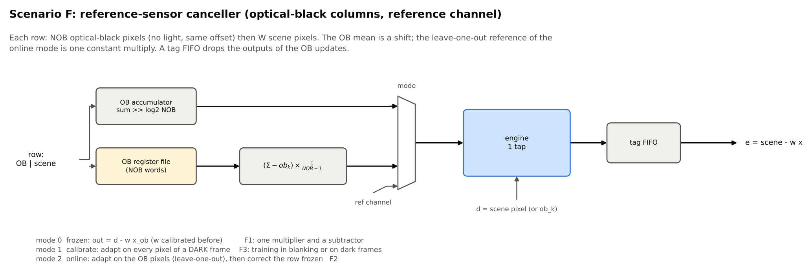
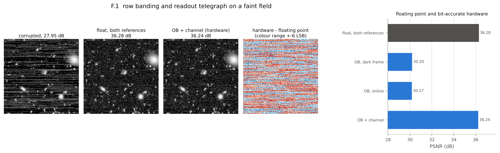
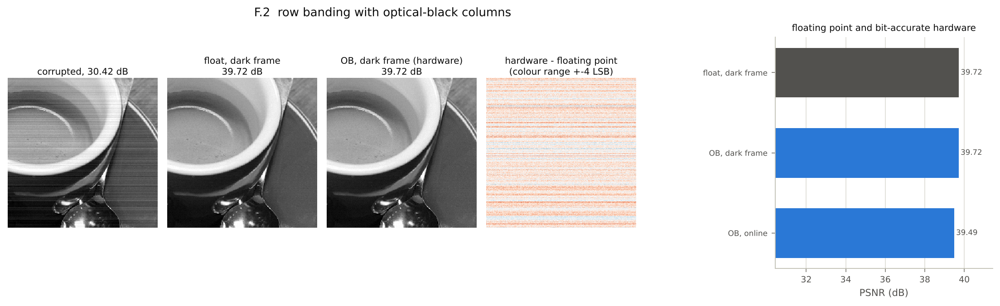
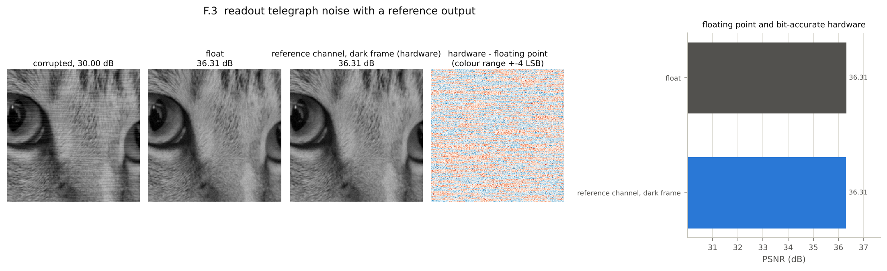

# Scenario F: reference-sensor canceller

[Contents](../../README.md#contents) · previous: [E](E.md) · next: [5. Verification](../05-verification.md)

The canceller in its purest form: a second input that sees the interference and none of the scene. Image sensors
carry two such inputs. **Optical-black (OB) columns**, shielded from light, see each row's offset (row banding);
a **reference output channel**, digitised with the pixels, sees the readout amplifier's telegraph noise. One
weight per reference scales it onto the interference, and the weight is best learned where the scene is absent.

<p align="center"></p>

| | |
|---|---|
| interference | row offsets $c_i$ (banding), telegraph noise $t(n)$ |
| reference | the mean of $N_{OB}=2^m$ OB pixels of the row, or the reference channel: one tap |
| output | the error $e=d-w\,x$ |
| architectures | **F1** frozen weight, **F2** online on the OB pixels, **F3** dark-frame calibration: `mode` 0, 2, 1 of one top |
| RTL | [`rtl/scenarios/scen_f_top.v`](../../rtl/scenarios/scen_f_top.v) |
| HLS C++ | [`hls/src/scen_f.cpp`](../../hls/src/scen_f.cpp), `scen_f_top` |
| examples | [F.1](#f1-row-banding-and-readout-telegraph-on-a-faint-field) both references · [F.2](#f2-row-banding-with-optical-black-columns) OB columns · [F.3](#f3-readout-telegraph-noise-with-a-reference-output) reference channel |
| smoke test | `python smoke/smoke.py F`: `F_ob_cal`, `F_online`, `F_channel` |
| algorithm | [companion repository, scenario F](https://github.com/VKHS/Adaptive-Filters-for-Image-Denoising/blob/main/docs/F_reference_canceller.md) |

## 1. The problem

Every row $i$ of the sensor delivers $N_{OB}$ optical-black pixels and then $W$ scene pixels:

$$ob_{ik}=c_i+n'_{ik},\qquad d_{ij}=x_{ij}+c_i+t_{ij}+n_{ij},\qquad r_{ij}=g\,t_{ij}+n''_{ij},$$

with $c_i$ the row offset (variance $\sigma_c^2$), $t$ a two-state telegraph signal of the readout amplifier
(amplitude $\pm a$, switching every few tens of pixels), $r$ the reference channel, which sees the telegraph with a
gain $g$ and its own noise, and $n,n',n''$ white read noise. A **dark frame** (shutter closed) has $x=0$.

## 2. The algorithm

<p align="center"></p>

### 2.1 One tap and its Wiener weight

The OB reference of row $i$ is the mean $x_i=\frac1{N}\sum_kob_{ik}=c_i+\bar n'_i$, the channel reference is
$r_{ij}$. For one tap the Wiener weight is $w=E[d\,x]/E[x^2]$; the scene is uncorrelated with both references, so

$$w_{\text{OB}}=\frac{\sigma_c^2}{\sigma_c^2+\sigma'^2/N},\qquad w_{\text{ch}}=\frac{g\,\sigma_t^2}{g^2\sigma_t^2+\sigma''^2}.$$

With the numbers of the examples ($\sigma_c=0.03$, $\sigma'=0.01$, $N=16$; $g=0.8$, $a=0.03$, $\sigma''=0.01$):
$w_{\text{OB}}=0.993$ and $w_{\text{ch}}=1.065$. Panel (a) shows one row of F.1: the corruption $d-x$ with its
offset and the telegraph steps, the OB mean at the offset, and the reference channel following the steps.

### 2.2 Where to learn the weight

The scene does not bias the weight, but it is noise in the gradient $e\,x$, and on a bright scene a large one. Two
places have no scene:

* **A dark frame** (F3, `mode` 1): the canceller adapts on every pixel of a frame taken with the shutter closed, and
  the weight is then frozen for the scenes (F1, `mode` 0).
* **The OB pixels themselves** (F2, `mode` 2): each OB pixel is predicted from the other $N-1$,
  $x_k=\frac1{N-1}\sum_{j\ne k}ob_j$. Leaving $ob_k$ out matters: inside its own reference, its noise would appear
  in both $d$ and $x$ and pull the weight to 1. Left out, the weight converges to
  $\sigma_c^2/(\sigma_c^2+\sigma'^2/(N-1))$, and the row's scene pixels are corrected with the frozen weight and the
  full OB mean. No dark frame is needed.

Panel (b) shows the three weights converging: the OB weight on a dark frame at $\mu=2^{-1}$ (three passes, ending at
1.012 against the least-squares 1.000 of that frame), online on the OB pixels at $\mu=2^{3}$ (0.987 after one
frame), and the channel weight on a dark frame at $\mu=2^{1}$ (1.031 against the least-squares 1.065). The steps are
large because the references are small; the weight accumulator allows $S<0$ ([2.2](../02-fixed-point.md#22-the-weight-accumulator)).

### 2.3 What is left

After the correction a row keeps the offset error $c_i-w\,x_i\approx-w\,\bar n'_i$, whose standard deviation is
$\sigma'/\sqrt N$: **the noise of the OB mean sets the floor**. Panel (c) measures it for $N=1$ to 64 (512 rows of
512 pixels, the white noise of the scene subtracted):

| $N$ | 1 | 2 | 4 | 8 | 16 | 32 | 64 |
|---|---|---|---|---|---|---|---|
| residual offset, hardware model (LSB) | 38.7 | 28.7 | 20.5 | 15.1 | 10.9 | 7.0 | 5.0 |
| $\sigma'/\sqrt N$ (LSB) | 41.0 | 29.0 | 20.5 | 14.5 | 10.2 | 7.2 | 5.1 |

From 123 LSB of banding, 16 OB columns leave 11. Panel (d) shows the row means of F.1 before and after: the banding
of up to $\pm400$ LSB is gone, what remains is within a few tens of LSB.

## 3. The architecture (RTL)

<p align="center"></p>

[`scen_f_top`](../../rtl/scenarios/scen_f_top.v) receives every row as $N_{OB}=2^m$ OB pixels followed by $W$
scene pixels, with the reference channel alongside (`in_ref`). One tap, any engine:

* **OB reference.** An accumulator sums the row's OB pixels; the mean is a shift (`LOGNOB`). The pixels are also
  kept in a small register file for the leave-one-out mode.
* **Reference channel.** `XSEL = 1` takes `in_ref` as the tap instead.
* **Three modes** (the architectures F1 to F3):

| code | `mode` | adapts on | reference | needs |
|---|---|---|---|---|
| **F3** | 1, calibrate | every pixel of a dark frame (shutter closed) | OB mean or channel | a dark frame |
| **F1** | 0, frozen | nothing | OB mean or channel | a calibrated weight |
| **F2** | 2, OB online | each OB pixel, predicted from the other $N-1$ | leave-one-out mean | nothing |

F2 adapts during the OB readout of every row and corrects the row's scene pixels with the frozen weight. Its
reference is the row sum minus $ob_k$, times the constant $\mathrm{round}(2^{12}/(N-1))$ (one multiplier). A tag
FIFO marks which engine outputs are scene pixels, so the outputs of the OB updates never leave the top.

Example F.1 cascades two tops: the OB canceller (F3, then F1) and the channel canceller (`XSEL = 1`, F3 then F1).
With `lms_serial` a sample takes 4 cycles frozen and 5 while adapting; for one sample per clock, `lms_df` with
$L=1$ has two multipliers and $D=3$. Yosys counts 2 DSP slices (the engine and the leave-one-out constant), 341
LUTs and 330 flip-flops for one top with `lms_serial`.

**A step larger than one.** The reference channel is small (0.026 rms on the dark frame), so its step is
$\mu=2^{1}$: $S=-1$. The weight accumulator allows negative $S$ as long as the view shift $V=2F_D-F_W+S$ stays
positive ([2.2](../02-fixed-point.md#22-the-weight-accumulator)), i.e. $S\ge-3$ with $F_D=12$, $F_W=20$.

**Ports and parameters.** `mode`, `in_pix`, `in_ref`, `in_valid`/`in_ready`, `in_flush` (a frame end: drain the
pipelined engines), `out_pix`/`out_valid`; parameters `W`, `NOB`, `LOGNOB`, `XSEL`, `ENGINE`, `S`, `DRAIN_ROW`.

## 4. The HLS C++ implementation

```cpp
void scen_f_top(hls::stream<pix_t>& pix_in, hls::stream<pix_t>& ref_in, hls::stream<pix_t>& pix_out,
                int mode, bool reset);

ROWS:
    for (int i = 0; i < F_H; i++) {
        sint<16 + F_LOGNOB + 2> sum = 0;
    OB: for (int k = 0; k < NOB; k++) {                 // PIPELINE II=1: the OB pixels, their sum
            ob[k] = pix_in.read();
            sum += ob[k];
        }
        if (mode == 2) {
        LOO: for (int k = 0; k < NOB; k++) {           // adapt on each OB pixel, leave-one-out reference
                x[0] = narrow<16>((sint<48>(sum - ob[k]) * INV) >> 12);
                ENGINE_STEP(true, false, x, ob[k], ob[k], true, gate_s, o, flag);
            }
        }
        const F::data_t xob = narrow<16>(sum >> F_LOGNOB);
    SCENE: for (int j = 0; j < F_W; j++) {
            x[0] = F_XSEL ? F::data_t(ref_in.read()) : xob;
            const F::data_t d = pix_in.read();
            ENGINE_STEP(true, j == F_W - 1, x, d, d, mode == 1, gate_s, o, flag);   // adapt in mode 1 only
            pix_out.write(o);
        }
    }
```

One call is one frame; the weight is `static` and carries over, so a calibration frame (`mode` 1) followed by scene
frames (`mode` 0) is a sequence of calls, as in the RTL. `INV` is the constant $\mathrm{round}(2^{12}/(N-1))$, the
one multiplier of F2. `ob[]` is partitioned into registers. Configuration: `F_W`, `F_H`, `F_LOGNOB`, `F_XSEL`,
`F_S`, `ENGINE`. Targets for Vitis HLS, to be replaced by the measured values: with `lms_serial`,
$\color{red}{\approx5}$ cycles per scene pixel and $\color{red}{2}$ DSP; with `lms_df`, II $\color{red}{1}$ and
$\color{red}{3}$ DSP.

## 5. Examples

Every example is reproduced word for word, over the whole scene frame, by the HLS C++ top and by the Verilog top;
the scene frame comes after the calibration frames of its sequence, whose weights it carries.

### F.1 Row banding and readout telegraph on a faint field

A faint astronomical field with row banding ($\sigma_c=0.03$), telegraph noise ($\pm0.03$, switching about every 60
pixels) and read noise (0.01); 16 OB columns, a reference channel with gain $g=0.8$, and a dark frame. Two tops in
series: OB (dark frame three times, then frozen, $S=1$), then the channel (dark frame, then frozen, $S=-1$).

<p align="center"></p>

| | weight (Wiener) | PSNR | SSIM |
|---|---|---|---|
| corrupted | | 27.95 dB | 0.613 |
| floating point, OB + channel | | 36.28 dB | 0.897 |
| OB, F3 on the dark frame, then F1 ($S=1$) | 0.984 (0.993) | 30.20 dB | 0.702 |
| OB, F2 online, no dark frame ($S=-3$) | 0.985 (0.993) | 30.17 dB | 0.702 |
| OB + channel, F3 then F1 (channel $S=-1$) | 1.005 (1.065) | **36.24 dB** | 0.897 |

The OB canceller removes the banding (+2.3 dB); the channel removes the telegraph streaks (+6.0 dB more). F2
reaches the dark-frame result to within 0.03 dB without a dark frame, because it adapts on pixels that never see
the scene. The fixed-point pipeline is 0.05 dB from floating point.

| implementation | configurations | words compared | equal to the model |
|---|---|---|---|
| HLS C++, whole frames | OB (4 frames), OB online (1 frame), OB + channel (4 + 2 frames) | 262 144 per scene frame | all |
| RTL, whole frames | the same three | 262 144 per scene frame | all |

### F.2 Row banding with optical-black columns

A photograph with row banding ($\sigma_c=0.03$) and read noise (0.01), 16 OB columns, and a dark frame.

<p align="center"></p>

| | PSNR | SSIM |
|---|---|---|
| corrupted | 30.42 dB | 0.712 |
| floating point, dark frame | 39.72 dB | 0.938 |
| OB, F3 on the dark frame, then F1 ($S=1$) | 39.72 dB | 0.938 |
| OB, F2 online ($S=-3$) | 39.49 dB | 0.937 |

The banding is removed down to the floor of 2.3: 9.3 dB gained with one tap.

| implementation | configurations | words compared | equal to the model |
|---|---|---|---|
| HLS C++, whole frames | OB dark frame (4 frames), OB online | 262 144 per scene frame | all |
| RTL, whole frames | the same two | 262 144 per scene frame | all |

### F.3 Readout telegraph noise with a reference output

A photograph with telegraph noise ($\pm0.03$, switching about every 60 pixels) and read noise (0.01), a reference
output with $g=0.8$, and a dark frame.

<p align="center"></p>

| | PSNR | SSIM |
|---|---|---|
| corrupted | 30.00 dB | 0.734 |
| floating point | 36.32 dB | 0.906 |
| channel, F3 on the dark frame, then F1 ($S=-1$) | 36.31 dB | 0.906 |

| implementation | configurations | words compared | equal to the model |
|---|---|---|---|
| HLS C++, whole frames | channel (dark frame + scene) | 262 144 per scene frame | all |
| RTL, whole frames | the same | 262 144 per scene frame | all |

## 6. Smoke test

A 40 x 10 crop with banding, telegraph and 16 OB columns, as frame sequences through the RTL top (with 10 % random
idle cycles) and the HLS top; every output word of every frame must equal the model's:

| case | sequence | RTL | HLS C++ (int64 and ap_int) |
|---|---|---|---|
| `F_ob_cal` | OB reference: two dark frames (`mode` 1), then a frozen frame, $S=1$ | PASS | PASS |
| `F_online` | OB reference online (`mode` 2), $S=-3$ | PASS | PASS |
| `F_channel` | reference channel: a dark frame, then a frozen frame, $S=-1$ | PASS | PASS |

```bash
python smoke/smoke.py F
bash smoke/run_vitis.sh F          # with Vitis HLS installed
```
