# figures/: every figure of the repository

[Repository](../README.md) · [experiments](../experiments/README.md)

Every figure is generated by a script of [`experiments/`](../experiments/README.md) from the models (or, for the
block diagrams, drawn by [`diagrams.py`](../experiments/diagrams.py)); none is drawn by hand.

## algorithms/: one figure per scenario ([`algorithms.py`](../experiments/algorithms.py))

<table>
<tr>
<td width="50%"><a href="../docs/scenarios/A.md#2-the-algorithm">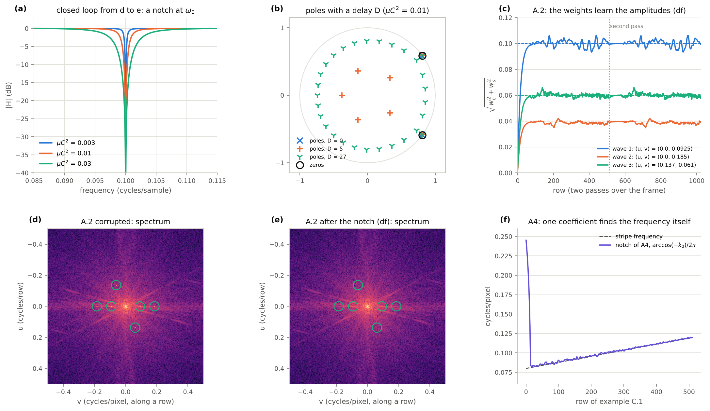</a> A: notch, poles with a delay, learned amplitudes, spectra, the lattice notch</td>
<td width="50%"><a href="../docs/scenarios/B.md#2-the-algorithm">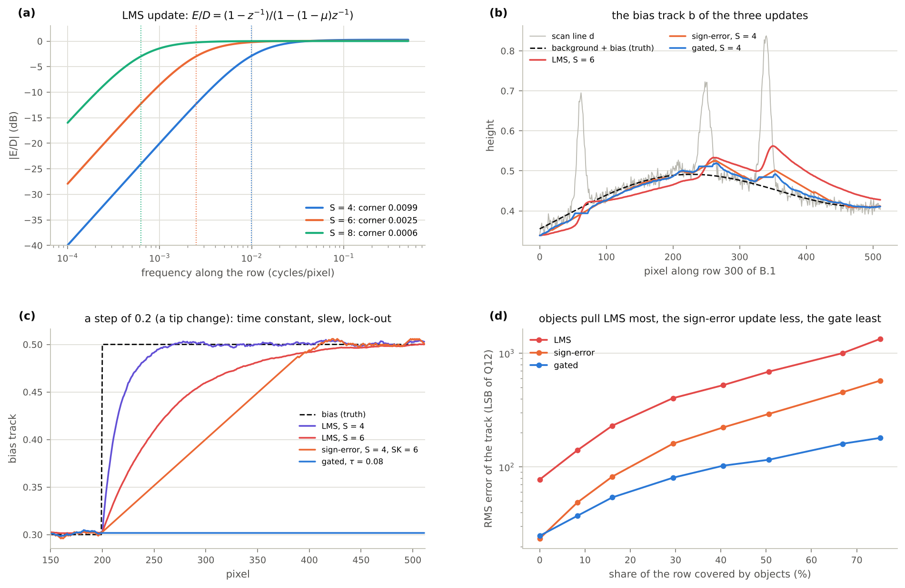</a> B: high-pass, three tracks, a step, robustness to objects</td>
</tr>
<tr>
<td><a href="../docs/scenarios/C.md#2-the-algorithm">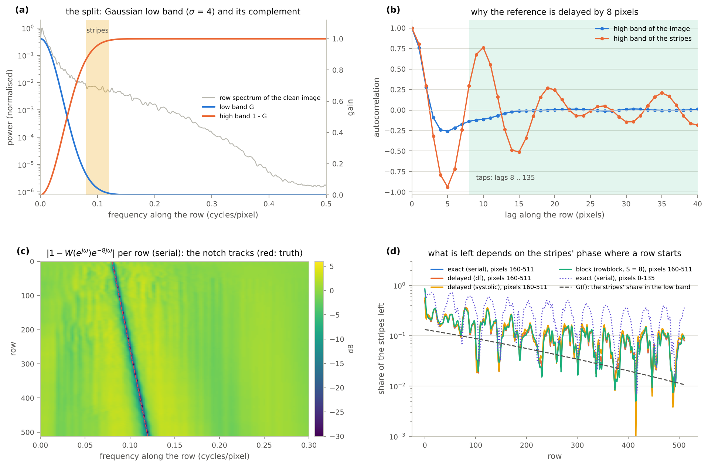</a> C: band split, delay, the moving notch, what is left</td>
<td><a href="../docs/scenarios/D.md#2-the-algorithm">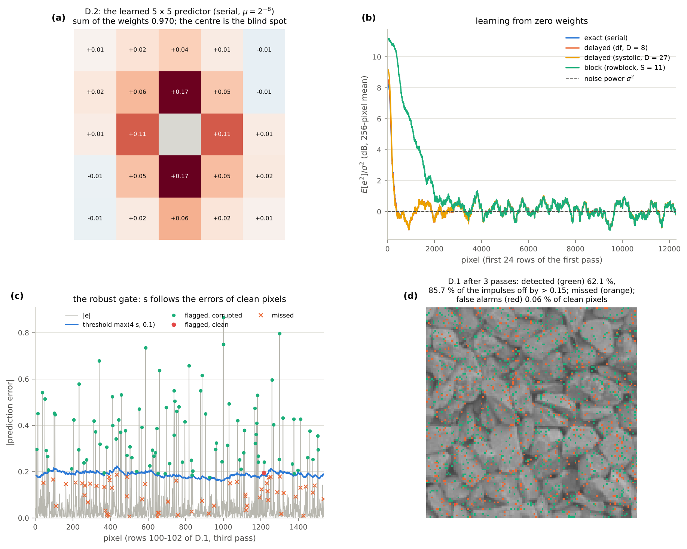</a> D: kernel, learning curves, the gate, detections</td>
</tr>
<tr>
<td><a href="../docs/scenarios/E.md#2-the-algorithm">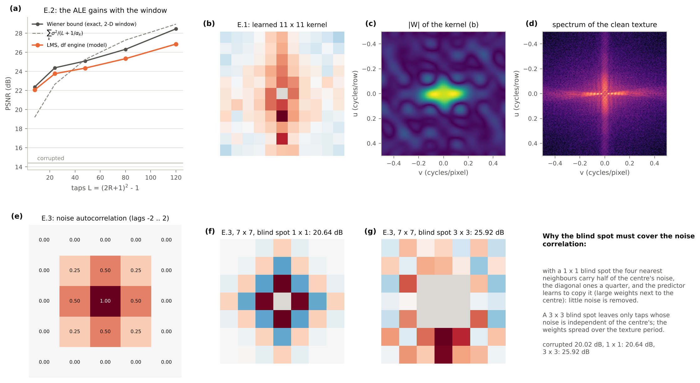</a> E: ALE against the Wiener bound, kernels, the blind spot</td>
<td><a href="../docs/scenarios/F.md#2-the-algorithm">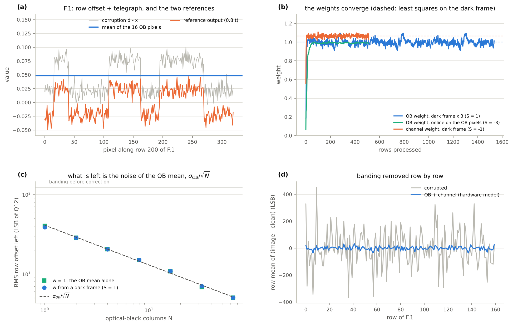</a> F: references, weights, residual against N, banding</td>
</tr>
</table>

## examples/: eighteen application examples ([`examples.py`](../experiments/examples.py))

`overview.png` (the first example of each scenario), `examples_<X>.png` (the three examples of scenario X), and
`example_<X>_<k>.png` for each example: corrupted crop, floating-point result, hardware result, their difference,
and the PSNR of every configuration.

<table>
<tr>
<td width="33%"><a href="../docs/scenarios/A.md">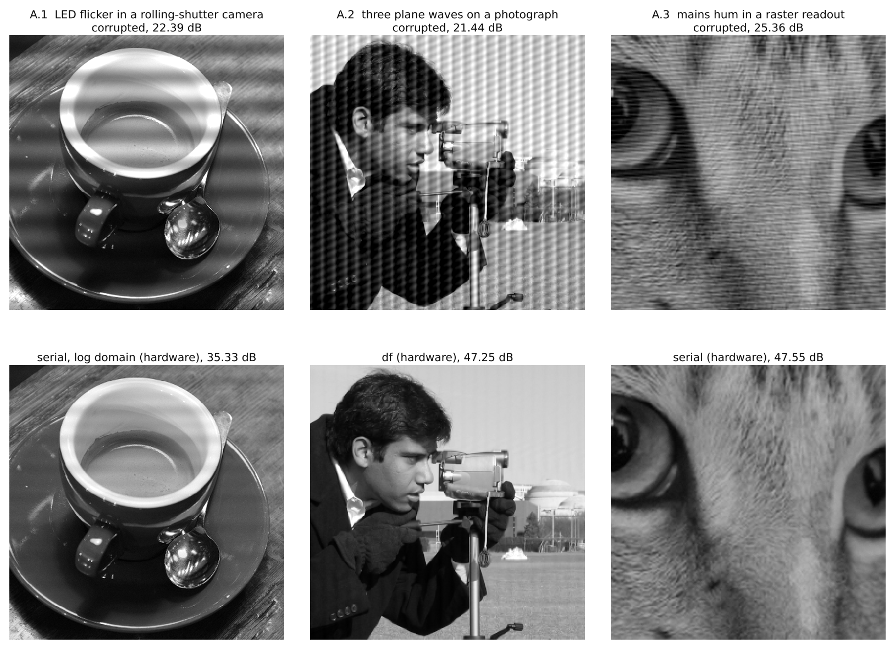</a></td>
<td width="33%"><a href="../docs/scenarios/B.md">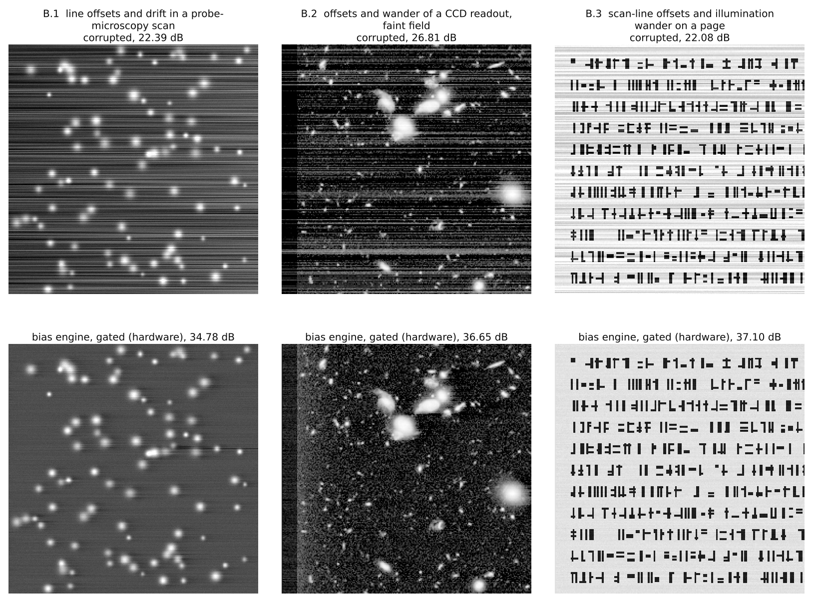</a></td>
<td width="33%"><a href="../docs/scenarios/C.md">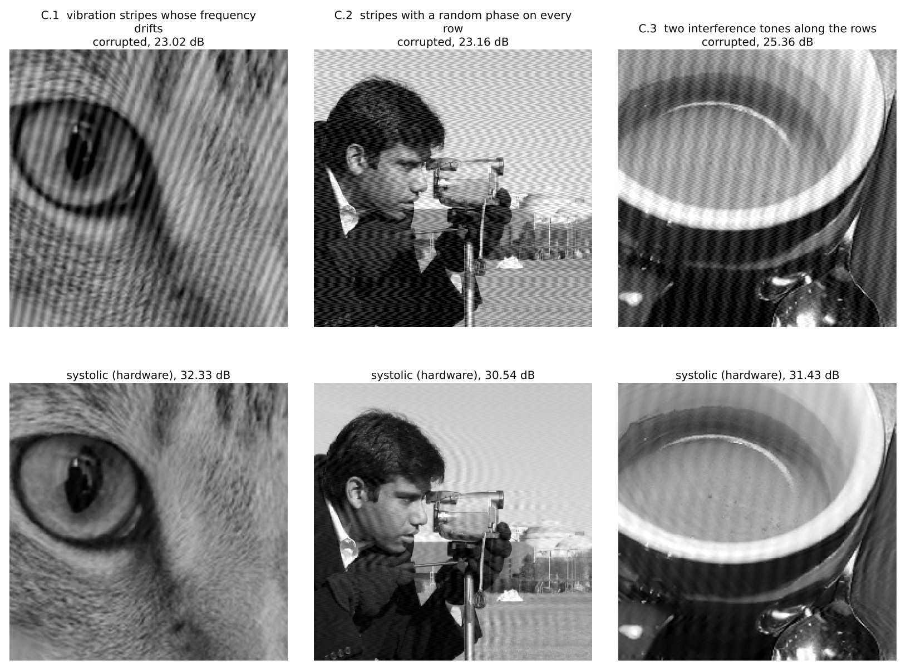</a></td>
</tr>
<tr>
<td><a href="../docs/scenarios/D.md">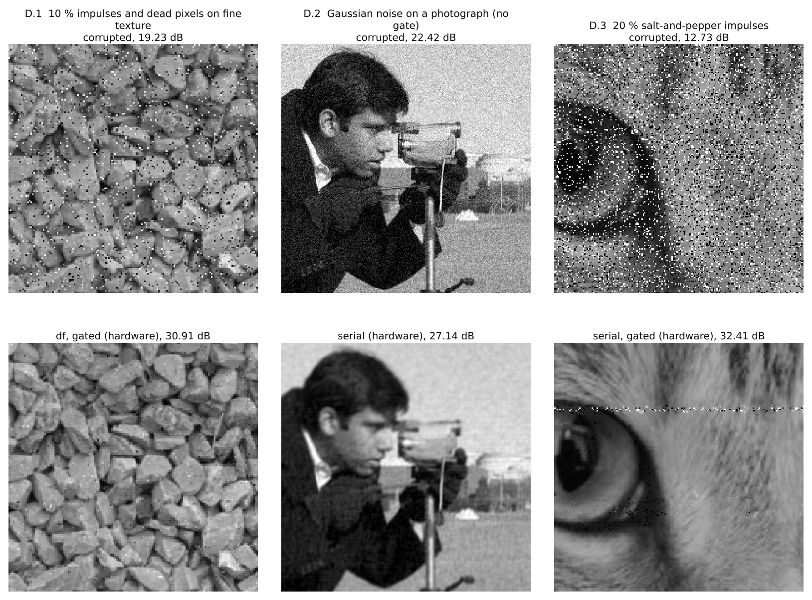</a></td>
<td><a href="../docs/scenarios/E.md">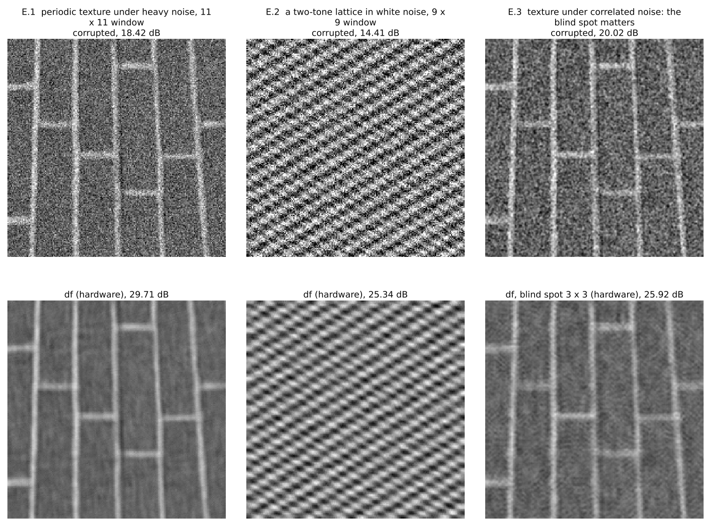</a></td>
<td><a href="../docs/scenarios/F.md">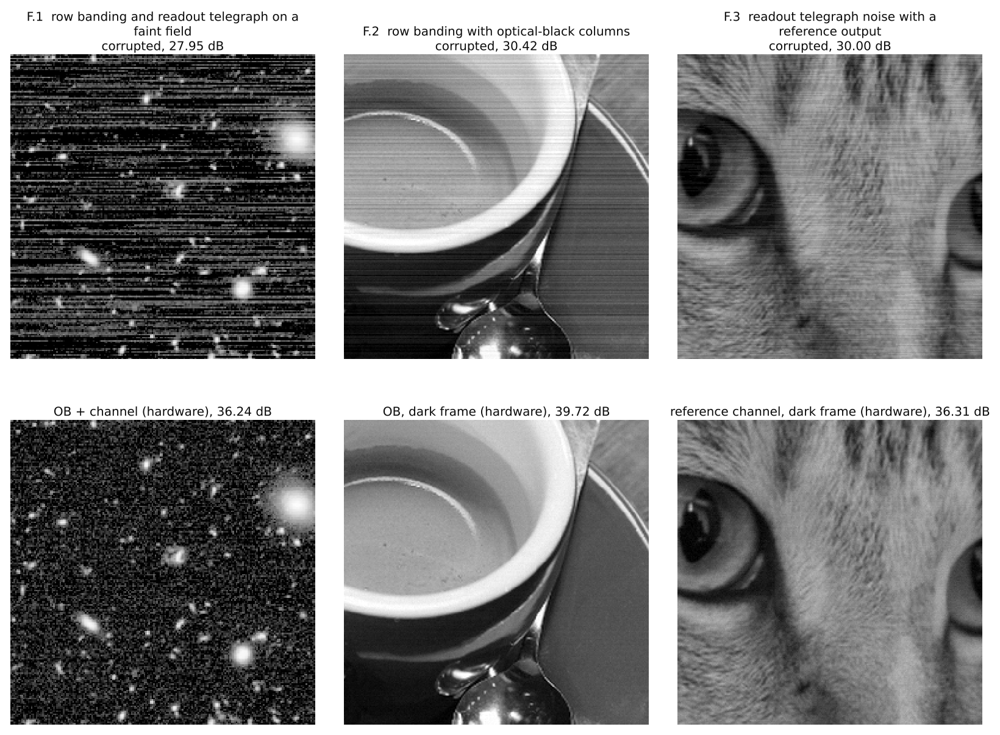</a></td>
</tr>
</table>

## diagrams/: block diagrams ([`diagrams.py`](../experiments/diagrams.py))

| figure | shows | used in |
|---|---|---|
| `lms_loop.png` | the LMS recursion as hardware and the loop that bounds the clock | [1](../docs/01-foundations.md), README |
| `schedules.png` | the schedules of the three classes | [1](../docs/01-foundations.md) |
| `weight_accumulator.png` | the 48-bit weight accumulator and its view | [2](../docs/02-fixed-point.md) |
| `engine_serial.png` ... `engine_da.png` | the six engines | [3](../docs/03-engines.md), [rtl/](../rtl/README.md) |
| `window_gen.png` | the window generator with reflected addressing | [4](../docs/04-front-ends.md), [D](../docs/scenarios/D.md) |
| `scenario_a.png`, `scenario_b.png`, `scenario_c.png`, `scenario_f.png` | the scenario tops | the scenario chapters |
| `median.png` | the median baseline | [D](../docs/scenarios/D.md) |
| `architecture_map.png` | the 25 architectures on the six engines | README, [rtl/](../rtl/README.md) |
| `verification.png` | the verification chain: model, Verilog, HLS C++ | README, [5](../docs/05-verification.md) |
| `hls_structure.png` | the HLS C++: headers, classes, tops, flows | README, [hls/](../hls/README.md) |

## results/: sweeps

| figure | shows | script |
|---|---|---|
| `delay_sweep.png` | DLMS against the adaptation delay, with the exact bound | [`delay_sweep.py`](../experiments/delay_sweep.py) |
| `rowblock_wordlength.png` | block LMS against the step; weight register against accumulator | [`rowblock_wordlength.py`](../experiments/rowblock_wordlength.py) |
| `design_space.png` | cycles per pixel against multipliers, with the video formats | [`design_space.py`](../experiments/design_space.py) |
