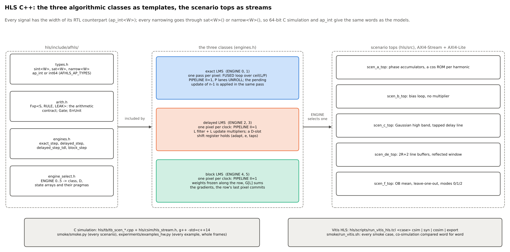

# hls/: the scenario tops in HLS C++

[Repository](../README.md) · [RTL](../rtl/README.md) · [smoke tests](../smoke/README.md) · [verification](../docs/05-verification.md)

The six scenarios written for Vitis HLS. Each top is the C++ counterpart of a Verilog top in [`rtl/scenarios`](../rtl/scenarios),
built from the same three algorithmic classes and the same arithmetic, and reproduces the bit-accurate model of
[`afarch`](../afarch/README.md) **word for word**: on every smoke case ([`smoke/`](../smoke/README.md)) and on every
configuration of the eighteen application examples, over whole frames ([`experiments/examples_hw.py`](../experiments/examples_hw.py)).

<p align="center"></p>

## Files

| file | contents |
|---|---|
| [`include/afhls/types.h`](include/afhls/types.h) | `sint<W>`, `uint<W>` (`ap_int<W>` under Vitis HLS or with `-DAFHLS_AP_TYPES`, 64-bit integers otherwise), `sat<W>()`, `narrow<W>()`, `sgn()`, `add_wrap<W>()`, `refl()` |
| [`include/afhls/arith.h`](include/afhls/arith.h) | `Fxp<S, RULE, LEAK>`: the arithmetic contract of [chapter 2](../docs/02-fixed-point.md) (Q12 data, the 48-bit weight accumulator, the Q20 view, rounding, the four update rules, leakage); `Gate<>`: the robust gate of D; `ErrUnit<>`: error, gate and output selection |
| [`include/afhls/engines.h`](include/afhls/engines.h) | the three classes: `exact_step` (fused folded pass), `delayed_step` / `delayed_step_tdl` (shift-register queue of pending updates), `block_step` (gradient accumulators, commit at the row end) |
| [`include/afhls/engine_select.h`](include/afhls/engine_select.h) | `ENGINE` 0 to 5, the RTL numbering, mapped onto a class, its delay $D$, its state arrays with their partitioning pragmas (`ENGINE_STATE()`) and its step macros |
| [`include/afhls/cos1024_q12.inc`](include/afhls/cos1024_q12.inc) | the cosine table of A, generated by [`scripts/gen_tables.py`](scripts/gen_tables.py) from [`rtl/scenarios/cos1024_q12.hex`](../rtl/scenarios/cos1024_q12.hex) |
| [`src/scen_a.cpp`](src/scen_a.cpp) | A: phase accumulators, a cosine ROM per harmonic, any engine, error out |
| [`src/scen_b.cpp`](src/scen_b.cpp) | B: the multiplier-free bias loop, three update modes |
| [`src/scen_c.cpp`](src/scen_c.cpp) | C: row buffer, Gaussian high band with pre-adders, tapped delay line with the reflected history, any engine |
| [`src/scen_de.cpp`](src/scen_de.cpp) | D and E: $2R+2$ line buffers per plane, reflected addressing, the blind-spot window, any engine, the gate |
| [`src/scen_f.cpp`](src/scen_f.cpp) | F: OB sum, leave-one-out reference, reference channel, modes 0/1/2 |
| [`tb/tb_scen_*.cpp`](tb) | C-simulation testbenches: read input codes from a text file, call the top (several passes or frames), write every output word |
| [`csim/hls_stream.h`](csim/hls_stream.h) | a minimal `hls::stream` for g++ C simulation without Vitis (not used under Vitis HLS) |
| [`scripts/run_vitis_hls.tcl`](scripts/run_vitis_hls.tcl) | the Vitis HLS flow for one smoke case: C simulation, synthesis, C/RTL co-simulation, IP export |

## Number types and why the words match

Every signal has the width of its Verilog counterpart. Under Vitis HLS (`__SYNTHESIS__`) or with
`-DAFHLS_AP_TYPES`, `sint<W>` is `ap_int<W>`; without it, `int64_t`. The two give the same results because no value
is ever allowed to exceed its declared width: every narrowing goes through `sat<W>()` (saturation, as in the RTL) or
`narrow<W>()`, which asserts the range in 64-bit C simulation. The phase accumulators of A, the only quantities that
wrap on purpose, use `add_wrap<W>()`. The arithmetic of [`arith.h`](include/afhls/arith.h) mirrors
[`afarch/fxp.py`](../afarch/fxp.py) and [`rtl/common/lms_arith.vh`](../rtl/common/lms_arith.vh) operation by
operation:

```cpp
template <int S_, int RULE_ = RULE_LMS, int LEAK_ = 0, int WD_ = 16, int FD_ = 12, int WW_ = 24, int FW_ = 20,
          int WA_ = 48>
struct Fxp {
    static const int V = 2 * FD - FW + S;                    // the view shift: mu = 2^-S is a bit position
    static wv_t   view(const acc_t& A);                       // sat_WW(A >> V): the Q20 weight
    static acc_t  rnd();                                      // 2^(FW-1): the filter sum starts rounded
    static data_t yout(const acc_t& acc);                     // sat_WD(acc >> FW)
    static data_t error(const data_t& d, const data_t& y);    // sat_WD(d - y)
    static acc_t  grad(const data_t& e, const data_t& x);     // e x, or one of the sign rules
    static acc_t  apply(const acc_t& A, const acc_t& g);      // leak, then add: exact, never stalls
};
```

## The three classes

| class | `ENGINE` | function | schedule | the RTL it mirrors |
|---|---|---|---|---|
| exact LMS | 0, 1 | `exact_step<F, L, P, EU>` | one pass of $\lceil L/P\rceil$ iterations per pixel, `PIPELINE II=1`, `P` lanes `UNROLL`; in the pass of sample $n$ each lane first applies the pending update of $n-1$ to a weight and then filters with it | `lms_serial` ($P=1$), `lms_folded` |
| delayed LMS | 2, 3 | `delayed_step<F, L, D, EU>`, `delayed_step_tdl` | one pixel per clock, `PIPELINE II=1`; a $D$-slot shift register holds (adapt, error, taps) of the last $D$ steps; the update of step $s$ is applied at the end of step $s+D$ | `lms_df` ($D=\lceil\log_2L\rceil+3$), `lms_systolic` ($D=L+3$) |
| block LMS | 4, 5 | `block_step<F, L, EU>` | one pixel per clock, `PIPELINE II=1`; weights frozen along a row, `G[L]` sums the row's gradients, the row's last pixel commits them | `lms_rowblock`, `lms_da` |

Because the queue of the delayed class is a register chain, the scheduler sees the true dependence distance: the
step pipelines at II = 1 whenever its latency fits in $D+1$ cycles, and the initiation interval grows (it never
produces wrong words) when it does not. The state arrays are declared in the top function by `ENGINE_STATE()`, with
their `ARRAY_PARTITION` pragmas there, because Vitis HLS wants array pragmas in the function that defines the array.

## The tops

| top | ports (AXI4-Stream) | registers (AXI4-Lite) | configuration macros |
|---|---|---|---|
| `scen_a_top` | `pix_in`, `pix_out` | `off`, `uinc[K]`, `vinc[K]`, `reset` | `A_W`, `A_H`, `A_K` (1 to 4), `A_S`, `ENGINE`, `ENG_P` |
| `scen_b_top` | `pix_in`, `pix_out`, `bias_out` | | `B_W`, `B_H`, `B_S`, `B_MODE`, `B_SK`, `B_TAU` |
| `scen_c_top` | `pix_in`, `pix_out` | `reset` | `C_W`, `C_H`, `C_L`, `C_DELAY`, `C_S`, `ENGINE`, `ENG_P` |
| `scen_de_top` | `tap_in`, `d_in`, `pix_out`, `flag_out` | `off`, `a0_wq`, `reset` | `DE_W`, `DE_H`, `DE_R`, `DE_HOLE`, `DE_S`, `DE_GATED`, `DE_RULE`, `DE_LEAK`, `ENGINE`, `ENG_P` |
| `scen_f_top` | `pix_in`, `ref_in`, `pix_out` | `mode`, `reset` | `F_W`, `F_H`, `F_LOGNOB`, `F_XSEL`, `F_S`, `ENGINE` |

One call processes one frame (one pass). The engine state is `static`: the weights carry over from pass to pass and
from frame to frame, and `reset` restarts them, as the RTL's weights persist until its reset. The scenario
chapters explain each top: [A](../docs/scenarios/A.md#4-the-hls-c-implementation) ·
[B](../docs/scenarios/B.md#4-the-hls-c-implementation) · [C](../docs/scenarios/C.md#4-the-hls-c-implementation) ·
[D, E](../docs/scenarios/D.md#4-the-hls-c-implementation) · [F](../docs/scenarios/F.md#4-the-hls-c-implementation).

## C simulation with g++

The smoke test builds and runs every top in its configurations:

```bash
python smoke/smoke.py --only hls                                  # 64-bit integers
python smoke/smoke.py --only hls --ap-types $XILINX_HLS/include   # ap_int, the headers of a Vitis installation
git clone https://github.com/Xilinx/HLS_arbitrary_Precision_Types /tmp/ap   # or the open headers
python smoke/smoke.py --only hls --ap-types /tmp/ap/include
```

By hand, for one configuration (the testbench's usage line gives its arguments):

```bash
g++ -std=c++14 -O2 -Ihls/include -Ihls/csim -DDE_W=512 -DDE_H=512 -DDE_R=2 -DDE_S=8 -DENGINE=2 \
    hls/tb/tb_scen_de.cpp hls/src/scen_de.cpp -o tb_scen_de
./tb_scen_de img.txt out.txt <off> <a0_wq> <passes>
```

The code is C++14; the pragmas are ignored by g++ (`-Wno-unknown-pragmas`).

## Vitis HLS

[`scripts/run_vitis_hls.tcl`](scripts/run_vitis_hls.tcl) runs one smoke case through Vitis HLS. The smoke test
writes, for every case, `build/smoke/<case>/vitis_case.tcl`: the top, the sources, the `-D` configuration (with
`-DAFHLS_AP_TYPES`) and the testbench arguments, so that the C simulation and the co-simulation run on the same
inputs as the smoke test, and the co-simulation's output can be compared with the model:

```bash
source <Vitis installation>/settings64.sh
python smoke/smoke.py --only hls D                                       # writes the case files
vitis_hls -f hls/scripts/run_vitis_hls.tcl -tclargs D_gated_df cosim xc7a200tsbg484-1 4.0
python smoke/smoke.py --vitis D                                          # compare the co-simulation output
bash smoke/run_vitis.sh                                                  # all of it, every case
```

The flow is `csim`, `syn`, `cosim` or `export` (each includes the ones before it); the part and the clock period
default to those of [`syn/vivado_ooc.tcl`](../syn/vivado_ooc.tcl). On releases that run HLS scripts through
`vitis-run`, the same values go in the environment: `AF_CASE=D_gated_df AF_FLOW=cosim vitis-run --mode hls --tcl
hls/scripts/run_vitis_hls.tcl`; `smoke/run_vitis.sh` picks whichever command is installed.

## Synthesis targets

No Vitis HLS result is reported in this repository yet. The values below are what the code is written to give, from
the RTL it mirrors; they are marked in red until the Vitis flow above replaces them with measured ones (xc7a200t,
4.0 ns, $W=512$):

| top | `ENGINE` | cycles per pixel | DSP | block RAM |
|---|---|---|---|---|
| `scen_a_top`, $K=2$ | 0 (exact) | $\color{red}{\approx10}$ | $\color{red}{2}$ | $\color{red}{2\ \text{RAMB18}}$ |
| `scen_a_top`, $K=2$ | 2 (delayed) | $\color{red}{1}$ | $\color{red}{8}$ | $\color{red}{2\ \text{RAMB18}}$ |
| `scen_b_top` | | $\color{red}{1}$ | $\color{red}{0}$ | $\color{red}{0}$ |
| `scen_c_top`, $L=128$ | 1, $P=8$ (exact) | $\color{red}{\approx16+\text{depth}}$, plus the high band | $\color{red}{16+\le17}$ | $\color{red}{2\ \text{RAMB18}}$ |
| `scen_c_top`, $L=128$ | 2 (delayed) | $\color{red}{\approx3}$ (read, high band, cancel in sequence) | $\color{red}{256+\le17}$ | $\color{red}{2\ \text{RAMB18}}$ |
| `scen_de_top`, $R=2$ | 0 (exact) | $\color{red}{\approx24+\text{depth}}$ | $\color{red}{2}$ | $\color{red}{12\ \text{RAMB18}}$ |
| `scen_de_top`, $R=2$ | 2 (delayed) | $\color{red}{1}$ | $\color{red}{48}$ | $\color{red}{12\ \text{RAMB18}}$ |
| `scen_f_top` | 0 (exact) | $\color{red}{\approx5}$ | $\color{red}{2}$ | $\color{red}{0}$ |
