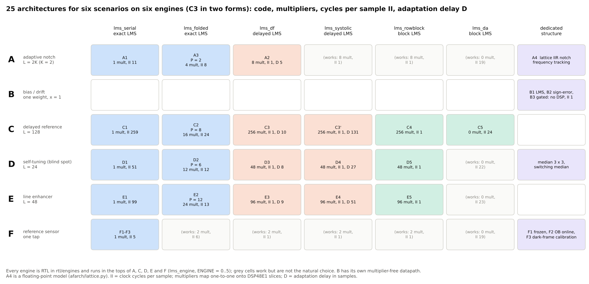
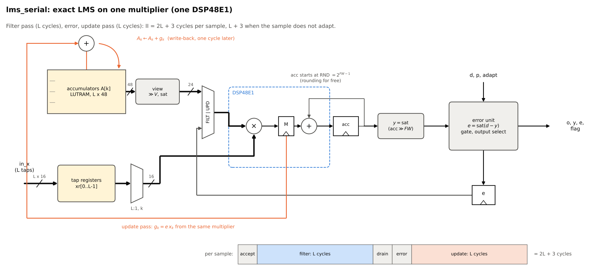
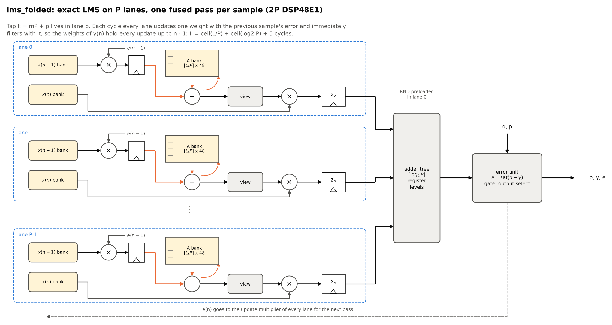
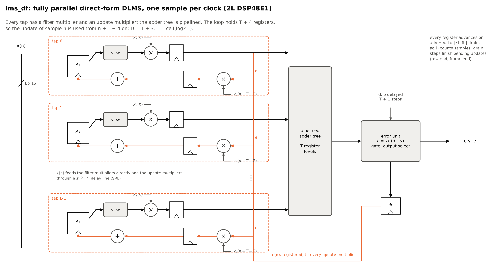
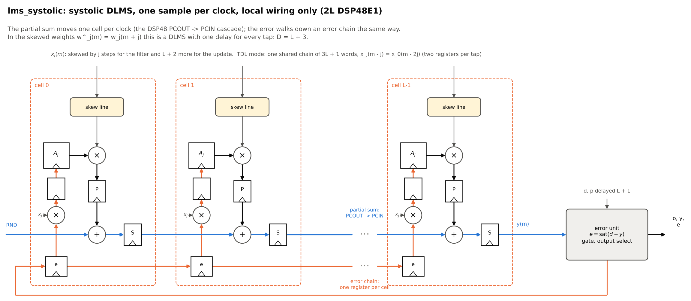
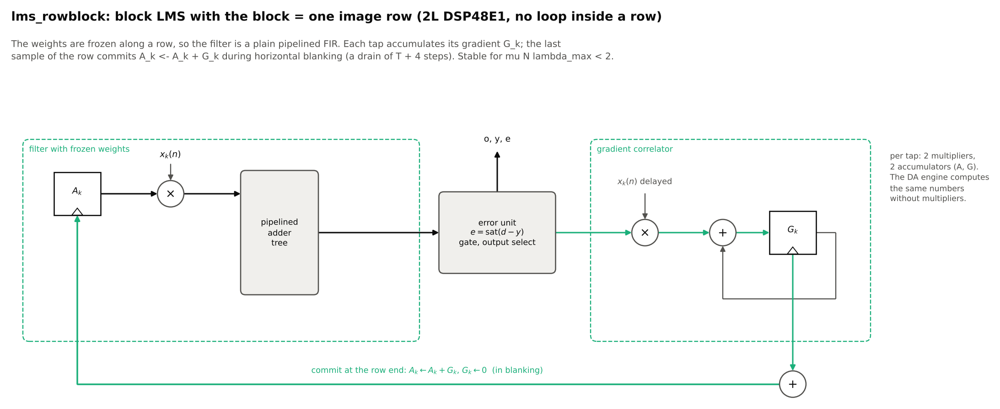
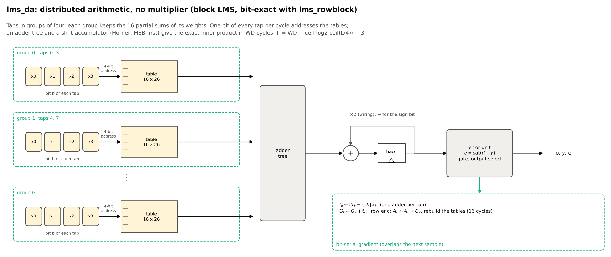

# rtl/: the Verilog

[Repository](../README.md) · [HLS C++](../hls/README.md) · [testbenches](../tb/README.md) · [regressions](../sim/README.md) · [synthesis](../syn/README.md)

Verilog-2005, compiled warning-free with `iverilog -g2005 -Wall`, counted by Yosys `synth_xilinx` (the numbers in
[`results/`](../results/README.md)) and ready for Vivado ([`syn/vivado_ooc.tcl`](../syn/vivado_ooc.tcl)). Every
module reproduces the bit-accurate model of [`afarch`](../afarch/README.md) word for word
([chapter 5](../docs/05-verification.md)).

<p align="center"></p>

## Layout

| folder | module | what it is |
|---|---|---|
| [`common/`](common) | [`lms_arith.vh`](common/lms_arith.vh) | the arithmetic contract as functions: view, rounding, saturation, the update rules ([chapter 2](../docs/02-fixed-point.md)) |
| | [`lms_err_unit.v`](common/lms_err_unit.v) | error, robust gate, output select (`OUT` 0: $e$, 1: $y$, 2: $p-y$, 3: gated) ([3.7](../docs/03-engines.md#37-the-shared-error-unit)) |
| | [`adder_tree.v`](common/adder_tree.v) | pipelined adder tree, one register per level |
| [`engines/`](engines) | [`lms_serial.v`](engines/lms_serial.v) | exact LMS, one multiplier, $II=2L+3$ |
| | [`lms_folded.v`](engines/lms_folded.v) | exact LMS, $P$ lanes of two multipliers, $II=\lceil L/P\rceil+\lceil\log_2P\rceil+5$ |
| | [`lms_df.v`](engines/lms_df.v) | delayed LMS, direct form, $2L$ multipliers, $II=1$, $D=\lceil\log_2L\rceil+3$ |
| | [`lms_systolic.v`](engines/lms_systolic.v) | delayed LMS, systolic, $2L$ multipliers, $II=1$, $D=L+3$ |
| | [`lms_rowblock.v`](engines/lms_rowblock.v) | block LMS, one update per row, $2L$ multipliers, $II=1$ |
| | [`lms_da.v`](engines/lms_da.v) | block LMS, distributed arithmetic, no multiplier |
| | [`lms_engine.v`](engines/lms_engine.v) | one port list for all six, `ENGINE = 0..5` |
| [`scenarios/`](scenarios) | [`window_gen.v`](scenarios/window_gen.v) | $(2R+1)^2$ window with reflected borders, two planes ([4.1](../docs/04-front-ends.md#41-borders-without-padding-reflected-addressing)) |
| | [`scen_a_top.v`](scenarios/scen_a_top.v) | A: phase accumulators, a cosine ROM per harmonic ([`cos1024_q12.hex`](scenarios/cos1024_q12.hex)), any engine |
| | [`scen_b_top.v`](scenarios/scen_b_top.v) | B: the multiplier-free bias loop, three modes |
| | [`scen_c_top.v`](scenarios/scen_c_top.v) | C: ping-pong row buffers, Gaussian high band, reflected history, any engine |
| | [`scen_de_top.v`](scenarios/scen_de_top.v) | D and E: window generator, blind spot, any engine, the gate |
| | [`scen_f_top.v`](scenarios/scen_f_top.v) | F: OB accumulation, leave-one-out reference, reference channel, three modes |
| [`baselines/`](baselines) | [`median3x3_top.v`](baselines/median3x3_top.v) | $3\times3$ median and switching median (19 compare-exchange cells) |

## The engine interface

```verilog
module lms_engine #(
    parameter ENGINE = 0, L = 4, P = 2, TDL = 0,
    parameter WD = 16, FD = 12, WW = 24, FW = 20, WA = 48, S = 7, RULE = 0, LEAK = 0,
    parameter OUT = 0, GATED = 0, GKS = 2, GRATE = 7, GFRAC = 8,
    parameter integer TMIN = 410, S0 = 205,
    parameter [WA-1:0] A0 = 0
)(
    input  wire clk, rst,
    input  wire in_valid, in_shift, in_drain,     // a sample, a pre-roll shift (TDL = 1), a drain step
    output wire in_ready,                          // the handshake engines (0, 1, 5) take a sample when ready
    input  wire [L*WD-1:0] in_x,                   // the taps (or, with TDL = 1, the newest tap in the low word)
    input  wire signed [WD-1:0] in_d, in_p,        // desired, pass-through
    input  wire in_adapt, in_last,                 // adapt on this sample; last sample of a block (a row)
    output wire out_valid,
    output wire signed [WD-1:0] out_o, out_y, out_e,
    output wire out_flag
);
```

The pipelined engines (2, 3, 4) take a step every cycle; `in_shift` and `in_drain` are the empty steps that the
models also count. Within a class the engines are bit-identical; across classes they differ by the adaptation
delay or the block update only ([chapter 3](../docs/03-engines.md)).

<table>
<tr>
<td width="50%"><br><sub><code>lms_serial</code></sub></td>
<td width="50%"><br><sub><code>lms_folded</code></sub></td>
</tr>
<tr>
<td><br><sub><code>lms_df</code></sub></td>
<td><br><sub><code>lms_systolic</code></sub></td>
</tr>
<tr>
<td><br><sub><code>lms_rowblock</code></sub></td>
<td><br><sub><code>lms_da</code></sub></td>
</tr>
</table>

## The scenario tops

| top | stream ports | main parameters | chapter |
|---|---|---|---|
| `scen_a_top` | `in_pix` → `out_pix`, `off` | `W`, `HH`, `K`, `ENGINE`, `P`, `S`, `UINC`, `VINC`, `COS_FILE` | [A](../docs/scenarios/A.md#3-the-architecture-rtl) |
| `scen_b_top` | `in_pix` → `out_pix`, `out_bias` | `W`, `S`, `MODE`, `SK`, `TAU` | [B](../docs/scenarios/B.md#3-the-architecture-rtl) |
| `scen_c_top` | `in_pix` → `out_pix` | `W`, `HH`, `L`, `DELAY`, `ENGINE`, `P`, `S` | [C](../docs/scenarios/C.md#3-the-architecture-rtl) |
| `scen_de_top` | `in_tap`, `in_d` → `out_pix`, `out_flag`, `off` | `W`, `HH`, `R`, `HOLE`, `ENGINE`, `P`, `S`, `GATED`, `A0` | [D](../docs/scenarios/D.md#3-the-architecture-rtl), [E](../docs/scenarios/E.md#3-the-architecture-rtl) |
| `scen_f_top` | `in_pix`, `in_ref`, `mode`, `in_flush` → `out_pix` | `W`, `NOB`, `LOGNOB`, `XSEL`, `ENGINE`, `S` | [F](../docs/scenarios/F.md#3-the-architecture-rtl) |

All streams are valid/ready; the pipelined engines also get `DRAIN_ROW` drain steps after each row and
`DRAIN_FRAME` at the end of a frame. The tops' Yosys counts at $W=512$ are in
[6.4](../docs/06-results.md#64-synthesis) and [`results/synth_tops.csv`](../results/synth_tops.csv).

## Running it

```bash
python sim/test_engines.py              # the engines against the models
python sim/test_scenarios.py            # the tops against the models
python smoke/smoke.py --only rtl        # the smoke cases, every scenario
python syn/synth_engines.py             # Yosys counts of the engines
vivado -mode batch -source syn/vivado_ooc.tcl -tclargs scen_de_top xc7a200tsbg484-1 4.0 W=512 HH=512 R=2 ENGINE=2
```

`scen_a_top` reads its cosine table with `$readmemh("cos1024_q12.hex")`: simulate and synthesise from
`rtl/scenarios`, or pass `COS_FILE` with a full path (the Python drivers do).
